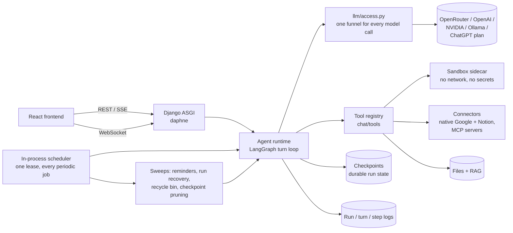

# AIAAS Backend

The server for AIAAS. Django (ASGI) with a LangGraph agent loop, Django Channels
for live updates, and a sandboxed Python runner. The web app is in
[`../better-n8n-frontend/`](../better-n8n-frontend/README.md).

> **New here?** Read [`../START_HERE.md`](../START_HERE.md). It has the run recipe,
> the app map, the layers rule and the common jobs. Each app folder also has its
> own `README.md`.

## Architecture



**One door for every run.** Chat, API calls, schedules and delegation all start
runs through `agents/agent/runtime.py::run_agent`. Callers differ in
configuration, not in code path, so a guardrail cannot be skipped by starting a
run a different way.

**One funnel for every model call.** `llm/access.py` resolves credentials, falls
back to the platform key, clamps context to the model's window, and classifies
provider errors. An empty balance becomes an immediate error, not a spinner
followed by an apology.

## Operations

| Concern | Where |
|---|---|
| Database | PostgreSQL in production. SQLite locally (`DB_ENGINE`). |
| Redis | Used in production for the Channels layer and the cache (`USE_REDIS_CHANNEL_LAYER=True`, set in `settings/deployment.py`). Not needed locally. |
| Background work | One in-process scheduler loop (`agents/scheduler.py`) runs schedules and every periodic job, under a database lease. Production runs no Celery worker. |
| Error reporting | Sentry, enabled by `SENTRY_DSN` (`workflow_backend/observability.py`) |
| Backups | Production: `pg_dump` from the database container (see [`DEPLOYMENT.md`](../DEPLOYMENT.md)). SQLite installs: `python manage.py backup_db`. |
| Health check | `GET /api/health/` |
| Crashed runs | Run recovery runs every 10 minutes. It resumes or closes runs orphaned by a restart. |
| Restarts | `manage.py boot`, then `exec daphne`: about 11 s from start to serving. Why: [`learning/16_deploy_downtime_and_background_work.md`](../learning/16_deploy_downtime_and_background_work.md). |
| Spend | Per-agent spend caps (`agents/spend.py`). |

## Tests

```bash
python -m pytest            # no network, Redis or database server needed
```

Tests live in `<app>/tests/`. Several are end-to-end. They drive the real
LangGraph graph against a stub provider and assert on what a client actually
receives. That is how a feature that passed every unit test but reached no user
was caught.

## Run it locally, layout, layers

- Run recipe: [`../START_HERE.md`](../START_HERE.md), section 3.
- Project layout and the layers rule: [`../START_HERE.md`](../START_HERE.md), section 7.
  The import rules live in [`.importlinter`](.importlinter). `lint-imports` (run from
  `Backend/`) prints the full report.

## Design docs

[`docs/README.md`](docs/README.md) sorts the design docs into current reference and
old plans. Start with:

- [`docs/API.md`](docs/API.md): every HTTP route
- [`docs/CONTEXT_LIFECYCLE.md`](docs/CONTEXT_LIFECYCLE.md): how a long run stays inside its context window
- [`docs/AGENT_OBSERVABILITY.md`](docs/AGENT_OBSERVABILITY.md): the run, turn and step records
- [`docs/SANDBOX_EXECUTION.md`](docs/SANDBOX_EXECUTION.md): the Python sandbox
- [`docs/SAFETY_AND_GUARDRAILS.md`](docs/SAFETY_AND_GUARDRAILS.md): every AI guardrail in one place
- [`docs/EVALUATION.md`](docs/EVALUATION.md): how agents are graded
