# AIAAS Feature Map

Every feature of the platform, linked to the functions and classes that implement it, with one flow chart per feature.

Use it to debug one feature at a time: find the feature, read its chart top to bottom, and open the file where the behaviour goes wrong.

- **Part 0** shows how the code is divided (layers, shared cores, the single entry points).
- **Part A** lists the features a user can see (47 of them).
- **Part B** lists the technical features that work behind them (15 of them).

## How to read this file

Each feature has the same five parts.

| Part | What it tells you |
|---|---|
| **What it is** | One or two sentences in plain words. |
| **Screen** | The route, page and components in `better-n8n-frontend/src/`. |
| **Code path** | A table: what happens, which function or class does it, in which file. |
| **Flow** | A chart of those functions in the order they run. |
| **Debug first** | The place to look first when this feature breaks, and its tests. |

Notes on accuracy:

- Every backend name in a table was checked against the code on 2026-10-11 by a script: the function or class exists in the file named beside it.
- Line numbers are left out on purpose. They change with every edit. Search for the name instead.
- `Class.method` means a method on that class. `name()` means a module-level function.
- The app in `Backend/agents/` has the Django label `orchestrator`, so its URLs start with `/api/orchestrator/`.
- Exact URL paths, permissions and serializers for every route are in [Backend/docs/API.md](Backend/docs/API.md). The design reasons behind each feature are in [CLAUDE.md](CLAUDE.md).
- BrowserOS is parked and is not covered here.

---

# Part 0 — How the code is divided

## 0.1 Layers

A lower layer never imports a higher one. The rule is checked by `Backend/.importlinter` and run as a test in `Backend/workflow_backend/tests/test_import_contracts.py`.

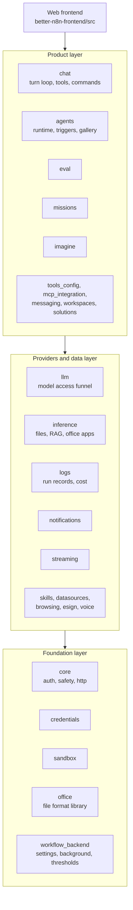

## 0.2 The single entry points

Most features pass through one of these. When two features break in the same way, the cause is usually here.

| Entry point | Function or class | File | Used by |
|---|---|---|---|
| Every model call | `preflight`, `complete`, `stream` | [Backend/llm/access.py](Backend/llm/access.py) | chat, agents, eval judge, auto reviewer, curation |
| Every agent run | `start_agent_run`, `run_agent` | [Backend/agents/agent/runtime.py](Backend/agents/agent/runtime.py) | Run button, schedules, webhooks, delegation, missions, evals |
| Every chat turn | `run_chat_turn` | [Backend/chat/turn/pipeline.py](Backend/chat/turn/pipeline.py) | chat page, slash commands |
| The tool loop | `run_turn`, `_build_graph` | [Backend/chat/turn/agent.py](Backend/chat/turn/agent.py) | chat turns and agent runs alike |
| Every tool call | `execute_tool` | [Backend/chat/tools/__init__.py](Backend/chat/tools/__init__.py) | chat, agents, the direct execute-tool endpoint |
| Every agent save | `AgentSerializer` | [Backend/agents/config.py](Backend/agents/config.py) | builder, wizard, templates, chat authoring tools, benchmarks |
| Every Python execution | `arun_code` | [Backend/sandbox/engine.py](Backend/sandbox/engine.py) | `execute_python`, `run_python_on_files` |
| Every agent file access | `FileScope` | [Backend/inference/vfs.py](Backend/inference/vfs.py) | file tools, office tools, sandbox file bridge |
| Every folder id from a client | `resolve_folder` | [Backend/inference/filesystem.py](Backend/inference/filesystem.py) | file explorer API |
| Every credential lookup | `CredentialManager.get_credential` | [Backend/credentials/manager.py](Backend/credentials/manager.py) | model keys, MCP injection, secret references |
| Every background task | `spawn` | [Backend/workflow_backend/background.py](Backend/workflow_backend/background.py) | chat runs, agent runs, sweeps |
| Every outbound provider HTTP call | `shared_client` | [Backend/workflow_backend/httpclient.py](Backend/workflow_backend/httpclient.py) | model handlers, Google tools, vision |
| Every solution read | `visible` | [Backend/solutions/access.py](Backend/solutions/access.py) | solution search, pages, tools |
| Every WebSocket | `useSocket` | [better-n8n-frontend/src/lib/websocket.ts](better-n8n-frontend/src/lib/websocket.ts) | all real-time screens |
| Every streamed HTTP response | `streamSse` | [better-n8n-frontend/src/api/sse.ts](better-n8n-frontend/src/api/sse.ts) | chat, builder chat |

## 0.3 The largest files

These files hold the most behaviour. A change in one of them can affect many features, so they are the first candidates for splitting.

| File | Lines | What it holds |
|---|---|---|
| [Backend/chat/turn/agent.py](Backend/chat/turn/agent.py) | 2,977 | The tool loop: four graph nodes, approvals, side effects |
| [Backend/agents/agent/runtime.py](Backend/agents/agent/runtime.py) | 2,611 | Agent run lifecycle, toolbox, system prompt, guardrails |
| [Backend/inference/vfs.py](Backend/inference/vfs.py) | 1,982 | The virtual filesystem for agents |
| [Backend/eval/graders.py](Backend/eval/graders.py) | 1,670 | Every eval grader |
| [Backend/chat/turn/pipeline.py](Backend/chat/turn/pipeline.py) | 1,467 | Everything a chat turn does before and after the loop |
| [Backend/mcp_integration/client.py](Backend/mcp_integration/client.py) | 1,325 | MCP sessions, pool, connect and call |
| [Backend/eval/generator.py](Backend/eval/generator.py) | 1,275 | Judge-written test cases and worlds |
| [Backend/logs/queries.py](Backend/logs/queries.py) | 1,148 | All read queries for runs, cost and insights |
| [Backend/inference/engine.py](Backend/inference/engine.py) | 1,146 | Vector index and RAG pipeline |
| [Backend/agents/config.py](Backend/agents/config.py) | 1,104 | `AgentSerializer` |
| [Backend/chat/tools/agents.py](Backend/chat/tools/agents.py) | 1,104 | Delegation tools |

## 0.4 Which features share which core

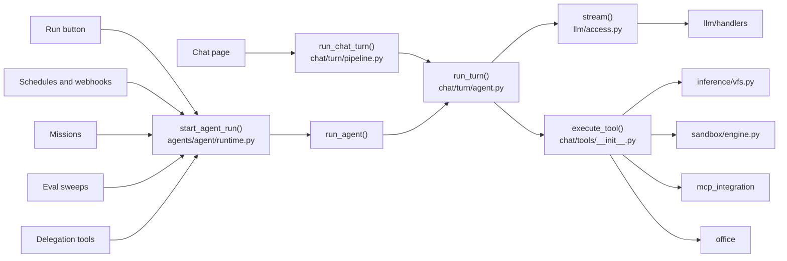

---

# Part A — Features a user can see

## A1. Accounts and sign-in

**What it is.** Sign up, sign in with a password or Google, reset a password with an emailed code, change email, and create API keys. Changing a password or email signs out every other session.

**Screen.** `/login`, `/signup`, `/forgot-password`, `/auth/google/callback`, `/profile` — [Login.tsx](better-n8n-frontend/src/pages/Login.tsx), [Signup.tsx](better-n8n-frontend/src/pages/Signup.tsx), [ForgotPassword.tsx](better-n8n-frontend/src/pages/ForgotPassword.tsx), [GoogleCallback.tsx](better-n8n-frontend/src/pages/GoogleCallback.tsx). Token refresh is in [api/client.ts](better-n8n-frontend/src/api/client.ts).

| What happens | Function or class | File |
|---|---|---|
| Sign up | `UserRegistrationView`, `RegisterRateThrottle` | [Backend/core/views.py](Backend/core/views.py) |
| Validate sign-up data | `UserRegistrationSerializer` | [Backend/core/serializers.py](Backend/core/serializers.py) |
| Password sign-in, issue tokens | `CustomTokenObtainPairView`, `LoginRateThrottle` | [Backend/core/views.py](Backend/core/views.py) |
| Build the token | `CustomTokenObtainPairSerializer` | [Backend/core/serializers.py](Backend/core/serializers.py) |
| Google sign-in | `GoogleLoginView`, `_claim_verified_email` | [Backend/core/views.py](Backend/core/views.py) |
| Check a token on every request | `RevocableJWTAuthentication`, `is_revoked` | [Backend/core/auth/revocation.py](Backend/core/auth/revocation.py) |
| Sign out every session | `revoke`, `fresh_pair` | [Backend/core/auth/revocation.py](Backend/core/auth/revocation.py) |
| Reset a password by code | `PasswordResetRequestView`, `PasswordResetVerifyView`, `PasswordResetConfirmView`, `_create_password_otp`, `_verify_password_otp` | [Backend/core/views.py](Backend/core/views.py) |
| Change email | `EmailChangeRequestView`, `EmailChangeConfirmView` | [Backend/core/views.py](Backend/core/views.py) |
| API keys | `APIKeyViewSet`, `APIKeyRotateView` | [Backend/core/views.py](Backend/core/views.py) |
| Sign in with an API key | `APIKeyAuthentication` | [Backend/core/auth/authentication.py](Backend/core/auth/authentication.py) |
| Stored data | `UserProfile`, `APIKey`, `PasswordOTP` | [Backend/core/models.py](Backend/core/models.py) |
| Sign in a WebSocket | `JWTAuthMiddleware` | [Backend/core/realtime/channels_middleware.py](Backend/core/realtime/channels_middleware.py) |

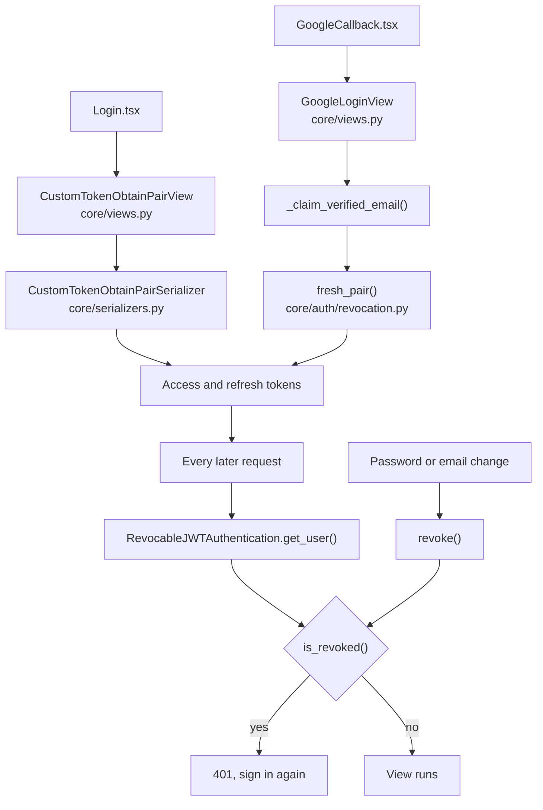

**Debug first.** A user signed out unexpectedly: `is_revoked` and `UserProfile.tokens_valid_after`. Tests: `Backend/core/tests/`.

---

## A2. Chat: send a message and get a streamed answer

**What it is.** The user types a message and the answer streams in word by word. This is the main pipeline of the product. A3 describes the loop inside it.

**Screen.** `/ai-chat` — [AIChat.tsx](better-n8n-frontend/src/pages/AIChat.tsx) → [StandaloneChat.tsx](better-n8n-frontend/src/components/chat/StandaloneChat.tsx). Endpoint: `POST /api/chat/sessions/<id>/message/stream/`.

| What happens | Function or class | File |
|---|---|---|
| Send the request, follow the stream | `chatService.sendMessageStream` | [better-n8n-frontend/src/api/chat.ts](better-n8n-frontend/src/api/chat.ts) |
| Keep following until a real end | `followTurn` | [better-n8n-frontend/src/lib/followTurn.ts](better-n8n-frontend/src/lib/followTurn.ts) |
| Read `data:` frames | `streamSse` | [better-n8n-frontend/src/api/sse.ts](better-n8n-frontend/src/api/sse.ts) |
| Fold frames into screen state | `useChatStream` | [better-n8n-frontend/src/hooks/useChatStream.ts](better-n8n-frontend/src/hooks/useChatStream.ts) |
| The view | `send_message_stream` | [Backend/chat/views.py](Backend/chat/views.py) |
| Sign-in and the HTTP stream | `authenticate`, `stream_response` | [Backend/chat/transport/streaming_http.py](Backend/chat/transport/streaming_http.py) |
| Start a run that outlives the request | `start`, `_drive`, `finish`, `subscribe`, `ChatRun` | [Backend/chat/turn/runs.py](Backend/chat/turn/runs.py) |
| The whole turn | `run_chat_turn`, `TurnRequest` | [Backend/chat/turn/pipeline.py](Backend/chat/turn/pipeline.py) |
| Fail early if the model cannot be paid for | `preflight` | [Backend/llm/access.py](Backend/llm/access.py) |
| Load earlier messages | `load_history`, `to_wire_history` | [Backend/chat/turn/history.py](Backend/chat/turn/history.py) |
| Build the system prompt and the per-turn note | `build_system_message`, `build_context_update` | [Backend/chat/turn/prompts.py](Backend/chat/turn/prompts.py) |
| Choose which tools are offered | `get_available_tools` | [Backend/chat/tools/__init__.py](Backend/chat/tools/__init__.py) |
| Run the loop | `run_turn` | [Backend/chat/turn/agent.py](Backend/chat/turn/agent.py) |
| Save the answer, price the turn | `_persist_answer`, `_price_turn` | [Backend/chat/turn/pipeline.py](Backend/chat/turn/pipeline.py) |
| Suggest follow-up questions | `suggest_follow_ups` | [Backend/chat/turn/agent.py](Backend/chat/turn/agent.py) |
| Event names | `Event`, `EventSink` | [Backend/chat/turn/events.py](Backend/chat/turn/events.py) |
| Stored data | `ChatSession`, `ChatMessage` | [Backend/chat/models.py](Backend/chat/models.py) |

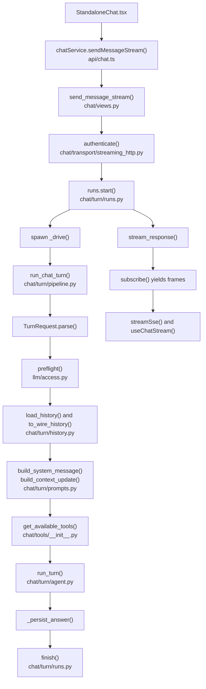

**Debug first.** Slow first token: grep the log for `[Latency] pre-model` (written by `_PhaseTimer` in `pipeline.py`). A wrong or empty answer: `[Turn] Empty answer`. Tests: `Backend/chat/tests/test_pipeline.py`, `test_chat_transcript.py`, `test_turn_output_e2e.py`.

---

## A3. Chat and agents: the tool loop

**What it is.** The model thinks, asks for tools, reads the results, and thinks again until it has an answer. Chat turns and agent runs use the same loop.

**Screen.** Tool activity, thinking timer and results in the transcript — [ChatMessageItem.tsx](better-n8n-frontend/src/components/chat/ChatMessageItem.tsx), [ThinkingTimer.tsx](better-n8n-frontend/src/components/chat/ThinkingTimer.tsx).

| What happens | Function or class | File |
|---|---|---|
| Wire the four nodes | `_build_graph`, `get_graph`, `_next_step` | [Backend/chat/turn/agent.py](Backend/chat/turn/agent.py) |
| Node 1: call the model | `agent_node`, `_run_model`, `iteration_limit` | [Backend/chat/turn/agent.py](Backend/chat/turn/agent.py) |
| Stream from the provider | `stream`, `StreamAccumulator` | [Backend/llm/access.py](Backend/llm/access.py) |
| Node 2: run the tool calls | `tools_node` | [Backend/chat/turn/agent.py](Backend/chat/turn/agent.py) |
| Pass 1: settle approvals | `_settle_gates` | [Backend/chat/turn/agent.py](Backend/chat/turn/agent.py) |
| Pass 2: plan each call | `_plan_calls`, `_tool_context` | [Backend/chat/turn/agent.py](Backend/chat/turn/agent.py) |
| Pass 3: run them, safe ones together | `_dispatch_calls`, `_dispatch_one` | [Backend/chat/turn/agent.py](Backend/chat/turn/agent.py) |
| Pass 4: record in call order | `_record_results`, `_apply_side_effects` | [Backend/chat/turn/agent.py](Backend/chat/turn/agent.py) |
| Run one tool | `execute_chat_tool`, `execute_tool` | [Backend/chat/tools/__init__.py](Backend/chat/tools/__init__.py) |
| Cap an oversized result | `bound` | [Backend/chat/tools/tool_output.py](Backend/chat/tools/tool_output.py) |
| Node 3: shrink the transcript if needed | `curate_node` | [Backend/chat/turn/agent.py](Backend/chat/turn/agent.py) |
| Node 4: deliver mid-run instructions | `steering_node` | [Backend/chat/turn/agent.py](Backend/chat/turn/agent.py) |
| Ask once more when the reply is empty | `_answer_again` | [Backend/chat/turn/agent.py](Backend/chat/turn/agent.py) |
| Shared per-turn settings | `TurnContext`, `AgentState`, `TurnResult` | [Backend/chat/turn/agent.py](Backend/chat/turn/agent.py) |

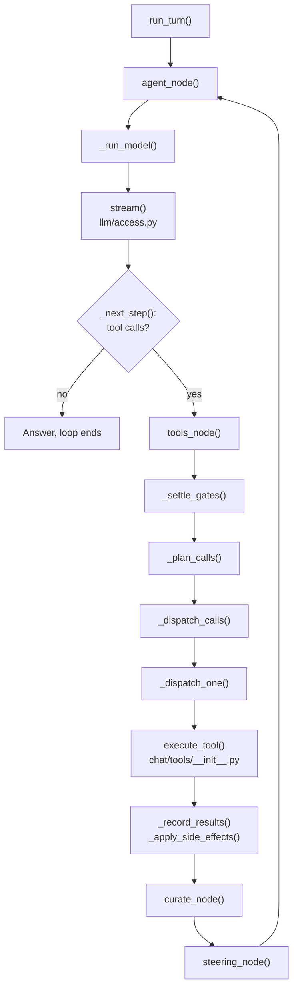

**Debug first.** A run that ends early: `iteration_limit` and `STEPS_PER_ITERATION` (pinned by `Backend/chat/tests/test_iteration_limit.py`). A tool that never ran in parallel: `parallel_names` in `chat/tools/registry.py`. Tests: `test_parallel_tools.py`, `test_empty_answer.py`, `test_tool_timeouts.py`.

---

## A4. Chat: approving or denying a tool call

**What it is.** Before a risky tool runs, the user sees a card that says in a sentence what the tool wants to do. They can approve once, for this conversation, or always, or deny.

**Screen.** [ToolApprovalCard.tsx](better-n8n-frontend/src/components/chat/ToolApprovalCard.tsx) in the transcript.

| What happens | Function or class | File |
|---|---|---|
| Decide whether a call needs approval | `default_policy`, `looks_read_only`, `carries_credentials`, `is_remembered` | [Backend/chat/tools/permissions.py](Backend/chat/tools/permissions.py) |
| Pause the run and send the card | `_require_approval` | [Backend/chat/turn/agent.py](Backend/chat/turn/agent.py) |
| Turn the call into a sentence | `describe_call`, `describe_call_async` | [Backend/chat/tools/describe.py](Backend/chat/tools/describe.py) |
| Approve and resume | `approve_tool_call` | [Backend/chat/turn/agent.py](Backend/chat/turn/agent.py) |
| Deny and resume with a refusal | `reject_tool_call`, `_refusal_text` | [Backend/chat/turn/agent.py](Backend/chat/turn/agent.py) |
| Route the approve or reject request | `run_chat_turn` | [Backend/chat/turn/pipeline.py](Backend/chat/turn/pipeline.py) |
| Remember "always allow" | `ToolPermission` | [Backend/chat/models.py](Backend/chat/models.py) |

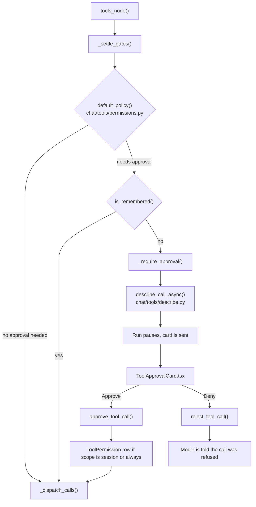

**Debug first.** A call that asks again after "always allow": `is_remembered` (it matches on the session key, not the thread id). Tests: `Backend/chat/tests/test_tool_approval.py`, `test_permissions.py`, `test_describe.py`.

---

## A5. Chat modes: Ask, Auto, Plan and Full auto

**What it is.** The user chooses how much the assistant may do without asking. Ask checks every risky step. Auto runs what can be undone and has a second model review the rest. Plan only reads. Full auto never asks.

**Screen.** Mode picker in the composer, Shift+Tab to cycle — [StandaloneChat.tsx](better-n8n-frontend/src/components/chat/StandaloneChat.tsx), rules in [lib/chatMode.ts](better-n8n-frontend/src/lib/chatMode.ts).

| What happens | Function or class | File |
|---|---|---|
| Save the mode on the conversation | `ChatSessionSerializer` | [Backend/chat/serializers.py](Backend/chat/serializers.py) |
| `/mode` command | `mode_command` | [Backend/chat/commands/session.py](Backend/chat/commands/session.py) |
| Auto: the approval rules | `auto_policy`, `rule_allow` | [Backend/chat/turn/reviewer.py](Backend/chat/turn/reviewer.py) |
| Auto: checks that never get waived | `static_check` | [Backend/chat/turn/reviewer.py](Backend/chat/turn/reviewer.py) |
| Auto: ask the judge model | `review`, `_model_judge`, `_cached_verdict` | [Backend/chat/turn/reviewer.py](Backend/chat/turn/reviewer.py) |
| Full auto | `full_policy` | [Backend/chat/turn/reviewer.py](Backend/chat/turn/reviewer.py) |
| Plan: offer read-only tools only | `read_only_source` | [Backend/chat/turn/reviewer.py](Backend/chat/turn/reviewer.py) |
| Switch mode while a turn runs | `set_autonomy`, `autonomy` | [Backend/chat/turn/steering.py](Backend/chat/turn/steering.py) |
| Read the live mode for each batch | `_live_autonomy`, `_approval_rules`, `_audit` | [Backend/chat/turn/agent.py](Backend/chat/turn/agent.py) |
| Carry the mode to a worker agent | `lifted_autonomy` | [Backend/agents/agent/runtime.py](Backend/agents/agent/runtime.py) |
| A worker's request, judged in Auto | `subagent_floor` | [Backend/chat/turn/reviewer.py](Backend/chat/turn/reviewer.py) |

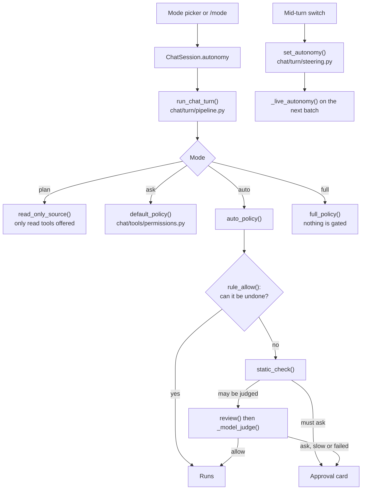

**Debug first.** Auto asking about everything: grep `[Latency] reviewer` and check `AUTO_REVIEWER_MODEL`. Tests: `Backend/chat/tests/test_auto_mode.py`, `test_auto_reviewer.py`, `better-n8n-frontend/src/lib/__tests__/chatMode.test.ts`.

---

## A6. Chat: steer, stop and reconnect

**What it is.** While a turn is running the user can send another instruction, stop it, or reload the page and pick the stream back up.

**Screen.** The send button in [StandaloneChat.tsx](better-n8n-frontend/src/components/chat/StandaloneChat.tsx). With text it steers. Empty it stops.

| What happens | Function or class | File |
|---|---|---|
| Send a steer | `chatService.steer` | [better-n8n-frontend/src/api/chat.ts](better-n8n-frontend/src/api/chat.ts) |
| Steer endpoint | `steer_message_stream` | [Backend/chat/views.py](Backend/chat/views.py) |
| Queue the instruction | `post`, `queued`, `stats` | [Backend/chat/turn/steering.py](Backend/chat/turn/steering.py) |
| Deliver it between tool results and the model | `steering_node` | [Backend/chat/turn/agent.py](Backend/chat/turn/agent.py) |
| Take the whole queue as one message | `take` | [Backend/chat/turn/steering.py](Backend/chat/turn/steering.py) |
| Return steers the run never read | `finish`, `drain_messages` | [Backend/chat/turn/runs.py](Backend/chat/turn/runs.py), [Backend/chat/turn/steering.py](Backend/chat/turn/steering.py) |
| Stop endpoint | `stop_message_stream` | [Backend/chat/views.py](Backend/chat/views.py) |
| Cancel the task, keep the partial text | `stop`, `partial_answer` | [Backend/chat/turn/runs.py](Backend/chat/turn/runs.py) |
| Save the partial answer | `persist_interrupted_answer` | [Backend/chat/turn/pipeline.py](Backend/chat/turn/pipeline.py) |
| Reconnect to a running turn | `attach_message_stream`, `active_runs` | [Backend/chat/views.py](Backend/chat/views.py) |
| Keep the connection alive when quiet | `stream_response` | [Backend/chat/transport/streaming_http.py](Backend/chat/transport/streaming_http.py) |
| Client-side reconnect | `followTurn` | [better-n8n-frontend/src/lib/followTurn.ts](better-n8n-frontend/src/lib/followTurn.ts) |

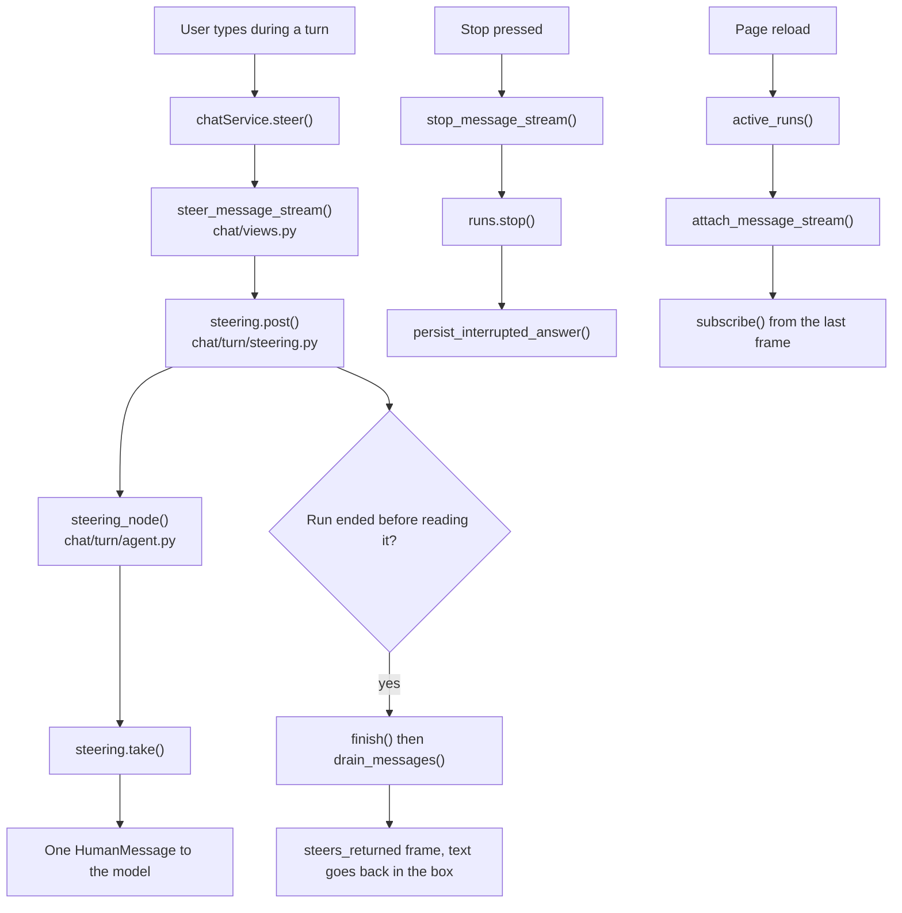

**Debug first.** A steer that seems lost: `stats` shows `queued` and `dropped`. Tests: `Backend/chat/tests/test_steering.py`, `test_undelivered_steers.py`, `test_runs.py`, `better-n8n-frontend/src/lib/__tests__/followTurn.test.ts`.

---

## A7. Plan (to-do list) and pace

**What it is.** On longer work the assistant writes a plan and updates it as it goes. The plan stays pinned above the composer. Each turn also has a budget of model calls (quick, standard or deep) that the model is told about.

**Screen.** [PlanDock.tsx](better-n8n-frontend/src/components/plan/PlanDock.tsx), [PlanView.tsx](better-n8n-frontend/src/components/plan/PlanView.tsx), [PlanSummary.tsx](better-n8n-frontend/src/components/plan/PlanSummary.tsx). Change tracking is in [lib/planView.ts](better-n8n-frontend/src/lib/planView.ts).

| What happens | Function or class | File |
|---|---|---|
| The tool the model calls | `update_todos` | [Backend/chat/tools/planning.py](Backend/chat/tools/planning.py) |
| Clean the list | `normalize`, `normalize_for`, `missing_notes` | [Backend/chat/turn/todos.py](Backend/chat/turn/todos.py) |
| Keep it in run metadata, send a frame | `_on_todos` | [Backend/chat/turn/agent.py](Backend/chat/turn/agent.py) |
| Keep each revision | `record_revision` | [Backend/chat/turn/todos.py](Backend/chat/turn/todos.py) |
| Feed open items back every pass | `render`, `unfinished` | [Backend/chat/turn/todos.py](Backend/chat/turn/todos.py) |
| Remind a model that has no plan | `nudge` | [Backend/chat/turn/todos.py](Backend/chat/turn/todos.py) |
| File each tool call under the current step | `current_step` | [Backend/chat/turn/todos.py](Backend/chat/turn/todos.py) |
| Pick the starting pace | `starting_tier`, `looks_like_lookup`, `start` | [Backend/chat/turn/pace.py](Backend/chat/turn/pace.py) |
| Raise the pace when the model plans or delegates | `promote` | [Backend/chat/turn/pace.py](Backend/chat/turn/pace.py) |
| Tell the model its budget | `render`, `cap`, `summary` | [Backend/chat/turn/pace.py](Backend/chat/turn/pace.py) |

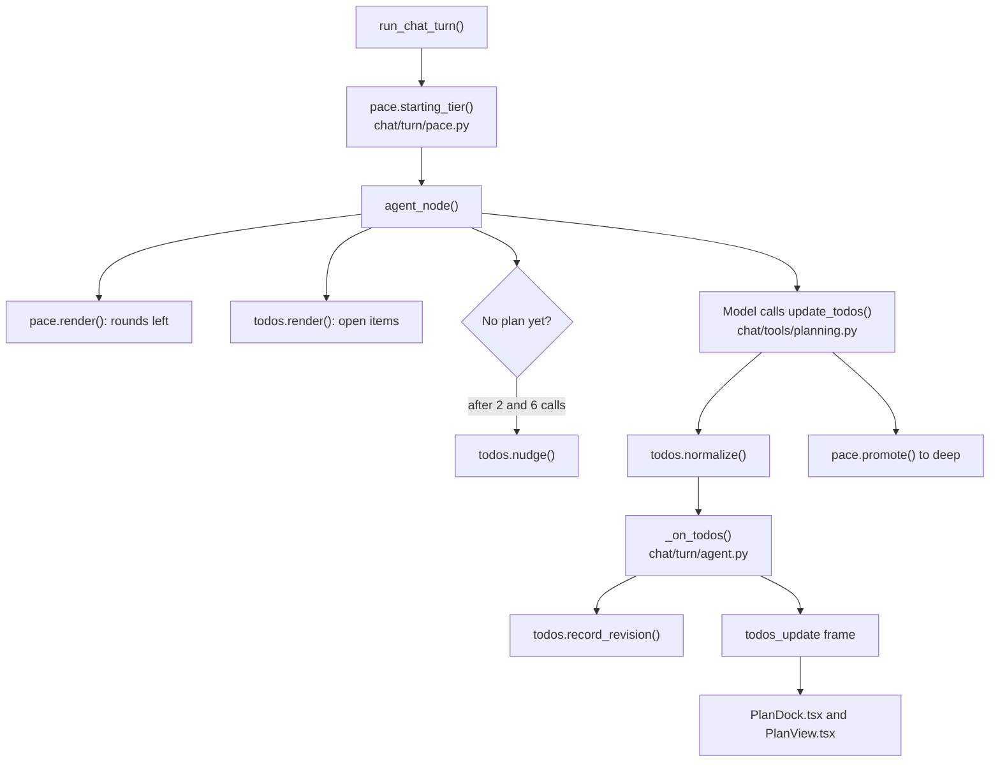

**Debug first.** A plan that vanishes on a long run: it must be in `metadata`, never in `messages`. Tests: `Backend/chat/tests/test_todos.py`, `test_pace.py`, `better-n8n-frontend/src/lib/__tests__/planView.test.ts`.

---

## A8. Questions from the assistant

**What it is.** The assistant can stop and ask the user a question with choices, a number or free text. The answer comes back to it as the tool's result.

**Screen.** [QuestionCard.tsx](better-n8n-frontend/src/components/chat/QuestionCard.tsx) in chat and in the Inbox. Answer checking mirrors [lib/question.ts](better-n8n-frontend/src/lib/question.ts).

| What happens | Function or class | File |
|---|---|---|
| The tool | `ask_user`, `question_spec` | [Backend/chat/tools/ask.py](Backend/chat/tools/ask.py) |
| Pause the run for an answer | `_require_answer` | [Backend/chat/turn/agent.py](Backend/chat/turn/agent.py) |
| Check the answer against the stored question | `answer_question` | [Backend/chat/turn/agent.py](Backend/chat/turn/agent.py) |
| Clean and render the answer | `normalise_answer`, `render_answer` | [Backend/chat/tools/ask.py](Backend/chat/tools/ask.py) |
| Agent runs: open an Inbox row | `AgentRunStream._question_asked` | [Backend/agents/agent/stream.py](Backend/agents/agent/stream.py) |
| Unattended runs and evals: record, never block | `_record_approval_intent` | [Backend/chat/turn/agent.py](Backend/chat/turn/agent.py) |

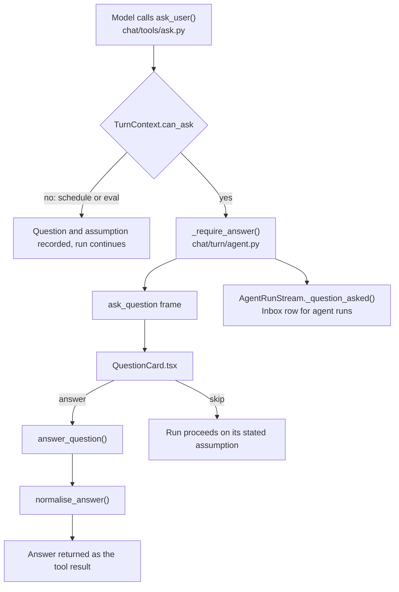

**Debug first.** Tests: `Backend/chat/tests/test_questions.py`, `better-n8n-frontend/src/lib/__tests__/question.test.ts`.

---

## A9. Slash commands

**What it is.** Typing `/` opens a palette of commands such as `/agent`, `/goal`, `/mode`, `/memory`, `/code-review`. A command is structured input resolved by the backend, not a prompt template.

**Screen.** [CommandPalette.tsx](better-n8n-frontend/src/components/chat/CommandPalette.tsx), [CommandCard.tsx](better-n8n-frontend/src/components/chat/CommandCard.tsx), [lib/commands.ts](better-n8n-frontend/src/lib/commands.ts), [hooks/useCommands.ts](better-n8n-frontend/src/hooks/useCommands.ts). Endpoints under `/api/chat/commands/`.

| What happens | Function or class | File |
|---|---|---|
| Declare a command | `command`, `Arg`, `Command`, `CommandResult` | [Backend/chat/commands/registry.py](Backend/chat/commands/registry.py) |
| List commands for the palette | `command_list`, `visible_commands` | [Backend/chat/commands/views.py](Backend/chat/commands/views.py), [Backend/chat/commands/resolve.py](Backend/chat/commands/resolve.py) |
| Complete an argument | `command_complete`, `complete_arg` | [Backend/chat/commands/views.py](Backend/chat/commands/views.py), [Backend/chat/commands/resolve.py](Backend/chat/commands/resolve.py) |
| Parse a typed line | `split_leading_command`, `resolve_line`, `resolve_arg_value` | [Backend/chat/commands/resolve.py](Backend/chat/commands/resolve.py) |
| Run an action command | `command_run`, `command_confirm` | [Backend/chat/commands/views.py](Backend/chat/commands/views.py) |
| Run a command that starts a turn | `_resolve_command`, `_command_toolbox`, `_start_command_run` | [Backend/chat/turn/pipeline.py](Backend/chat/turn/pipeline.py) |
| Agent commands | `agent_command`, `run_agent_start` | [Backend/chat/commands/agents.py](Backend/chat/commands/agents.py) |
| Session commands | `mode_command`, `model_command`, `effort_command`, `pause_command`, `status_command` | [Backend/chat/commands/session.py](Backend/chat/commands/session.py) |
| File and document commands | `deck_command`, `doc_command`, `sheet_command`, `schedule_command`, `cost_command` | [Backend/chat/commands/library.py](Backend/chat/commands/library.py) |
| Review command | `code_review_command` | [Backend/chat/commands/review.py](Backend/chat/commands/review.py) |

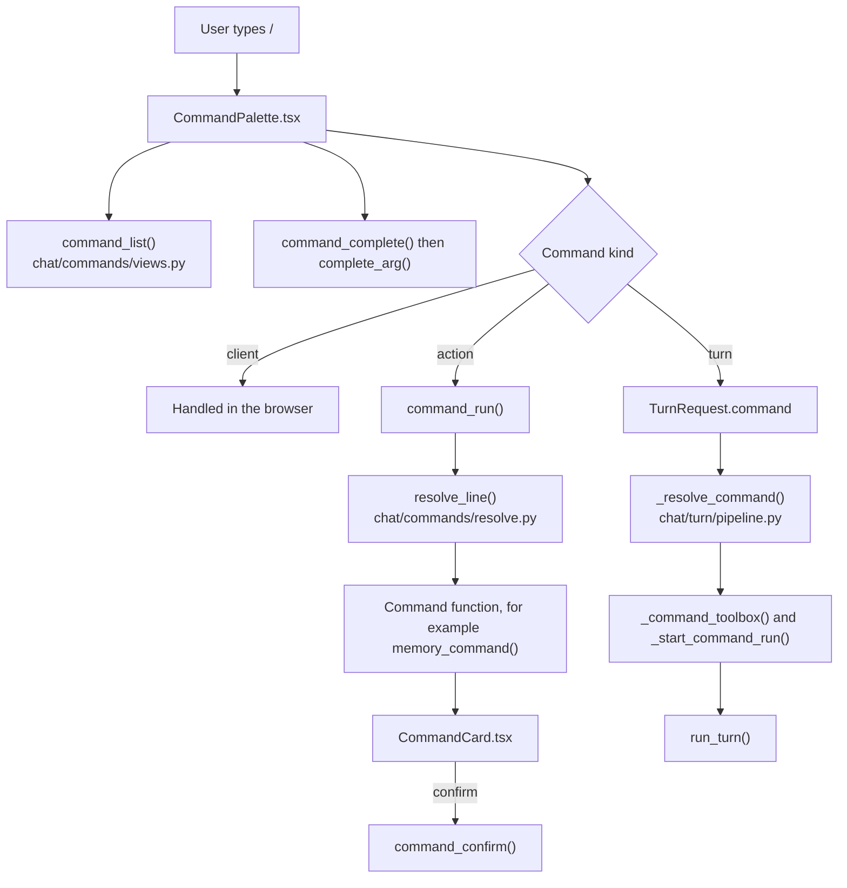

**Debug first.** An unknown command returns a 400 from `resolve_line`, never a model turn. Tests: `Backend/chat/tests/test_commands.py`, `better-n8n-frontend/src/lib/__tests__/commands.test.ts`.

---

## A10. Attachments and image understanding

**What it is.** The user attaches files and images to a message. A model that reads images gets them directly. A text-only model can question a second, image-reading model through the `ask_vision` tool.

**Screen.** Attach button in [StandaloneChat.tsx](better-n8n-frontend/src/components/chat/StandaloneChat.tsx). Endpoint: `POST /api/chat/sessions/<id>/upload/`.

| What happens | Function or class | File |
|---|---|---|
| Upload | `upload_file`, `UploadThrottle` | [Backend/chat/views.py](Backend/chat/views.py), [Backend/core/http/throttling.py](Backend/core/http/throttling.py) |
| Classify and extract text | `classify_file`, `extract_text`, `store_document` | [Backend/chat/sources/attachments.py](Backend/chat/sources/attachments.py) |
| Pick the attachments for this turn | `recent_attachments`, `partition_attachments` | [Backend/chat/turn/history.py](Backend/chat/turn/history.py) |
| Tell the model about files it cannot read | `describe_blocked`, `describe_for_model` | [Backend/chat/turn/history.py](Backend/chat/turn/history.py) |
| Prepare images for a vision model | `prepare_attachments`, `supports_vision` | [Backend/chat/turn/agent.py](Backend/chat/turn/agent.py) |
| Encode images for the provider | `encode_image_attachments` | [Backend/llm/handlers/openai_compatible.py](Backend/llm/handlers/openai_compatible.py) |
| Find an image-reading helper model | `resolve_witness`, `witness_available` | [Backend/chat/vision/resolve.py](Backend/chat/vision/resolve.py) |
| The tool | `ask_vision` | [Backend/chat/tools/vision.py](Backend/chat/tools/vision.py) |
| Ask the helper, cross-check numbers | `ask`, `_call_witness`, `_cross_check`, `readings_diverge` | [Backend/chat/vision/agent.py](Backend/chat/vision/agent.py) |
| Second reading for the cross-check | `parse_image` | [Backend/chat/vision/nim.py](Backend/chat/vision/nim.py) |
| Stored data | `ChatAttachment`, `VisionExchange` | [Backend/chat/models.py](Backend/chat/models.py) |

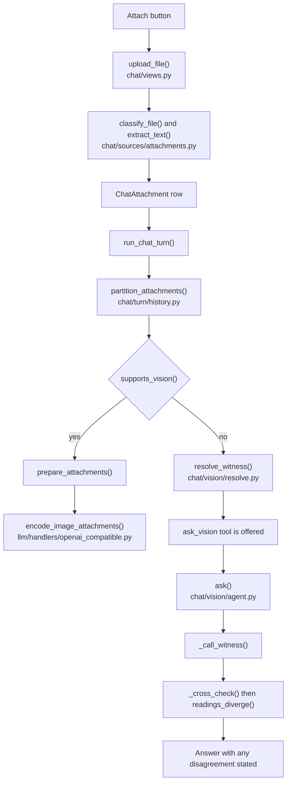

**Debug first.** `ask_vision` not offered: `resolve_witness` is cached for 60 seconds. Tests: `Backend/chat/tests/test_vision.py`, `test_attachment_types.py`.

---

## A11. Web search, research and reading pages

**What it is.** The assistant searches the web, reads a page, runs a multi-source research pass, or downloads a file the user named. Sources appear as cards.

**Screen.** Source cards and media in [ChatMessageItem.tsx](better-n8n-frontend/src/components/chat/ChatMessageItem.tsx) and [MediaPreview.tsx](better-n8n-frontend/src/components/chat/MediaPreview.tsx).

| What happens | Function or class | File |
|---|---|---|
| The tools | `web_search`, `deep_research`, `image_search`, `video_search`, `read_url`, `scrape_webpage` | [Backend/chat/tools/web.py](Backend/chat/tools/web.py) |
| Search engine calls | `web_search`, `scrape_sources`, `WebResults` | [Backend/chat/sources/search.py](Backend/chat/sources/search.py) |
| Download a file into the user's files | `download_file` | [Backend/chat/tools/fetch.py](Backend/chat/tools/fetch.py) |
| Block private and unsafe addresses | `validate_url`, `fetch_url`, `fetch_file` | [Backend/core/safety/net.py](Backend/core/safety/net.py) |
| Refuse a made-up URL that carries data | `check_fetch`, `urls_in` | [Backend/core/safety/provenance.py](Backend/core/safety/provenance.py) |
| Turn results into source cards | `_on_web_search`, `_on_deep_research`, `_on_scrape` | [Backend/chat/turn/agent.py](Backend/chat/turn/agent.py) |
| Search first when the user picked Search mode | `classify_intent`, `_seed_intent_tool` | [Backend/chat/turn/pipeline.py](Backend/chat/turn/pipeline.py) |

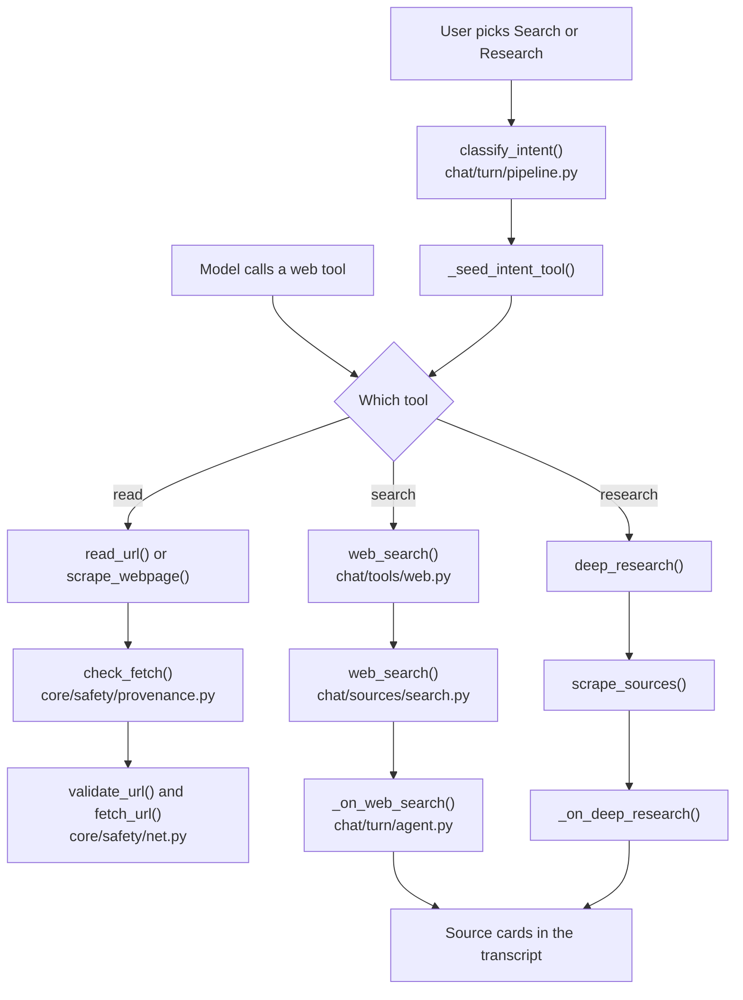

**Debug first.** A page that is refused: read the reason from `check_fetch` or `validate_url`. Tests: `Backend/core/tests/test_provenance.py`, `test_net.py`, `Backend/chat/tests/test_injection_defences.py`.

---

## A12. Charts, HTML artifacts, diagrams and dashboards

**What it is.** The assistant can draw a chart from data, render a small HTML page, draw a box-and-arrow diagram, and save a dashboard of charts the user can reopen.

**Screen.** [ChartArtifact.tsx](better-n8n-frontend/src/components/chat/ChartArtifact.tsx), [HtmlArtifact.tsx](better-n8n-frontend/src/components/chat/HtmlArtifact.tsx), `/dashboards` — [Dashboards.tsx](better-n8n-frontend/src/pages/Dashboards.tsx). Scales are in [lib/chartScale.ts](better-n8n-frontend/src/lib/chartScale.ts).

| What happens | Function or class | File |
|---|---|---|
| Chart tool | `render_chart` | [Backend/chat/tools/charts.py](Backend/chat/tools/charts.py) |
| Validate the chart data | `build_spec`, `ChartError` | [Backend/office/charts.py](Backend/office/charts.py) |
| Attach the chart to the message | `_on_chart` | [Backend/chat/turn/agent.py](Backend/chat/turn/agent.py) |
| HTML artifact tool | `render_html_artifact` | [Backend/chat/tools/artifacts.py](Backend/chat/tools/artifacts.py) |
| Diagram tool | `render_diagram` | [Backend/chat/tools/office.py](Backend/chat/tools/office.py) |
| Lay out and draw the diagram | `validate`, `render` | [Backend/office/diagram.py](Backend/office/diagram.py) |
| Dashboard tools | `render_dashboard`, `save_dashboard` | [Backend/chat/tools/dashboards.py](Backend/chat/tools/dashboards.py) |
| Validate a dashboard | `validate_spec` | [Backend/inference/dashboards.py](Backend/inference/dashboards.py) |
| Dashboard API | `dashboard_list`, `dashboard_detail`, `dashboard_refresh` | [Backend/inference/dashboard_views.py](Backend/inference/dashboard_views.py) |

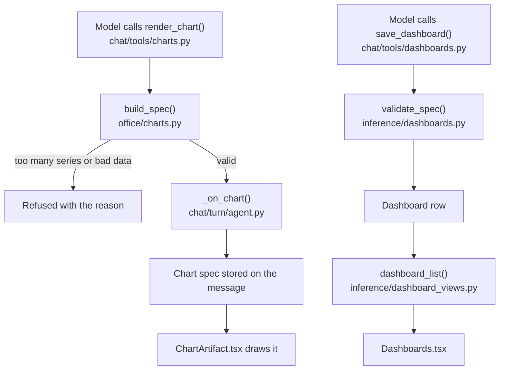

**Debug first.** The spec is stored, never a picture, so a wrong chart is a wrong spec. Tests: `Backend/chat/tests/test_charts.py`, `better-n8n-frontend/src/lib/__tests__/chartScale.test.ts`.

---

## A13. Voice: dictation and read-aloud

**What it is.** The user can speak a message instead of typing, and have an answer read aloud. Agents can transcribe audio files and produce speech files.

**Screen.** [VoiceInputButton.tsx](better-n8n-frontend/src/components/chat/VoiceInputButton.tsx), [hooks/useVoiceInput.ts](better-n8n-frontend/src/hooks/useVoiceInput.ts), [hooks/useSpeech.ts](better-n8n-frontend/src/hooks/useSpeech.ts). Endpoints: `POST /api/chat/transcribe/`, `POST /api/chat/speak/`.

| What happens | Function or class | File |
|---|---|---|
| Transcribe a clip | `transcribe_clip`, `TranscribeThrottle` | [Backend/chat/views.py](Backend/chat/views.py) |
| Speech-to-text engine | `transcribe`, `stt_available`, `_transcribe_openrouter` | [Backend/voice/stt.py](Backend/voice/stt.py) |
| Read text aloud | `speak_text`, `SpeakThrottle` | [Backend/chat/views.py](Backend/chat/views.py) |
| Choose the model and voice | `resolve_voice` | [Backend/voice/tts.py](Backend/voice/tts.py) |
| Text-to-speech engine | `synthesize`, `tts_available`, `_synthesize_openrouter` | [Backend/voice/tts.py](Backend/voice/tts.py) |
| Agent tools | `transcribe_audio`, `text_to_speech` | [Backend/chat/tools/voice.py](Backend/chat/tools/voice.py) |

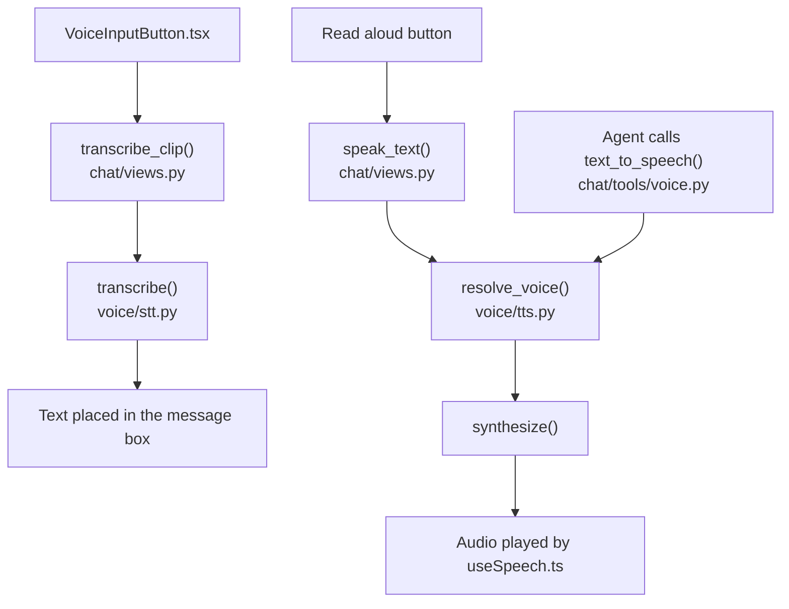

**Debug first.** "No speech engine is configured": `TTS_ENGINE` or `STT_ENGINE` is `none`. Tests: `Backend/chat/tests/test_speak.py`.

---

## A14. Guest chat

**What it is.** A visitor can try the chat without an account. Guest chat has no tools, a small token budget and strict rate limits.

**Screen.** The landing chat with [GuestBanner.tsx](better-n8n-frontend/src/components/chat/GuestBanner.tsx). Endpoints under `/api/chat/guest/`.

| What happens | Function or class | File |
|---|---|---|
| Create or read a guest session | `create_guest_session`, `get_guest_session` | [Backend/chat/guest/views.py](Backend/chat/guest/views.py) |
| Send a message | `guest_send_message_stream`, `_check_guest_throttles` | [Backend/chat/guest/views.py](Backend/chat/guest/views.py) |
| Limits per minute, hour and day | `GuestChatMinuteThrottle`, `GuestChatHourThrottle`, `GuestChatDayThrottle` | [Backend/core/http/throttling.py](Backend/core/http/throttling.py) |
| Stream the answer | `stream_guest_chat`, `fits_token_budget`, `get_guest_user` | [Backend/chat/guest/runtime.py](Backend/chat/guest/runtime.py) |

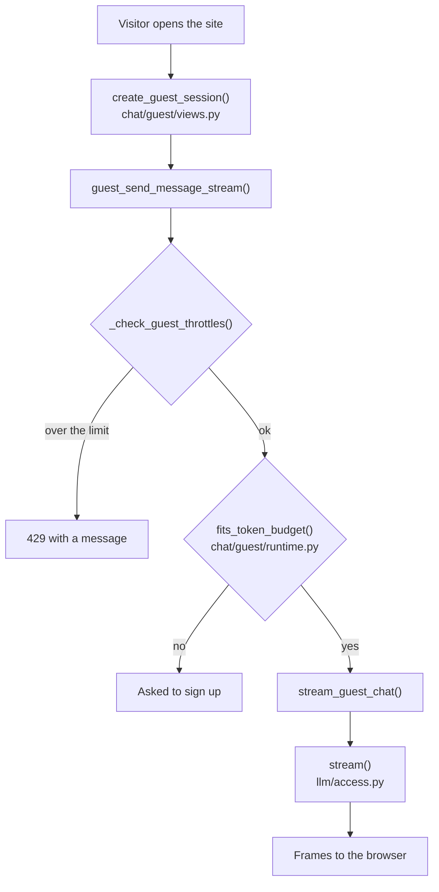

**Debug first.** Tests: `Backend/chat/tests/`, searching for `guest`.

---

## A15. Memory about the user

**What it is.** The assistant remembers lasting facts about the user (who they are, preferences, projects) and uses them in later conversations. The user can see and delete them.

**Screen.** `/settings` Memory tab — [MemoryTab.tsx](better-n8n-frontend/src/components/settings/MemoryTab.tsx), [api/memory.ts](better-n8n-frontend/src/api/memory.ts). Also `/memory` in chat.

| What happens | Function or class | File |
|---|---|---|
| Tools the chat model calls | `remember_about_user`, `forget_about_user` | [Backend/chat/tools/memory.py](Backend/chat/tools/memory.py) |
| Save a fact, merge repeats, enforce caps | `remember`, `normalise`, `_same_fact`, `_enforce_cap` | [Backend/core/memory.py](Backend/core/memory.py) |
| Delete a fact | `forget` | [Backend/core/memory.py](Backend/core/memory.py) |
| Choose which facts fit in the prompt | `_select`, `for_prompt`, `in_prompt_ids` | [Backend/core/memory.py](Backend/core/memory.py) |
| Put them in the system prompt | `_user_memory_block` | [Backend/chat/turn/pipeline.py](Backend/chat/turn/pipeline.py) |
| Settings API | `UserMemoryView` | [Backend/core/views.py](Backend/core/views.py) |
| `/memory` command | `memory_command`, `memory_delete` | [Backend/chat/commands/memory.py](Backend/chat/commands/memory.py) |
| Stored data | `UserMemory` | [Backend/core/models.py](Backend/core/models.py) |

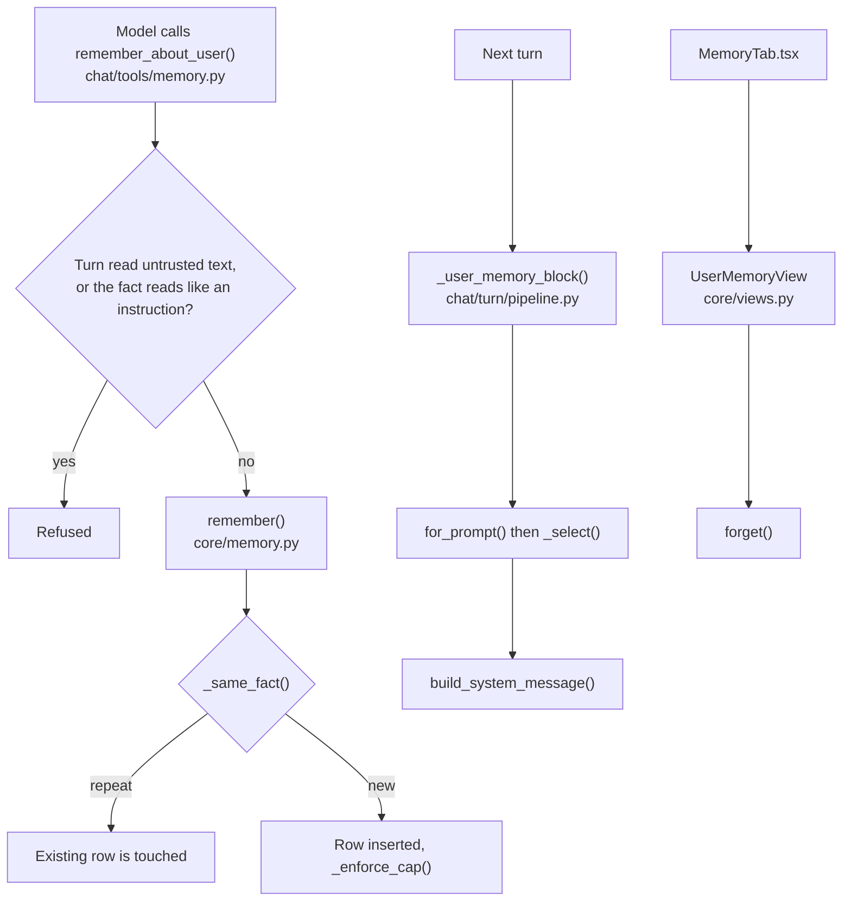

**Debug first.** A fact that is stored but not used: `_select` fills by category priority under a character cap; the Memory tab shows `in_prompt`. Tests: `Backend/core/tests/test_memory.py`.

---

## A16. Model picker, thinking effort and ChatGPT sign-in

**What it is.** The user picks which model answers and how hard it should think. On a self-hosted install they can sign in with their ChatGPT plan and use it as a provider.

**Screen.** [ChatHeader.tsx](better-n8n-frontend/src/components/chat/ChatHeader.tsx), [EffortPicker.tsx](better-n8n-frontend/src/components/chat/EffortPicker.tsx), [ChatGPTPlanPanel.tsx](better-n8n-frontend/src/components/chat/ChatGPTPlanPanel.tsx), [hooks/useAIModels.ts](better-n8n-frontend/src/hooks/useAIModels.ts), [hooks/useChatModelSelection.ts](better-n8n-frontend/src/hooks/useChatModelSelection.ts), [hooks/useEffortSelection.ts](better-n8n-frontend/src/hooks/useEffortSelection.ts).

| What happens | Function or class | File |
|---|---|---|
| List models for the picker | `AIModelListView`, `offered_in_picker` | [Backend/llm/views.py](Backend/llm/views.py) |
| Save the choice on the conversation | `_sync_model_choice`, `_parse_effort` | [Backend/chat/turn/pipeline.py](Backend/chat/turn/pipeline.py) |
| Snap effort to what the model supports | `resolve`, `nearest`, `support_for` | [Backend/llm/effort.py](Backend/llm/effort.py) |
| Replace a retired model | `resolve_with_fallback`, `get_fallback` | [Backend/llm/fallback.py](Backend/llm/fallback.py) |
| User's fallback choice | `ModelFallbackView` | [Backend/llm/views.py](Backend/llm/views.py) |
| ChatGPT sign-in routes | `start`, `callback`, `status`, `disconnect` | [Backend/credentials/chatgpt_views.py](Backend/credentials/chatgpt_views.py) |
| ChatGPT sign-in logic and token refresh | `begin`, `complete`, `access_token_for` | [Backend/credentials/chatgpt.py](Backend/credentials/chatgpt.py) |
| Models available on the user's plan | `models_for` | [Backend/llm/chatgpt_plan.py](Backend/llm/chatgpt_plan.py) |
| Call the plan through the Responses API | `ChatGPTPlanNode`, `ResponsesAPINode` | [Backend/llm/handlers/responses_api.py](Backend/llm/handlers/responses_api.py) |
| Stored data | `AIProvider`, `AIModel`, `ModelFallback` | [Backend/llm/models.py](Backend/llm/models.py) |

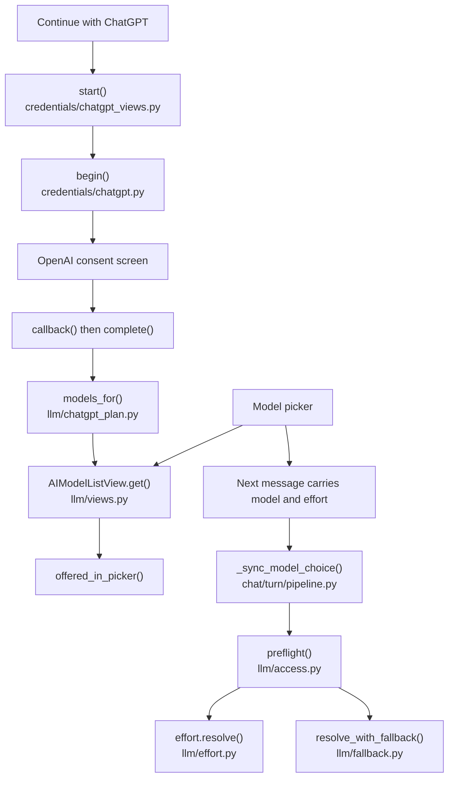

**Debug first.** A model missing from the picker: `offered_in_picker` (it must read images) and `is_active`. Tests: `Backend/llm/tests/test_effort.py`, `test_seed_catalogue.py`, `Backend/credentials/tests/test_chatgpt_auth.py`.

---

## A17. Agents: create, configure and version

**What it is.** An agent is a saved configuration: a prompt, a model, the tools it may use, and its limits. The user builds one in a form, through a short wizard, or by describing it in chat. Every change is kept as a revision.

**Screen.** `/agents`, `/agents/new`, `/agents/:id`, `/agents/:id/history` — [Agents.tsx](better-n8n-frontend/src/pages/Agents.tsx), [AgentCreateWizard.tsx](better-n8n-frontend/src/pages/AgentCreateWizard.tsx), [AgentBuilder.tsx](better-n8n-frontend/src/pages/AgentBuilder.tsx), [AgentHistory.tsx](better-n8n-frontend/src/pages/AgentHistory.tsx).

| What happens | Function or class | File |
|---|---|---|
| List and read agents with their stats | `agent_list`, `agent_detail`, `_with_stats` | [Backend/agents/views/agents.py](Backend/agents/views/agents.py) |
| The one save path for every agent | `AgentSerializer` | [Backend/agents/config.py](Backend/agents/config.py) |
| Tool, grant and autonomy vocabulary | `GRANT_TOOLS`, `ALWAYS_AVAILABLE`, `AUTONOMY_LADDER` | [Backend/agents/grants.py](Backend/agents/grants.py) |
| What each grant unlocks, for the form | `capability_list`, `engine_live`, `unavailable_grants` | [Backend/agents/views/capabilities.py](Backend/agents/views/capabilities.py) |
| Keep a revision on each real change | `record`, `diff`, `snapshot`, `summarise` | [Backend/logs/revisions.py](Backend/logs/revisions.py) |
| Restore an older revision | `agent_restore_revision` | [Backend/agents/views/agents.py](Backend/agents/views/agents.py) |
| Wizard | `wizard_questions`, `wizard_propose` | [Backend/agents/views/wizard.py](Backend/agents/views/wizard.py) |
| Builder chat: change settings by talking | `builder_chat`, `configure_agent`, `sanitise`, `enforce_couplings` | [Backend/agents/views/builder.py](Backend/agents/views/builder.py) |
| Build an agent from the main chat | `create_agent`, `update_agent` | [Backend/chat/tools/authoring.py](Backend/chat/tools/authoring.py) |
| Named output formats | `Contract`, `resolve`, `coerce` | [Backend/agents/contracts.py](Backend/agents/contracts.py) |
| Stored data | `SubAgent` | [Backend/agents/models.py](Backend/agents/models.py) |
| Stored revisions | `SubAgentRevision` | [Backend/logs/models.py](Backend/logs/models.py) |

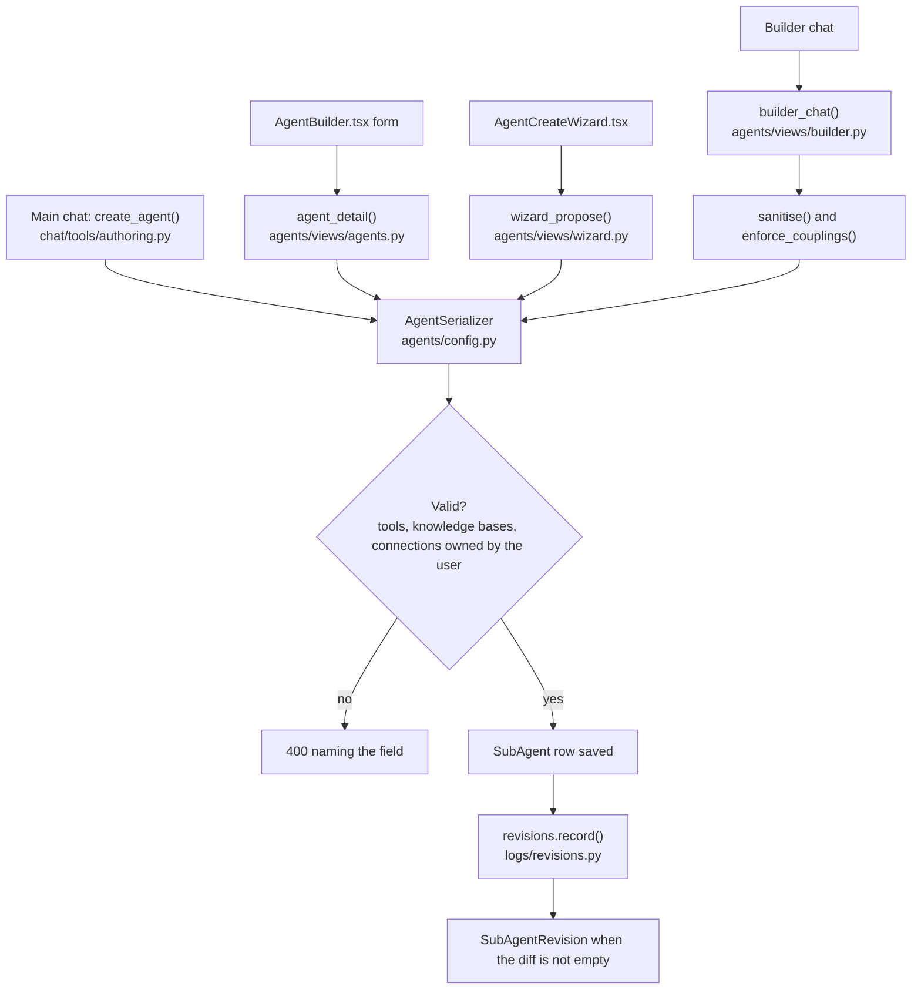

**Debug first.** A setting that does not stick: look for its `validate_<field>` method on `AgentSerializer`. Tests: `Backend/agents/tests/test_agent_runtime.py`, `Backend/logs/tests/test_revisions.py`, `Backend/chat/tests/test_authoring.py`.

---

## A18. Run an agent

**What it is.** The user presses Run with a goal. The agent works in the background, streams its progress, and ends with an answer, files, or a request for approval.

**Screen.** [RunAgentDialog.tsx](better-n8n-frontend/src/components/agents/RunAgentDialog.tsx), live view through [hooks/useLiveRun.ts](better-n8n-frontend/src/hooks/useLiveRun.ts), detail in [RunDetail.tsx](better-n8n-frontend/src/components/activity/RunDetail.tsx). Endpoint: `POST /api/orchestrator/agents/<id>/execute/` (answers 202 with an execution id).

| What happens | Function or class | File |
|---|---|---|
| The view | `agent_execute`, `AgentExecuteSerializer` | [Backend/agents/views/runs.py](Backend/agents/views/runs.py) |
| Check and start, detached | `start_agent_run` | [Backend/agents/agent/runtime.py](Backend/agents/agent/runtime.py) |
| Refuse before any cost | `_check_unattended`, `_check_status`, `check_guardrails`, `_check_plan_provider` | [Backend/agents/agent/runtime.py](Backend/agents/agent/runtime.py) |
| Pick the model, check it can be paid for | `_resolve_run_model`, `resolve_agent_model` | [Backend/agents/agent/runtime.py](Backend/agents/agent/runtime.py) |
| Open the run record | `_open_log` | [Backend/agents/agent/runtime.py](Backend/agents/agent/runtime.py) |
| Wait for a free slot | `slot` | [Backend/agents/admission.py](Backend/agents/admission.py) |
| The run itself | `run_agent` | [Backend/agents/agent/runtime.py](Backend/agents/agent/runtime.py) |
| Time limit | `Deadline` | [Backend/agents/budget.py](Backend/agents/budget.py) |
| Build the toolbox from the agent's grants | `AgentToolbox.for_agent`, `AgentToolbox.descriptors` | [Backend/agents/agent/runtime.py](Backend/agents/agent/runtime.py) |
| Build the file scope and knowledge scope | `build_file_scope`, `kb_scope_for` | [Backend/agents/agent/runtime.py](Backend/agents/agent/runtime.py) |
| Build the system prompt | `_gather_context`, `build_system_prompt` | [Backend/agents/agent/runtime.py](Backend/agents/agent/runtime.py) |
| Choose the approval rules | `sensitive_tools_for`, `approval_policy_for`, `switchable_modes` | [Backend/agents/agent/runtime.py](Backend/agents/agent/runtime.py) |
| Run the shared tool loop | `run_turn` | [Backend/chat/turn/agent.py](Backend/chat/turn/agent.py) |
| Record turns and steps, stream events | `AgentRunStream` | [Backend/agents/agent/stream.py](Backend/agents/agent/stream.py) |
| Shape the answer to the agent's contract | `_apply_contract` | [Backend/agents/agent/runtime.py](Backend/agents/agent/runtime.py) |
| Close the record, add up cost | `_close_log`, `_roll_up_cost` | [Backend/agents/agent/runtime.py](Backend/agents/agent/runtime.py) |
| Cancel | `run_cancel`, `cancel_agent_run` | [Backend/agents/views/runs.py](Backend/agents/views/runs.py), [Backend/agents/agent/runtime.py](Backend/agents/agent/runtime.py) |
| Steer or change mode during a run | `agent_steer`, `agent_autonomy` | [Backend/agents/views/runs.py](Backend/agents/views/runs.py) |

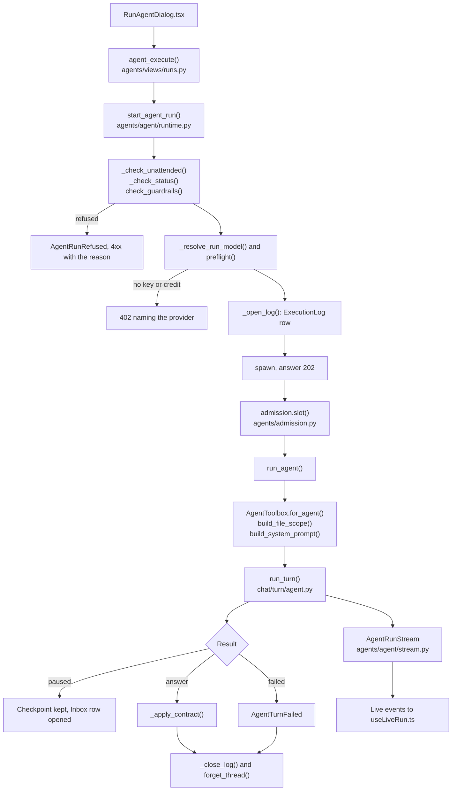

**Debug first.** A run refused at start: read `AgentRunRefused` from `check_guardrails`. A run stuck on "running": see B5 (recovery). Tests: `Backend/agents/tests/test_agent_runtime.py`, `test_run_cancellation.py`, `test_regressions.py`.

---

## A19. Delegation: one agent hands work to others

**What it is.** The chat assistant, or an agent with the `subAgents` grant, can find other agents, give them tasks, and combine their answers. If a worker stops to ask something, the manager can answer it.

**Screen.** Worker plans and results in the transcript; workers appear as their own runs on `/runs`.

| What happens | Function or class | File |
|---|---|---|
| Find an agent to delegate to | `search_agents` | [Backend/chat/tools/agents.py](Backend/chat/tools/agents.py) |
| Start one agent and wait for it | `run_agent`, `_await_agent_run`, `get_agent_run` | [Backend/chat/tools/agents.py](Backend/chat/tools/agents.py) |
| Fan out to several workers at once | `invoke_subagent` | [Backend/chat/tools/agents.py](Backend/chat/tools/agents.py) |
| Check the task size and worker count | `check_delegation_payload` | [Backend/agents/agent/orchestrator.py](Backend/agents/agent/orchestrator.py) |
| Limit nesting | `check_depth` | [Backend/agents/agent/orchestrator.py](Backend/agents/agent/orchestrator.py) |
| Split the spend cap between workers | `divide_budget` | [Backend/agents/agent/orchestrator.py](Backend/agents/agent/orchestrator.py) |
| Give workers a narrower toolbox | `worker_grants` | [Backend/agents/agent/orchestrator.py](Backend/agents/agent/orchestrator.py) |
| Run the workers | `run_fanout`, `worker_thread_id` | [Backend/agents/agent/orchestrator.py](Backend/agents/agent/orchestrator.py) |
| Trim answers, keep the full text reachable | `bound_results` | [Backend/agents/agent/orchestrator.py](Backend/agents/agent/orchestrator.py) |
| Which agents this one may call | `delegation_scope_for` | [Backend/agents/agent/runtime.py](Backend/agents/agent/runtime.py) |
| Pass tool rules down, strictest wins | `merge_tool_permissions` | [Backend/agents/agent/runtime.py](Backend/agents/agent/runtime.py) |
| Share one writable folder with the worker | `with_shared_workspace` | [Backend/inference/vfs.py](Backend/inference/vfs.py) |
| See what a paused worker is waiting for | `pending_requests` | [Backend/chat/tools/agents.py](Backend/chat/tools/agents.py) |
| Answer a paused worker | `answer_subagent`, `subagent_answer_needs_user` | [Backend/chat/tools/agents.py](Backend/chat/tools/agents.py) |
| Which caller a worker runs as | `worker_caller` | [Backend/chat/tools/agents.py](Backend/chat/tools/agents.py) |

```mermaid
flowchart TD
    A["Manager calls invoke_subagent()<br/>chat/tools/agents.py"] --> B["check_delegation_payload()<br/>agents/agent/orchestrator.py"]
    B --> C["check_depth()"]
    C --> D["divide_budget()"]
    D --> E["worker_grants()"]
    E --> F["run_fanout()"]
    F --> G["start_agent_run() per worker<br/>agents/agent/runtime.py"]
    G --> H["run_agent() on a new thread id"]
    H --> I{"Worker result"}
    I -->|done| J["bound_results()"]
    I -->|paused| K["pending_requests()"]
    K --> L["Manager calls answer_subagent()"]
    L --> M{"subagent_answer_needs_user()"}
    M -->|yes| N["Approval card for the person"]
    M -->|no| O["resume_agent_run()"]
    N --> O
    O --> H
    J --> P["Answers back to the manager"]
```

**Debug first.** A worker that cannot see its briefing or files: `with_shared_workspace` and `delegation_scope_for`. Tests: `Backend/agents/tests/test_delegation.py`, `test_delegation_scope.py`, `Backend/inference/tests/test_workspace.py`.

---

## A20. Coding team: tasks, file locks and the plan panel

**What it is.** A coding lead agent starts several coding workers without waiting for each, watches their progress, and steers or stops them. Workers lock the files they are changing so two never overwrite each other.

**Screen.** [PlanPanel.tsx](better-n8n-frontend/src/components/orchestration/PlanPanel.tsx), fed by [hooks/usePlanStream.ts](better-n8n-frontend/src/hooks/usePlanStream.ts) and [lib/planStream.ts](better-n8n-frontend/src/lib/planStream.ts).

| What happens | Function or class | File |
|---|---|---|
| Start workers, return at once | `start_tasks`, `_launch_one`, `_batch_clash` | [Backend/chat/tools/tasks.py](Backend/chat/tools/tasks.py) |
| Wait for the next event | `wait_tasks`, `_collect_events` | [Backend/chat/tools/tasks.py](Backend/chat/tools/tasks.py) |
| Snapshot, steer, stop, undo | `task_status`, `steer_task`, `stop_task`, `revert_task` | [Backend/chat/tools/tasks.py](Backend/chat/tools/tasks.py) |
| In-memory task records and frames | `CodeTask`, `emit`, `task_frame`, `post_event`, `drain_events` | [Backend/agents/agent/tasks.py](Backend/agents/agent/tasks.py) |
| Lock files for a worker | `acquire`, `overlaps`, `release_holder`, `LeaseConflict` | [Backend/workspaces/leases.py](Backend/workspaces/leases.py) |
| Workspace file and git tools | `ws_read`, `ws_edit`, `ws_apply_patch`, `ws_run`, `git_commit`, `open_pull_request` | [Backend/chat/tools/code.py](Backend/chat/tools/code.py) |
| Refuse a write to a file that changed since it was read | `_stale_refused`, `_remember_read` | [Backend/chat/tools/code.py](Backend/chat/tools/code.py) |
| Record what each run has read | `record`, `last_read` | [Backend/workspaces/reads.py](Backend/workspaces/reads.py) |
| Record a change and tell who is affected | `_record_change`, `_publish_change` | [Backend/chat/tools/code.py](Backend/chat/tools/code.py) |
| Find the affected runs and notify them | `affected_threads`, `notify` | [Backend/workspaces/awareness.py](Backend/workspaces/awareness.py) |
| Deliver the notice inside the worker's run | `post_notice`, `take_notices` | [Backend/chat/turn/steering.py](Backend/chat/turn/steering.py) |
| Limits per agent | `write_paths_for`, `command_scope_for`, `intersect_write_paths` | [Backend/agents/agent/runtime.py](Backend/agents/agent/runtime.py) |
| Per-worker buttons | `run_steer`, `run_autonomy`, `_cancel_code_task` | [Backend/agents/views/runs.py](Backend/agents/views/runs.py) |
| Stored data | `CodeProject`, `CodeChange`, `CodeLease` | [Backend/workspaces/models.py](Backend/workspaces/models.py) |

```mermaid
flowchart TD
    A["Lead calls start_tasks()<br/>chat/tools/tasks.py"] --> B["_batch_clash(): claims overlap?"]
    B -->|yes| C["Refused with the reason"]
    B -->|no| D["leases.acquire()<br/>workspaces/leases.py"]
    D --> E["_launch_one(): detached worker run"]
    E --> F["task_update frame"]
    F --> G["PlanPanel.tsx"]
    E --> H["Worker calls ws_read()<br/>chat/tools/code.py"]
    H --> I["reads.record()<br/>workspaces/reads.py"]
    I --> J["Worker calls ws_edit()"]
    J --> K{"_stale_refused():<br/>changed since read?"}
    K -->|yes| L["Refused, worker re-reads"]
    K -->|no| M["_record_change()"]
    M --> N["awareness.notify()<br/>workspaces/awareness.py"]
    N --> O["steering.post_notice() to affected workers"]
    P["Lead calls wait_tasks()"] --> Q["_collect_events()"]
    Q --> R["done, failed, paused or file change"]
```

**Debug first.** A worker refused a write: check the lease holder and the write scope. Tests: `Backend/agents/tests/test_code_dispatch.py`, `test_code_scopes.py`, `Backend/workspaces/tests/test_leases.py`, `test_stale_write.py`, `test_awareness.py`.

---

## A21. Inbox: approvals and reminders for agent runs

**What it is.** When an agent run pauses for an approval or a question, a row appears in the Inbox. The user answers there and the run continues. Unanswered rows are nudged, then summarised in a daily digest.

**Screen.** `/runs` "Needs you" — [NeedsYou.tsx](better-n8n-frontend/src/components/activity/NeedsYou.tsx), [hooks/useHitlPending.ts](better-n8n-frontend/src/hooks/useHitlPending.ts), [hooks/useHITLReminders.ts](better-n8n-frontend/src/hooks/useHITLReminders.ts), [api/orchestrator.ts](better-n8n-frontend/src/api/orchestrator.ts).

| What happens | Function or class | File |
|---|---|---|
| The run pauses | `_require_approval`, `_require_answer` | [Backend/chat/turn/agent.py](Backend/chat/turn/agent.py) |
| Stream handler sees the pause | `AgentRunStream._approval_requested`, `AgentRunStream._question_asked` | [Backend/agents/agent/stream.py](Backend/agents/agent/stream.py) |
| Open one row per paused call | `open_request` | [Backend/agents/agent/hitl.py](Backend/agents/agent/hitl.py) |
| List pending rows | `pending_hitl_requests` | [Backend/agents/views/hitl.py](Backend/agents/views/hitl.py) |
| Answer from the Inbox | `respond_to_hitl` | [Backend/agents/views/hitl.py](Backend/agents/views/hitl.py) |
| Approve or reject by agent | `agent_approve`, `agent_reject` | [Backend/agents/views/runs.py](Backend/agents/views/runs.py) |
| Close the row | `resolve_request` | [Backend/agents/agent/hitl.py](Backend/agents/agent/hitl.py) |
| Continue the run on the same id | `resume_agent_run`, `_find_paused_log`, `_reopen_log` | [Backend/agents/agent/runtime.py](Backend/agents/agent/runtime.py) |
| Arm the reminder schedule | `sync_reminder_schedule` | [Backend/notifications/signals.py](Backend/notifications/signals.py) |
| Nudges and the daily digest | `run_reminder_sweep`, `deliver_escalation`, `_sweep_hourly`, `_sweep_daily_digests`, `pending_for_nudges` | [Backend/notifications/reminders.py](Backend/notifications/reminders.py) |
| Push to open browsers | `HITLNotificationConsumer` | [Backend/streaming/consumers.py](Backend/streaming/consumers.py) |
| Stored data | `HITLRequest` | [Backend/agents/models.py](Backend/agents/models.py) |
| Reminder state | `HITLReminderSchedule` | [Backend/notifications/models.py](Backend/notifications/models.py) |

```mermaid
flowchart TD
    A["tools_node() pauses the run<br/>chat/turn/agent.py"] --> B["AgentRunStream._approval_requested()<br/>agents/agent/stream.py"]
    B --> C["hitl.open_request()<br/>agents/agent/hitl.py"]
    C --> D["HITLRequest row"]
    D --> E["sync_reminder_schedule()<br/>notifications/signals.py"]
    E --> F["run_reminder_sweep()<br/>notifications/reminders.py"]
    F --> G["deliver_escalation(): now, +1h, +1d"]
    F --> H["_sweep_daily_digests(): one email a day"]
    D --> I["pending_hitl_requests()<br/>agents/views/hitl.py"]
    I --> J["NeedsYou.tsx"]
    J --> K["respond_to_hitl()"]
    K --> L["approve_tool_call() or reject_tool_call()"]
    L --> M["hitl.resolve_request()"]
    M --> N["resume_agent_run()<br/>agents/agent/runtime.py"]
```

**Debug first.** An answered row whose run did not continue: the resume step in `respond_to_hitl` (failures there are logged, not shown). Tests: `Backend/agents/tests/test_hitl_inbox.py`, `Backend/notifications/tests/test_agent_notifications.py`, `test_reminders.py`.

---

## A22. Schedules and webhooks

**What it is.** An agent can run on a schedule (a cron expression in the user's timezone) or when an outside system calls a secret URL.

**Screen.** `/schedules` — [Schedules.tsx](better-n8n-frontend/src/pages/Schedules.tsx), [ScheduleEditor.tsx](better-n8n-frontend/src/components/schedules/ScheduleEditor.tsx), [WebhookEditor.tsx](better-n8n-frontend/src/components/schedules/WebhookEditor.tsx). The live reading of a cron expression is [lib/cron.ts](better-n8n-frontend/src/lib/cron.ts).

| What happens | Function or class | File |
|---|---|---|
| Create, edit, delete | `trigger_list`, `trigger_detail`, `TriggerSerializer` | [Backend/agents/views/triggers.py](Backend/agents/views/triggers.py) |
| Preview while typing | `schedule_preview` | [Backend/agents/views/triggers.py](Backend/agents/views/triggers.py) |
| Parse cron, find the next run, describe in words | `parse_cron`, `next_run_after`, `next_runs`, `describe` | [Backend/agents/triggers.py](Backend/agents/triggers.py) |
| The loop that wakes up | `run_forever`, `sweep_once`, `try_acquire` | [Backend/agents/scheduler.py](Backend/agents/scheduler.py) |
| Find due triggers | `due_triggers`, `run_trigger_sweep` | [Backend/agents/sweep.py](Backend/agents/sweep.py) |
| Check and claim one firing | `prepare`, `_is_busy`, `_rearm` | [Backend/agents/sweep.py](Backend/agents/sweep.py) |
| Start the run, record the outcome | `fire`, `record_started`, `record_failure` | [Backend/agents/sweep.py](Backend/agents/sweep.py) |
| Run now | `trigger_run_now` | [Backend/agents/views/triggers.py](Backend/agents/views/triggers.py) |
| Webhook receiver (no sign-in) | `webhook_receive`, `_readable_payload` | [Backend/agents/views/triggers.py](Backend/agents/views/triggers.py) |
| New webhook secret | `trigger_rotate_secret` | [Backend/agents/views/triggers.py](Backend/agents/views/triggers.py) |
| Stored data | `Trigger`, `SchedulerLease` | [Backend/agents/models.py](Backend/agents/models.py) |

```mermaid
flowchart TD
    A["ScheduleEditor.tsx"] --> B["schedule_preview()<br/>agents/views/triggers.py"]
    B --> C["triggers.describe() and next_runs()<br/>agents/triggers.py"]
    A --> D["trigger_list() saves a Trigger"]
    D --> E["next_run_after() sets next_due_at"]
    F["scheduler.run_forever()<br/>agents/scheduler.py"] --> G["try_acquire(): one process holds the lease"]
    G --> H["sweep_once()"]
    H --> I["sweep.due_triggers()<br/>agents/sweep.py"]
    I --> J["sweep.prepare()"]
    J -->|busy, outside window or not allowed| K["record_failure() with the reason"]
    J -->|ok| L["sweep.fire()"]
    L --> M["start_agent_run(caller=trigger)<br/>agents/agent/runtime.py"]
    N["Outside system POSTs /hooks/secret/"] --> O["webhook_receive()"]
    O -->|any refusal| P["404"]
    O --> J
```

**Debug first.** A schedule that never fires: `Trigger.last_outcome` and `last_error`, then `lease_status` in `scheduler.py`. Tests: `Backend/agents/tests/test_schedules.py`, `test_scheduler.py`, `better-n8n-frontend/src/lib/__tests__/cron.test.ts`.

---

## A23. Missions: long goals across many runs

**What it is.** A mission is a goal that takes more than one run. The agent works, waits for a time or event, and is woken again until the goal is done.

**Screen.** `/runs` Missions section — [MissionsSection.tsx](better-n8n-frontend/src/components/activity/MissionsSection.tsx), [api/missions.ts](better-n8n-frontend/src/api/missions.ts). Also `/goal` in chat.

| What happens | Function or class | File |
|---|---|---|
| Start a mission from chat | `start_mission` | [Backend/chat/tools/missions.py](Backend/chat/tools/missions.py) |
| `/goal` command | `goal_command`, `start_goal_mission` | [Backend/chat/commands/missions.py](Backend/chat/commands/missions.py) |
| Mission API: list, pause, resume, cancel | `mission_list_create`, `mission_detail`, `mission_action` | [Backend/chat/commands/views.py](Backend/chat/commands/views.py) |
| Tools the agent uses inside a mission | `mission_status`, `wait_for`, `complete_mission`, `report_progress` | [Backend/chat/tools/missions.py](Backend/chat/tools/missions.py) |
| The sweep | `sweep`, `run_mission_sweep`, `due_missions` | [Backend/missions/sweep.py](Backend/missions/sweep.py) |
| Read back a finished run | `settle`, `_run_result` | [Backend/missions/sweep.py](Backend/missions/sweep.py) |
| Decide what happens next | `after_run`, `after_failed_run` | [Backend/missions/service.py](Backend/missions/service.py) |
| Claim a due mission and start its run | `_claim`, `goal_for`, `_record_launch` | [Backend/missions/sweep.py](Backend/missions/sweep.py) |
| Run it every two minutes | `_missions` | [Backend/agents/scheduler.py](Backend/agents/scheduler.py) |
| Stored data | `Mission` | [Backend/missions/models.py](Backend/missions/models.py) |

```mermaid
flowchart TD
    A["/goal or start_mission()<br/>chat/tools/missions.py"] --> B["Mission row"]
    C["scheduler: _missions()<br/>agents/scheduler.py"] --> D["missions.sweep()<br/>missions/sweep.py"]
    D --> E["Pass 1: settle()"]
    E --> F{"Last run"}
    F -->|finished| G["after_run()<br/>missions/service.py"]
    F -->|failed| H["after_failed_run(): retry, pause after three"]
    G --> I{"Decision"}
    I -->|done| J["Mission complete, owner notified"]
    I -->|waiting| K["Wake time set"]
    I -->|next| L["Due again"]
    D --> M["Pass 2: due_missions()"]
    M --> N["_claim()"]
    N --> O["start_agent_run(caller=mission)<br/>agents/agent/runtime.py"]
    O --> P["Agent calls wait_for() or complete_mission()"]
    P --> E
```

**Debug first.** A mission that never wakes: only its timeout wakes a waiting mission, not its event. Tests: `Backend/missions/tests/test_mission_sweep.py`.

---

## A24. Templates, packs and sharing an agent

**What it is.** The Explore page lists ready-made agents and packs of agents to install. A user can also publish their own agent for a colleague, for all signed-in users, or for the public.

**Screen.** `/templates`, `/a/:slug` — [Templates.tsx](better-n8n-frontend/src/pages/Templates.tsx), [PublicAgent.tsx](better-n8n-frontend/src/pages/PublicAgent.tsx), [ShareAgentDialog.tsx](better-n8n-frontend/src/components/agents/ShareAgentDialog.tsx), [lib/packs.ts](better-n8n-frontend/src/lib/packs.ts).

| What happens | Function or class | File |
|---|---|---|
| The catalogue (code, not rows) | `listing`, `get`, `pack_of`, `check_catalogue` | [Backend/agents/gallery/__init__.py](Backend/agents/gallery/__init__.py) |
| List and show templates | `template_list`, `template_detail` | [Backend/agents/views/gallery.py](Backend/agents/views/gallery.py) |
| Offer the user's own knowledge bases and connections | `_candidates`, `_with_candidates` | [Backend/agents/views/gallery.py](Backend/agents/views/gallery.py) |
| Install one template | `template_install`, `_resolve` | [Backend/agents/views/gallery.py](Backend/agents/views/gallery.py) |
| Install a pack | `template_install_pack`, `_wire_coding_lead` | [Backend/agents/views/gallery.py](Backend/agents/views/gallery.py) |
| Publish an agent | `agent_share`, `_mint_slug` | [Backend/agents/views/gallery.py](Backend/agents/views/gallery.py) |
| Strip every id, list what the installer must supply | `to_shareable`, `_requirement_for`, `sanitise_requirements` | [Backend/agents/publishing.py](Backend/agents/publishing.py) |
| Public pages (no sign-in) | `public_agent_list`, `public_agent_detail`, `_present_public` | [Backend/agents/views/gallery.py](Backend/agents/views/gallery.py) |
| Coding playbooks shipped with templates | `load`, `load_many` | [Backend/agents/playbooks/__init__.py](Backend/agents/playbooks/__init__.py) |
| Stored data | `SharedAgent` | [Backend/agents/models.py](Backend/agents/models.py) |

```mermaid
flowchart TD
    A["Templates.tsx"] --> B["template_list()<br/>agents/views/gallery.py"]
    B --> C["gallery.listing()<br/>agents/gallery/__init__.py"]
    B --> D["SharedAgent rows the user may see"]
    A --> E["template_detail()"]
    E --> F["_with_candidates(): the user's own rows per requirement"]
    A --> G["template_install()"]
    G --> H["_resolve(): requirement to chosen id"]
    H --> I["AgentSerializer<br/>agents/config.py"]
    I --> J["New SubAgent"]
    K["ShareAgentDialog.tsx"] --> L["agent_share()"]
    L --> M["to_shareable()<br/>agents/publishing.py"]
    M -->|an id no longer resolves| N["PublishError"]
    M --> O["SharedAgent snapshot with a slug"]
    O --> P["public_agent_detail() for /a/slug"]
```

**Debug first.** An install that fails validation: the template's config is checked by the same serializer as the builder. Tests: `Backend/agents/tests/test_gallery.py`, `test_sharing.py`, `test_install_pack.py`.

---

## A25. Runs, activity, cost and feedback

**What it is.** The Runs page shows what is running now, what needs the user, what finished, and the full record of any run: each model turn with its reasoning and each tool call. The user can rate a run and see where money went.

**Screen.** `/runs` — [Runs.tsx](better-n8n-frontend/src/pages/Runs.tsx) with [LiveList.tsx](better-n8n-frontend/src/components/activity/LiveList.tsx), [HistoryList.tsx](better-n8n-frontend/src/components/activity/HistoryList.tsx), [RunDetail.tsx](better-n8n-frontend/src/components/activity/RunDetail.tsx), [FeedbackControl.tsx](better-n8n-frontend/src/components/runs/FeedbackControl.tsx). Insights: [InsightsDashboard.tsx](better-n8n-frontend/src/components/billing/InsightsDashboard.tsx).

| What happens | Function or class | File |
|---|---|---|
| What is live right now | `activity_live`, `_agent_run_items`, `_chat_turn_items`, `_code_task_items` | [Backend/logs/activity.py](Backend/logs/activity.py) |
| Run list and detail (views) | `execution_list`, `execution_detail` | [Backend/logs/views.py](Backend/logs/views.py) |
| Run list and detail (queries) | `execution_page`, `execution_detail`, `_execution_row`, `_step_row` | [Backend/logs/queries.py](Backend/logs/queries.py) |
| Statistics and cost | `execution_statistics`, `cost_breakdown`, `insights_overview` | [Backend/logs/queries.py](Backend/logs/queries.py) |
| Thumbs up or down | `feedback`, `quality` | [Backend/logs/views.py](Backend/logs/views.py) |
| Save feedback | `upsert_feedback`, `clear_feedback`, `quality_summary` | [Backend/logs/queries.py](Backend/logs/queries.py) |
| Delete runs, mark a stuck run failed | `execution_bulk_delete`, `execution_mark_failed` | [Backend/logs/views.py](Backend/logs/views.py) |
| Agent change history | `revision_list`, `revision_detail` | [Backend/logs/views.py](Backend/logs/views.py) |
| Classify why a run failed | `classify` | [Backend/logs/failures.py](Backend/logs/failures.py) |
| Stored data | `ExecutionLog`, `AgentTurn`, `AgentStep`, `Feedback`, `CostEntry` | [Backend/logs/models.py](Backend/logs/models.py) |

```mermaid
flowchart TD
    A["Runs.tsx"] --> B["activity_live()<br/>logs/activity.py"]
    B --> C["_agent_run_items()<br/>_chat_turn_items()<br/>_code_task_items()"]
    A --> D["execution_list()<br/>logs/views.py"]
    D --> E["queries.execution_page()<br/>logs/queries.py"]
    A --> F["execution_detail()"]
    F --> G["queries.execution_detail()"]
    G --> H["ExecutionLog, AgentTurn and AgentStep rows"]
    H --> I["RunDetail.tsx"]
    I --> J["FeedbackControl.tsx"]
    J --> K["feedback()<br/>logs/views.py"]
    K --> L["queries.upsert_feedback()"]
    M["Settings, Insights tab"] --> N["insights_overview() and cost_breakdown()"]
```

**Debug first.** A run with no turns: recording is in `AgentRunStream` (see B9). Tests: `Backend/logs/tests/test_turns.py`, `test_delegation.py`.

---

## A26. Files: folders, upload, search, trash

**What it is.** A file explorer for the user's own documents: folders, upload, rename, move, search by name or content, a recycle bin with restore, and a storage meter.

**Screen.** `/documents` — [Documents.tsx](better-n8n-frontend/src/pages/Documents.tsx) with [NavPane.tsx](better-n8n-frontend/src/components/explorer/NavPane.tsx), [ItemsView.tsx](better-n8n-frontend/src/components/explorer/ItemsView.tsx), [StorageMeter.tsx](better-n8n-frontend/src/components/explorer/StorageMeter.tsx). API client: [api/documents.ts](better-n8n-frontend/src/api/documents.ts).

| What happens | Function or class | File |
|---|---|---|
| List, upload, read, delete documents | `document_list`, `document_detail`, `document_content`, `document_download` | [Backend/inference/views.py](Backend/inference/views.py) |
| Check and read an uploaded file | `DocumentProcessor`, `normalize_file_type`, `user_document_path` | [Backend/inference/utils.py](Backend/inference/utils.py) |
| Storage limit | `check`, `usage`, `QuotaExceeded` | [Backend/inference/quota.py](Backend/inference/quota.py) |
| Folder API | `folder_list`, `folder_detail`, `fs_move`, `storage_usage` | [Backend/inference/folder_views.py](Backend/inference/folder_views.py) |
| Resolve a folder id safely | `resolve_folder`, `resolve_documents` | [Backend/inference/filesystem.py](Backend/inference/filesystem.py) |
| Create, rename and move folders | `create_folder`, `rename_folder`, `move`, `subtree`, `breadcrumbs` | [Backend/inference/filesystem.py](Backend/inference/filesystem.py) |
| Search by name or content | `document_search` | [Backend/inference/views.py](Backend/inference/views.py) |
| Search scoring | `search`, `word_score`, `fuzzy_score` | [Backend/inference/search.py](Backend/inference/search.py) |
| Recycle bin API | `trash_list`, `trash_restore`, `trash_empty` | [Backend/inference/folder_views.py](Backend/inference/folder_views.py) |
| Trash, restore, purge after 30 days | `trash`, `restore`, `run_recycle_sweep`, `empty_bin` | [Backend/inference/recycle.py](Backend/inference/recycle.py) |
| Previews for images and archives | `document_preview_image`, `document_archive` | [Backend/inference/views.py](Backend/inference/views.py) |
| Build a preview | `preview_image`, `archive_listing`, `preview_kind` | [Backend/inference/previews.py](Backend/inference/previews.py) |
| Stored data | `Folder`, `Document`, `LiveManager` | [Backend/inference/models.py](Backend/inference/models.py) |

```mermaid
flowchart TD
    A["Documents.tsx"] --> B["folder_list()<br/>inference/folder_views.py"]
    B --> C["filesystem.resolve_folder()<br/>inference/filesystem.py"]
    C -->|unknown or not yours| D["404"]
    C --> E["filesystem.children()"]
    A --> F["Upload: document_list() POST<br/>inference/views.py"]
    F --> G["DocumentProcessor.validate_file_upload()<br/>inference/utils.py"]
    G --> H["quota.check()<br/>inference/quota.py"]
    H --> I["Document row and stored bytes"]
    A --> J["Move: fs_move()"]
    J --> K["filesystem.move()"]
    A --> L["Delete"]
    L --> M["recycle.trash()<br/>inference/recycle.py"]
    M --> N["deleted_at set, search index dropped"]
    N --> O["trash_restore() then recycle.restore()"]
    N --> P["run_recycle_sweep() after 30 days"]
```

**Debug first.** A file that "disappeared": it may be trashed — `LiveManager` hides rows with `deleted_at`. Tests: `Backend/inference/tests/test_filesystem.py`, `test_recycle.py`, `test_file_types.py`.

---

## A27. Files for the assistant: the virtual filesystem

**What it is.** The assistant and agents read, write, edit, find, move and delete the user's files through path-shaped tools. Each agent is confined to a scope (read-only, its own folder, or more).

**Screen.** File cards in the transcript and on `/runs` — [FileCards.tsx](better-n8n-frontend/src/components/files/FileCards.tsx). Paths in prose are linked by [lib/vfsPath.ts](better-n8n-frontend/src/lib/vfsPath.ts).

| What happens | Function or class | File |
|---|---|---|
| The tools | `list_files`, `read_file`, `write_file`, `edit_file`, `find_files`, `delete_file`, `move_file`, `copy_file`, `make_directory` | [Backend/chat/tools/files.py](Backend/chat/tools/files.py) |
| Shared tool wrapper | `_run`, `_scope`, `_no_scope` | [Backend/chat/tools/files.py](Backend/chat/tools/files.py) |
| Scope for an agent | `build_file_scope` | [Backend/agents/agent/runtime.py](Backend/agents/agent/runtime.py) |
| Scope for chat | `_chat_file_scope` | [Backend/chat/turn/pipeline.py](Backend/chat/turn/pipeline.py) |
| What a scope is | `FileScope`, `build_scope`, `chat_scope`, `agent_home` | [Backend/inference/vfs.py](Backend/inference/vfs.py) |
| Turn a path into folder rows, one step at a time | `segments`, `_scope_parts`, `_folder_at`, `_document_in` | [Backend/inference/vfs.py](Backend/inference/vfs.py) |
| Refuse a write outside the scope | `_require_write_at`, `_require_room` | [Backend/inference/vfs.py](Backend/inference/vfs.py) |
| Read | `list_dir`, `read_file`, `read_binary`, `find` | [Backend/inference/vfs.py](Backend/inference/vfs.py) |
| Write under a name lock | `write_file`, `_write_text_locked`, `write_binary`, `_name_lock` | [Backend/inference/vfs.py](Backend/inference/vfs.py) |
| Edit by exact match | `edit_file`, `_edit_locked` | [Backend/inference/vfs.py](Backend/inference/vfs.py) |
| Refuse a stale write | `_require_fresh` | [Backend/inference/vfs.py](Backend/inference/vfs.py) |
| Delete to the recycle bin, move, copy | `delete`, `move`, `copy` | [Backend/inference/vfs.py](Backend/inference/vfs.py) |
| Keep the old content as a version | `save_text` | [Backend/inference/office_edit.py](Backend/inference/office_edit.py) |
| Show the file as a card | `_on_file` | [Backend/chat/turn/agent.py](Backend/chat/turn/agent.py) |

```mermaid
flowchart TD
    A["Model calls write_file()<br/>chat/tools/files.py"] --> B["_run() and _scope()"]
    B -->|no scope| C["_no_scope(): tool refuses"]
    B --> D["vfs.write_file()<br/>inference/vfs.py"]
    D --> E["segments(): clean the path, clamp .."]
    E --> F["_require_write_at()"]
    F -->|outside the write folder| G["VfsError with the reason"]
    F --> H["_name_lock()"]
    H --> I["_write_text_locked()"]
    I --> J["_folder_at() and _document_in()"]
    J --> K{"expected_version given?"}
    K -->|stale| L["_require_fresh() refuses"]
    K -->|ok| M["office_edit.save_text()<br/>inference/office_edit.py"]
    M --> N["versions.snapshot() keeps the old content"]
    M --> O["Document row updated"]
    O --> P["_on_file()<br/>chat/turn/agent.py"]
    P --> Q["files_update frame, FileCards.tsx"]
```

**Debug first.** "No such file" for a file that exists: check the scope root with `_scope_parts`. Tests: `Backend/inference/tests/test_vfs.py`, `test_vfs_hardening.py`, `test_chat_files.py`, `Backend/chat/tests/test_file_cards.py`.

---

## A28. Office apps: Sheets, Docs, Slides, code and LaTeX editors

**What it is.** The user opens a file in a full-screen editor: spreadsheets, documents, slide decks, code and text, LaTeX, PDFs. Edits save automatically, every overwrite keeps a version, and files export to other formats.

**Screen.** `/apps`, `/apps/:appId` — [Apps.tsx](better-n8n-frontend/src/pages/Apps.tsx), [AppFrame.tsx](better-n8n-frontend/src/components/apps/AppFrame.tsx), [AppBar.tsx](better-n8n-frontend/src/components/apps/AppBar.tsx), [SheetEditor.tsx](better-n8n-frontend/src/components/apps/SheetEditor.tsx), [TipTapEditor.tsx](better-n8n-frontend/src/components/apps/TipTapEditor.tsx), [OfficeEditors.tsx](better-n8n-frontend/src/components/apps/OfficeEditors.tsx), [CodeMirrorView.tsx](better-n8n-frontend/src/components/apps/CodeMirrorView.tsx), [LatexEditor.tsx](better-n8n-frontend/src/components/apps/LatexEditor.tsx), [VersionHistoryPanel.tsx](better-n8n-frontend/src/components/apps/VersionHistoryPanel.tsx), [PdfJsViewer.tsx](better-n8n-frontend/src/components/files/PdfJsViewer.tsx).

| What happens | Function or class | File |
|---|---|---|
| Open tabs per app | `useAppTabs` | [better-n8n-frontend/src/hooks/useAppTabs.ts](better-n8n-frontend/src/hooks/useAppTabs.ts) |
| Load an office file for editing | `document_office` | [Backend/inference/views.py](Backend/inference/views.py) |
| Spreadsheet to editor snapshot and back | `to_snapshot`, `apply_snapshot` | [Backend/office/sheets.py](Backend/office/sheets.py) |
| Calculate formulas | `evaluate`, `cell` | [Backend/office/formulas.py](Backend/office/formulas.py) |
| Autosave: park a draft | `document_draft` | [Backend/inference/views.py](Backend/inference/views.py) |
| Draft logic | `save_draft`, `maybe_render_draft`, `ensure_rendered` | [Backend/inference/drafts.py](Backend/inference/drafts.py) |
| Write the real file | `replace_bytes`, `edit_spec`, `edit_workbook`, `is_stale` | [Backend/inference/office_edit.py](Backend/inference/office_edit.py) |
| New, copy, rename | `document_new`, `document_copy`, `create`, `copy`, `rename` | [Backend/inference/views.py](Backend/inference/views.py), [Backend/inference/office_edit.py](Backend/inference/office_edit.py) |
| Versions API | `document_versions`, `document_version_restore`, `document_version_download` | [Backend/inference/views.py](Backend/inference/views.py) |
| Version logic | `snapshot`, `listing`, `restore` | [Backend/inference/versions.py](Backend/inference/versions.py) |
| Export | `document_export` | [Backend/inference/views.py](Backend/inference/views.py) |
| Export logic | `build`, `formats_for`, `workbook_csv`, `deck_pdf` | [Backend/inference/export.py](Backend/inference/export.py) |
| Convert an uploaded Word or PowerPoint file | `document_import` | [Backend/inference/views.py](Backend/inference/views.py) |
| Import logic | `import_upload`, `docx_to_spec`, `pptx_to_spec` | [Backend/inference/importers.py](Backend/inference/importers.py) |
| Recently opened and restored tabs | `recent_list`, `recent_detail`, `app_session` | [Backend/inference/recent_views.py](Backend/inference/recent_views.py) |
| Recents logic | `record_open`, `save_view_state`, `session`, `save_session` | [Backend/inference/recents.py](Backend/inference/recents.py) |
| Stored data | `DocumentVersion`, `RecentFile`, `AppSession` | [Backend/inference/models.py](Backend/inference/models.py) |

```mermaid
flowchart TD
    A["AppFrame.tsx opens a file"] --> B["document_office()<br/>inference/views.py"]
    B --> C["drafts.ensure_rendered()<br/>inference/drafts.py"]
    C --> D["sheets.to_snapshot()<br/>office/sheets.py"]
    D --> E["SheetEditor.tsx"]
    E -->|edit| F["document_draft()"]
    F --> G["drafts.save_draft()"]
    G --> H{"Quiet for 30 seconds,<br/>or the bytes are needed?"}
    H -->|yes| I["drafts.maybe_render_draft()"]
    I --> J["sheets.apply_snapshot()"]
    J --> K["office_edit.replace_bytes()<br/>inference/office_edit.py"]
    K --> L{"is_stale()"}
    L -->|someone else wrote| M["Refused, editor reloads"]
    L -->|ok| N["versions.snapshot()<br/>inference/versions.py"]
    N --> O["File replaced in place, same id"]
    P["File menu, Export"] --> Q["document_export()"]
    Q --> R["export.build()<br/>inference/export.py"]
    S["Version history"] --> T["document_version_restore()"]
    T --> U["versions.restore()"]
```

**Debug first.** An edit that was lost: the draft/render hand-off in `maybe_render_draft` and `is_stale`. Tests: `Backend/inference/tests/test_drafts.py`, `test_versions.py`, `test_sheets.py`, `test_formulas.py`, `test_import.py`, `test_recents.py`.

---

## A29. Office files made by the assistant

**What it is.** The assistant creates real PowerPoint, Excel, Word and PDF files. The model says what goes on each slide or sheet; our code decides the layout and styling.

**Screen.** File cards in chat; previews through [OfficePreview.tsx](better-n8n-frontend/src/components/files/OfficePreview.tsx) and [lib/officeSpec.ts](better-n8n-frontend/src/lib/officeSpec.ts).

| What happens | Function or class | File |
|---|---|---|
| The tools | `render_deck`, `render_workbook`, `render_document`, `render_pdf`, `edit_workbook`, `read_workbook` | [Backend/chat/tools/office.py](Backend/chat/tools/office.py) |
| Shared save step | `_save`, `_target`, `_load_images` | [Backend/chat/tools/office.py](Backend/chat/tools/office.py) |
| Slides: check and draw | `validate`, `render`, `add_chart`, `preview` | [Backend/office/deck.py](Backend/office/deck.py) |
| Workbook: check and draw | `validate`, `render`, `preview` | [Backend/office/workbook.py](Backend/office/workbook.py) |
| Document: check and draw | `validate`, `render`, `preview` | [Backend/office/document.py](Backend/office/document.py) |
| PDF | `render` | [Backend/office/pdf.py](Backend/office/pdf.py) |
| Edit an existing workbook, keep its formatting | `validate`, `apply` | [Backend/office/edit.py](Backend/office/edit.py) |
| Themes | `Theme` | [Backend/office/themes.py](Backend/office/themes.py) |
| Save the bytes into the user's files | `write_binary`, `_free_name` | [Backend/inference/vfs.py](Backend/inference/vfs.py) |
| Edit a document or deck by operations | `edit_document`, `edit_deck` | [Backend/chat/tools/files.py](Backend/chat/tools/files.py) |

```mermaid
flowchart TD
    A["Model calls render_deck()<br/>chat/tools/office.py"] --> B["deck.validate()<br/>office/deck.py"]
    B -->|slide over its limit| C["Refused: split the slide"]
    B --> D["_load_images()"]
    D --> E["deck.render(): pptx bytes"]
    E --> F["_save()"]
    F --> G["vfs.write_binary()<br/>inference/vfs.py"]
    G --> H{"Name taken?"}
    H -->|yes, no overwrite| I["_free_name(): name (2).pptx"]
    H -->|overwrite| J["Old content kept as a version"]
    I --> K["Document row with the spec in metadata"]
    J --> K
    K --> L["_on_file() card, OfficePreview.tsx"]
```

**Debug first.** A file that will not open: validate the spec first — limits refuse, they never shrink. Tests: `Backend/chat/tests/test_office.py`, `Backend/inference/tests/test_vfs_binary.py`, `Backend/eval/tests/test_office_graders.py`.

---

## A30. Share a file and published pages

**What it is.** Any file can be shared as a link. A share is a snapshot of the file at that moment. Pages can be visible by link, to signed-in users, or to the public.

**Screen.** Share button in every app — [ShareDialog.tsx](better-n8n-frontend/src/components/files/ShareDialog.tsx); `/pages` — [Pages.tsx](better-n8n-frontend/src/pages/Pages.tsx); `/p/:slug` — [PublishedPageView.tsx](better-n8n-frontend/src/pages/PublishedPageView.tsx); [api/pages.ts](better-n8n-frontend/src/api/pages.ts).

| What happens | Function or class | File |
|---|---|---|
| Publish from the app or the API | `page_list` | [Backend/inference/page_views.py](Backend/inference/page_views.py) |
| Publish from an agent | `publish_page` | [Backend/chat/tools/publish.py](Backend/chat/tools/publish.py) |
| The one write path | `publish`, `mint_slug`, `PublishError` | [Backend/inference/pages.py](Backend/inference/pages.py) |
| Make sure pending edits are in the snapshot | `ensure_rendered` | [Backend/inference/drafts.py](Backend/inference/drafts.py) |
| Content checks before publishing | `check_text` | [Backend/core/safety/content_policy.py](Backend/core/safety/content_policy.py) |
| Model check before publishing | `check` | [Backend/core/safety/moderation.py](Backend/core/safety/moderation.py) |
| Withdraw | `page_detail` | [Backend/inference/page_views.py](Backend/inference/page_views.py) |
| Public read (no sign-in) | `public_page_detail`, `public_page_download`, `_visible_to` | [Backend/inference/page_views.py](Backend/inference/page_views.py) |
| Stored data | `PublishedPage` | [Backend/inference/models.py](Backend/inference/models.py) |

```mermaid
flowchart TD
    A["ShareDialog.tsx"] --> B["pagesService.shareFile()<br/>api/pages.ts"]
    B --> C["page_list() POST<br/>inference/page_views.py"]
    D["Agent calls publish_page()<br/>chat/tools/publish.py"] --> E
    C --> E["pages.publish()<br/>inference/pages.py"]
    E --> F["drafts.ensure_rendered()"]
    F --> G["content_policy.check_text()"]
    G -->|violation| H["PublishError"]
    G --> I["moderation.check()"]
    I --> J["mint_slug()"]
    J --> K["PublishedPage snapshot"]
    K --> L["Visitor opens /p/slug"]
    L --> M["public_page_detail()"]
    M --> N{"_visible_to()"}
    N -->|no| O["404"]
    N -->|yes| P["PublishedPageView.tsx in a sandboxed frame"]
```

**Debug first.** A share that shows old content: `ensure_rendered` must run before the snapshot. Tests: `Backend/inference/tests/test_published_pages.py`, `better-n8n-frontend/src/lib/__tests__/share.test.ts`.

---

## A31. Knowledge bases and search over documents (RAG)

**What it is.** The user groups documents into a knowledge base. The assistant searches it by meaning, by keyword, or reads the documents directly, depending on how the knowledge base is built.

**Screen.** Knowledge base controls on `/documents`; the agent builder's knowledge base picker.

| What happens | Function or class | File |
|---|---|---|
| Search API | `rag_search`, `rag_query` | [Backend/inference/views.py](Backend/inference/views.py) |
| Index a document | `DocumentIndexingService` | [Backend/inference/tasks.py](Backend/inference/tasks.py) |
| Indexing queue | `submit`, `index_document`, `_drain` | [Backend/inference/indexing.py](Backend/inference/indexing.py) |
| Choose the backends for a knowledge base | `get_ingest_backends`, `get_search_backends` | [Backend/inference/backends/__init__.py](Backend/inference/backends/__init__.py) |
| Meaning search | `VectorBackend` | [Backend/inference/backends/vector.py](Backend/inference/backends/vector.py) |
| Keyword search | `FullTextBackend`, `tokenize`, `rank_postings` | [Backend/inference/backends/fulltext.py](Backend/inference/backends/fulltext.py) |
| Both, merged | `HybridBackend`, `fuse` | [Backend/inference/backends/hybrid.py](Backend/inference/backends/hybrid.py) |
| No index, read whole documents | `RawBackend` | [Backend/inference/backends/raw.py](Backend/inference/backends/raw.py) |
| Vector index and embeddings | `HNSWKnowledgeBase`, `KnowledgeBaseManager`, `RemoteEmbedder`, `get_kb_for_user` | [Backend/inference/engine.py](Backend/inference/engine.py) |
| Answer with sources | `RAGPipeline`, `get_rag_pipeline` | [Backend/inference/engine.py](Backend/inference/engine.py) |
| Tools the model calls | `list_knowledge_bases`, `knowledge_base_search`, `keyword_search`, `list_documents`, `read_document` | [Backend/chat/tools/knowledge.py](Backend/chat/tools/knowledge.py) |
| Keep an agent inside its knowledge bases | `_resolve_kb`, `kb_scope` | [Backend/chat/tools/knowledge.py](Backend/chat/tools/knowledge.py) |
| Build that scope for a run | `kb_scope_for` | [Backend/agents/agent/runtime.py](Backend/agents/agent/runtime.py) |
| Rebuild an index | `reindex_one`, `reindex_many` | [Backend/inference/reindex.py](Backend/inference/reindex.py) |
| Stored data | `KnowledgeBase`, `DocumentChunk`, `IndexedTerm` | [Backend/inference/models.py](Backend/inference/models.py) |

```mermaid
flowchart TD
    A["Document added to a knowledge base"] --> B["indexing.submit()<br/>inference/indexing.py"]
    B --> C["indexing.index_document() → DocumentIndexingService.process_document()<br/>inference/indexing.py, inference/tasks.py"]
    C --> D["get_ingest_backends()<br/>inference/backends/__init__.py"]
    D --> E["VectorBackend.ingest()"]
    D --> F["FullTextBackend.ingest()"]
    E --> G["HNSWKnowledgeBase<br/>inference/engine.py"]
    H["Model calls knowledge_base_search()<br/>chat/tools/knowledge.py"] --> I["_resolve_kb(): inside the agent's scope?"]
    I -->|no| J["Refused"]
    I --> K["get_search_backends()"]
    K --> L["HybridBackend.search()"]
    L --> M["fuse()<br/>inference/backends/hybrid.py"]
    M --> N["Chunks with sources"]
    N --> O["_on_kb_search()<br/>chat/turn/agent.py"]
```

**Debug first.** A search that returns nothing: check the knowledge base backend — a meaning search on a keyword index returns nothing, not an error. Tests: `Backend/chat/tests/test_context_acquisition.py`, `Backend/inference/tests/`.

---

## A32. Extract structured data from documents

**What it is.** The user defines the fields they want (invoice number, total, date). The platform reads each document and fills a table, with a confidence score and a review queue for low-confidence rows.

**Screen.** [ExtractionPanel.tsx](better-n8n-frontend/src/components/extraction/ExtractionPanel.tsx) on `/documents`; [api/extraction.ts](better-n8n-frontend/src/api/extraction.ts). Routes under `/api/extraction/`.

| What happens | Function or class | File |
|---|---|---|
| Schemas and the extract action | `ExtractionSchemaViewSet` | [Backend/inference/extraction_views.py](Backend/inference/extraction_views.py) |
| Rows and the review action | `ExtractedRowViewSet` | [Backend/inference/extraction_views.py](Backend/inference/extraction_views.py) |
| Run extraction over documents | `dispatch_extraction`, `run_extraction` | [Backend/inference/extraction.py](Backend/inference/extraction.py) |
| Extract one document with a model | `_extract_one`, `_parse_reply`, `resolve_model` | [Backend/inference/extraction.py](Backend/inference/extraction.py) |
| Tool for agents | `extract_data` | [Backend/chat/tools/workspace.py](Backend/chat/tools/workspace.py) |
| Stored data | `ExtractionSchema`, `ExtractedRow` | [Backend/inference/models.py](Backend/inference/models.py) |

```mermaid
flowchart TD
    A["ExtractionPanel.tsx"] --> B["ExtractionSchemaViewSet.extract()<br/>inference/extraction_views.py"]
    C["Agent calls extract_data()<br/>chat/tools/workspace.py"] --> D
    B --> D["dispatch_extraction()<br/>inference/extraction.py"]
    D --> E["run_extraction()"]
    E --> F["_extract_one() per document"]
    F --> G["complete()<br/>llm/access.py"]
    G --> H["_parse_reply()"]
    H --> I["ExtractedRow.apply_threshold()<br/>inference/models.py"]
    I -->|low confidence| J["Review queue"]
    I -->|ok| K["Accepted row"]
    J --> L["ExtractedRowViewSet.review()"]
```

**Debug first.** Rows all in review: the schema's `confidence_threshold`. Tests: `Backend/inference/tests/`, searching for `extraction`.

---

## A33. Connections: MCP servers

**What it is.** The user connects outside tools through the Model Context Protocol. They can switch a connection on or off, sign in to it with OAuth, add their own server, and approve tools whose description changed.

**Screen.** `/connections` — [Connections.tsx](better-n8n-frontend/src/pages/Connections.tsx), [MCPServerModal.tsx](better-n8n-frontend/src/components/mcp/MCPServerModal.tsx), [HeldToolsPanel.tsx](better-n8n-frontend/src/components/mcp/HeldToolsPanel.tsx), [OAuthCallback.tsx](better-n8n-frontend/src/pages/OAuthCallback.tsx), [api/mcp.ts](better-n8n-frontend/src/api/mcp.ts).

| What happens | Function or class | File |
|---|---|---|
| Connections API | `MCPServerViewSet` | [Backend/mcp_integration/views.py](Backend/mcp_integration/views.py) |
| Validate a server, show per-user on/off | `MCPServerSerializer` | [Backend/mcp_integration/serializers.py](Backend/mcp_integration/serializers.py) |
| Which servers a user can see | `visible_servers_sync`, `_visible_servers_queryset` | [Backend/mcp_integration/client.py](Backend/mcp_integration/client.py) |
| Connect, list tools, call a tool | `MCPClientManager` | [Backend/mcp_integration/client.py](Backend/mcp_integration/client.py) |
| One session in its own task | `_SessionWorker`, `_PoolEntry` | [Backend/mcp_integration/client.py](Backend/mcp_integration/client.py) |
| Session pool | `_touch`, `_trim_pool`, `_evict_lru_idle`, `_evict` | [Backend/mcp_integration/client.py](Backend/mcp_integration/client.py) |
| Safe environment for a local server | `_build_subprocess_env`, `_write_credential_files` | [Backend/mcp_integration/client.py](Backend/mcp_integration/client.py) |
| Put the user's credentials in | `CredentialInjector` | [Backend/mcp_integration/credential_injector.py](Backend/mcp_integration/credential_injector.py) |
| Memory budget for local servers | `ConnectorSupervisor`, `container_headroom_mb`, `kill_tree` | [Backend/mcp_integration/supervisor.py](Backend/mcp_integration/supervisor.py) |
| Start command | `resolve_launch` | [Backend/mcp_integration/launch.py](Backend/mcp_integration/launch.py) |
| Tool list cache (Redis, then database) | `MCPToolCache`, `_store_tools`, `_stored_tools` | [Backend/mcp_integration/tool_cache.py](Backend/mcp_integration/tool_cache.py) |
| Offer MCP tools to the model, run them | `MCPToolProvider`, `encode_tool_name`, `decode_tool_name` | [Backend/mcp_integration/tool_provider.py](Backend/mcp_integration/tool_provider.py) |
| Hold tools whose text changed or looks unsafe | `filter_tools`, `is_allowed`, `held`, `approve` | [Backend/mcp_integration/pinning.py](Backend/mcp_integration/pinning.py) |
| OAuth for remote servers | `discover`, `begin`, `complete`, `access_token_for`, `disconnect` | [Backend/mcp_integration/oauth.py](Backend/mcp_integration/oauth.py) |
| Which connections and tools one agent may use | `ConnectorScope`, `parse`, `for_agent` | [Backend/agents/connector_scope.py](Backend/agents/connector_scope.py) |
| Stored data | `MCPServer`, `MCPServerPreference`, `MCPToolCatalogue`, `MCPToolPin`, `MCPOAuthToken` | [Backend/mcp_integration/models.py](Backend/mcp_integration/models.py) |

```mermaid
flowchart TD
    A["Connections.tsx"] --> B["MCPServerViewSet.set_enabled()<br/>mcp_integration/views.py"]
    B --> C["MCPServerPreference row"]
    D["Turn starts"] --> E["MCPToolProvider.get_openai_tool_descriptors()<br/>mcp_integration/tool_provider.py"]
    E --> F["MCPClientManager.list_tools(cached_only)<br/>mcp_integration/client.py"]
    F --> G["MCPToolCache: Redis, then database<br/>mcp_integration/tool_cache.py"]
    G --> H["pinning.filter_tools()<br/>mcp_integration/pinning.py"]
    H --> I["Tools offered to the model"]
    I --> J["Model calls an MCP tool"]
    J --> K["MCPToolProvider.execute()"]
    K --> L["MCPClientManager.call_tool()"]
    L --> M["CredentialInjector.resolve()<br/>mcp_integration/credential_injector.py"]
    M --> N{"Session in the pool?"}
    N -->|no| O["ConnectorSupervisor.admit()<br/>mcp_integration/supervisor.py"]
    O -->|no memory| P["ConnectorBudgetExceeded"]
    O --> Q["_SessionWorker.start()"]
    N -->|yes| R["_touch()"]
    Q --> S["Tool result"]
    R --> S
```

**Debug first.** A connection with no tools: listing never starts a server, so check `MCPToolCatalogue` and the refresh queue. A 502 on the tools button: the error `code` from `_describe`. Tests: `Backend/mcp_integration/tests/test_connections.py`, `test_supervisor.py`, `test_pool_lru.py`, `test_tool_catalogue.py`, `test_tool_pins.py`, `test_subprocess_env.py`.

---

## A34. Google connectors: Gmail, Drive, Sheets, Docs, Calendar

**What it is.** The user connects a Google account once. The assistant can then search mail, read and create files, read and write sheets, and manage calendar events. These tools run inside the backend and call Google's REST APIs directly.

**Screen.** Connection cards on `/connections`. Google sign-in for the credential uses [lib/oauthPopup.ts](better-n8n-frontend/src/lib/oauthPopup.ts) and [lib/googleScopes.ts](better-n8n-frontend/src/lib/googleScopes.ts).

| What happens | Function or class | File |
|---|---|---|
| Connect a Google account | `GoogleCredentialOAuthViewSet` | [Backend/credentials/views.py](Backend/credentials/views.py) |
| Google OAuth calls | `GoogleOAuthProvider` | [Backend/credentials/oauth.py](Backend/credentials/oauth.py) |
| Which connector cards are live for a user | `live_native_connectors`, `native_server_ids`, `tools_for_row` | [Backend/mcp_integration/native.py](Backend/mcp_integration/native.py) |
| Filter tools by live cards (chat) | `live_connectors`, `get_available_tools` | [Backend/chat/tools/__init__.py](Backend/chat/tools/__init__.py) |
| Filter and re-check (agents) | `AgentToolbox.native_live`, `AgentToolbox.native_call_allowed` | [Backend/agents/agent/runtime.py](Backend/agents/agent/runtime.py) |
| Token, request, error handling | `_access_token`, `_request`, `get_json`, `send_json`, `handles_google_errors`, `GoogleAPIError` | [Backend/chat/tools/google/client.py](Backend/chat/tools/google/client.py) |
| Gmail tools | `gmail_search_threads`, `gmail_get_thread`, `gmail_create_draft`, `gmail_send_message`, `gmail_trash_message` | [Backend/chat/tools/google/gmail.py](Backend/chat/tools/google/gmail.py) |
| Drive and Sheets tools | `drive_search_files`, `drive_read_file_content`, `drive_create_file`, `sheets_get_values`, `sheets_update_values` | [Backend/chat/tools/google/drive.py](Backend/chat/tools/google/drive.py) |
| Docs tools | `docs_read`, `docs_create`, `docs_append` | [Backend/chat/tools/google/docs.py](Backend/chat/tools/google/docs.py) |
| Calendar tools | `calendar_list_events`, `calendar_find_free_time`, `calendar_create_event`, `calendar_update_event` | [Backend/chat/tools/google/calendar.py](Backend/chat/tools/google/calendar.py) |
| Daily send limit and AI disclosure on mail | `check`, `disclose` | [Backend/core/safety/outbound.py](Backend/core/safety/outbound.py) |

```mermaid
flowchart TD
    A["Connect Google on Connections"] --> B["GoogleCredentialOAuthViewSet.init()<br/>credentials/views.py"]
    B --> C["Google consent"]
    C --> D["GoogleCredentialOAuthViewSet.callback()"]
    D --> E["Credential row with tokens"]
    F["Turn starts"] --> G["live_native_connectors()<br/>mcp_integration/native.py"]
    G --> H{"Card enabled and credential held?"}
    H -->|no| I["Google tools not offered"]
    H -->|yes| J["Tools offered"]
    J --> K["Model calls gmail_send_message()<br/>chat/tools/google/gmail.py"]
    K --> L["Approval, since the tool carries credentials"]
    L --> M["outbound.check()<br/>core/safety/outbound.py"]
    M --> N["client._access_token(): refresh if needed<br/>chat/tools/google/client.py"]
    N --> O["client._request() to Google"]
    O --> P["Result or GoogleAPIError"]
```

**Debug first.** Tools missing after connecting: `live_native_connectors` needs both the card switch and the credential. Tests: `Backend/chat/tests/test_google_tools.py`, `Backend/mcp_integration/tests/test_native_connectors.py`.

---

## A35. Credentials vault

**What it is.** The user stores API keys and logins. They are encrypted at rest, never sent back to the browser, and can be tested with a Verify button.

**Screen.** `/credentials` — [Credentials.tsx](better-n8n-frontend/src/pages/Credentials.tsx), [CredentialModal.tsx](better-n8n-frontend/src/components/credentials/CredentialModal.tsx), [api/credentials.ts](better-n8n-frontend/src/api/credentials.ts).

| What happens | Function or class | File |
|---|---|---|
| Credentials API | `CredentialViewSet`, `CredentialTypeViewSet`, `CredentialAuditLogViewSet` | [Backend/credentials/views.py](Backend/credentials/views.py) |
| Validate and save without echoing secrets | `CredentialSerializer` | [Backend/credentials/serializers.py](Backend/credentials/serializers.py) |
| Encrypt and decrypt, refresh a Google token | `Credential` | [Backend/credentials/models.py](Backend/credentials/models.py) |
| The one lookup, with a short cache | `CredentialManager`, `get_credential_manager` | [Backend/credentials/manager.py](Backend/credentials/manager.py) |
| Find the model API key for a user | `resolve_api_key`, `platform_api_key`, `slugs_for` | [Backend/credentials/resolution.py](Backend/credentials/resolution.py) |
| Test a credential | `CredentialVerifier` | [Backend/credentials/verification.py](Backend/credentials/verification.py) |
| Let a tool name a secret instead of holding it | `find_refs`, `aresolve_refs`, `redact` | [Backend/credentials/refs.py](Backend/credentials/refs.py) |
| Types and audit trail | `CredentialType`, `CredentialAuditLog` | [Backend/credentials/models.py](Backend/credentials/models.py) |

```mermaid
flowchart TD
    A["CredentialModal.tsx"] --> B["CredentialViewSet.perform_create()<br/>credentials/views.py"]
    B --> C["CredentialSerializer<br/>credentials/serializers.py"]
    C --> D["Credential.encrypt_data()<br/>credentials/models.py"]
    D --> E["Encrypted row, audit log entry"]
    A --> F["Verify button"]
    F --> G["CredentialViewSet.verify()"]
    G --> H["CredentialVerifier.verify()<br/>credentials/verification.py"]
    I["A model call needs a key"] --> J["resolve_api_key()<br/>credentials/resolution.py"]
    J --> K["CredentialManager.get_credential()<br/>credentials/manager.py"]
    K --> L["Credential.decrypt_data()"]
    J -->|user has none| M["platform_api_key()"]
    N["A tool argument names a secret"] --> O["refs.aresolve_refs()<br/>credentials/refs.py"]
    O --> K
    O --> P["refs.redact() on the result"]
```

**Debug first.** A key that "stopped working" after an edit: `_bust_credential_cache` on the viewset and the manager's 5-minute cache. Tests: `Backend/credentials/tests/test_credentials.py`, `test_refs.py`.

---

## A36. Tool library: switch tools on or off and set their limits

**What it is.** A page listing every built-in tool. The user can switch a tool off for their whole workspace and change how much each tool may return.

**Screen.** `/tools` — [Tools.tsx](better-n8n-frontend/src/pages/Tools.tsx), [api/tools.ts](better-n8n-frontend/src/api/tools.ts).

| What happens | Function or class | File |
|---|---|---|
| List tools with their settings; save changes | `tool_catalogue`, `_build_catalogue`, `_apply_changes` | [Backend/tools_config/views.py](Backend/tools_config/views.py) |
| Usage counts | `tool_usage` | [Backend/tools_config/views.py](Backend/tools_config/views.py) |
| The settings each tool has | `Setting`, `settings_for`, `defaults_for`, `clean_config` | [Backend/tools_config/settings_schema.py](Backend/tools_config/settings_schema.py) |
| Validate a change | `ToolConfigWriteSerializer`, `validate_payload` | [Backend/tools_config/serializers.py](Backend/tools_config/serializers.py) |
| Read the user's overrides, cached | `overlay`, `adisabled_names`, `alimit`, `invalidate` | [Backend/tools_config/overlay.py](Backend/tools_config/overlay.py) |
| Apply "switched off" at run time | `disabled_tools_for`, `get_available_tools`, `execute_tool` | [Backend/chat/tools/__init__.py](Backend/chat/tools/__init__.py) |
| Stored data (no row means the default) | `ToolConfig` | [Backend/tools_config/models.py](Backend/tools_config/models.py) |

```mermaid
flowchart TD
    A["Tools.tsx"] --> B["tool_catalogue() GET<br/>tools_config/views.py"]
    B --> C["_build_catalogue(): registry plus grants plus overrides"]
    A --> D["tool_catalogue() PATCH"]
    D --> E["validate_payload()<br/>tools_config/serializers.py"]
    E --> F["_apply_changes()"]
    F --> G{"Back to defaults?"}
    G -->|yes| H["ToolConfig row deleted"]
    G -->|no| I["ToolConfig row saved"]
    H --> J["overlay.invalidate()<br/>tools_config/overlay.py"]
    I --> J
    K["Any turn"] --> L["disabled_tools_for()<br/>chat/tools/__init__.py"]
    L --> M["overlay.adisabled_names()"]
    M --> N["Tool withheld and refused at dispatch"]
    O["A tool reads its limit"] --> P["overlay.alimit()"]
```

**Debug first.** A switch that does nothing: the overlay cache lasts 60 seconds. Tests: `Backend/tools_config/tests/test_config.py`.

---

## A37. Data sources: SQL databases and HTTP APIs

**What it is.** The user connects their own database or API. The assistant can describe the schema, run read queries, run writes where the owner allowed them, and call API operations. A connection can be shared with others as a tool.

**Screen.** [CustomTools.tsx](better-n8n-frontend/src/components/tools/CustomTools.tsx) on `/tools`, [api/datasources.ts](better-n8n-frontend/src/api/datasources.ts).

| What happens | Function or class | File |
|---|---|---|
| Connections API | `DataConnectionViewSet`, `ApiConnectionViewSet` | [Backend/datasources/views.py](Backend/datasources/views.py) |
| Validate a connection | `DataConnectionSerializer`, `ApiConnectionSerializer` | [Backend/datasources/serializers.py](Backend/datasources/serializers.py) |
| SQL tools | `list_data_connections`, `describe_schema`, `query_sql`, `execute_sql` | [Backend/chat/tools/data.py](Backend/chat/tools/data.py) |
| Refuse unsafe SQL | `check`, `SqlRefused` | [Backend/datasources/sqlcheck.py](Backend/datasources/sqlcheck.py) |
| Run the query | `run`, `describe`, `_run_postgres`, `_run_mysql`, `_run_sqlite` | [Backend/datasources/drivers.py](Backend/datasources/drivers.py) |
| API tools | `list_api_operations`, `call_api`, `_auth_headers` | [Backend/chat/tools/apicaller.py](Backend/chat/tools/apicaller.py) |
| Allow only approved hosts | `check_egress` | [Backend/core/safety/net.py](Backend/core/safety/net.py) |
| Use the stored secret without showing it | `aresolve_refs` | [Backend/credentials/refs.py](Backend/credentials/refs.py) |
| Share a connection as a tool | `tool_share`, `shared_tool_list`, `shared_tool_install` | [Backend/datasources/views.py](Backend/datasources/views.py) |
| Copy a shared tool without its secrets | `snapshot_api`, `snapshot_data`, `install_copy` | [Backend/datasources/sharing.py](Backend/datasources/sharing.py) |
| Stored data | `DataConnection`, `ApiConnection`, `SharedTool` | [Backend/datasources/models.py](Backend/datasources/models.py) |

```mermaid
flowchart TD
    A["CustomTools.tsx"] --> B["DataConnectionViewSet<br/>datasources/views.py"]
    B --> C["DataConnectionSerializer.validate()<br/>datasources/serializers.py"]
    C --> D["DataConnection row"]
    E["Model calls query_sql()<br/>chat/tools/data.py"] --> F["_connection(): inside the agent's scope?"]
    F -->|no| G["Refused"]
    F --> H["sqlcheck.check()<br/>datasources/sqlcheck.py"]
    H -->|a write in a read tool| I["SqlRefused"]
    H --> J["check_egress()<br/>core/safety/net.py"]
    J --> K["drivers.run()<br/>datasources/drivers.py"]
    K --> L["Rows, large results saved as a CSV file"]
    M["Model calls call_api()<br/>chat/tools/apicaller.py"] --> N["_operations(): known operation?"]
    N --> O["_auth_headers() with aresolve_refs()"]
    O --> J
```

**Debug first.** A query refused: the message from `sqlcheck.check` or `check_egress` names the reason. Tests: `Backend/datasources/tests/`, `Backend/core/tests/test_net.py`.

---

## A38. Messaging: Slack, Telegram, WhatsApp, SMS

**What it is.** The assistant can read and send messages on the user's channels. An agent that runs with nobody watching can only message recipients the owner listed. Incoming messages arrive on verified webhooks.

**Screen.** [MessagingChannels.tsx](better-n8n-frontend/src/components/messaging/MessagingChannels.tsx) on `/connections`, [api/messaging.ts](better-n8n-frontend/src/api/messaging.ts).

| What happens | Function or class | File |
|---|---|---|
| Channel setup API | `channel_list`, `account_create`, `account_register` | [Backend/messaging/views.py](Backend/messaging/views.py) |
| The tools | `message_channels`, `message_search`, `message_read`, `message_draft`, `message_send` | [Backend/chat/tools/talk.py](Backend/chat/tools/talk.py) |
| Per-run limits and allowed recipients | `_check_rate`, `_recipient_allowed`, `_unattended` | [Backend/chat/tools/talk.py](Backend/chat/tools/talk.py) |
| Pick the channel adapter | `adapter_for`, `validate_channel` | [Backend/chat/tools/messaging/common.py](Backend/chat/tools/messaging/common.py) |
| Slack | `send`, `search`, `read`, `list_targets` | [Backend/chat/tools/messaging/slack.py](Backend/chat/tools/messaging/slack.py) |
| Telegram | `send`, `register_webhook` | [Backend/chat/tools/messaging/telegram.py](Backend/chat/tools/messaging/telegram.py) |
| WhatsApp | `send`, `_in_window` | [Backend/chat/tools/messaging/whatsapp.py](Backend/chat/tools/messaging/whatsapp.py) |
| SMS | `send` | [Backend/chat/tools/messaging/sms.py](Backend/chat/tools/messaging/sms.py) |
| Content check, daily cap, AI disclosure | `check`, `sent_last_24h`, `disclose` | [Backend/core/safety/outbound.py](Backend/core/safety/outbound.py) |
| Incoming webhook, signature checks | `message_hook`, `_verify_slack`, `_verify_telegram`, `_verify_whatsapp`, `_verify_twilio` | [Backend/messaging/views.py](Backend/messaging/views.py) |
| Delete old incoming messages | `purge_expired` | [Backend/messaging/retention.py](Backend/messaging/retention.py) |
| Stored data | `MessagingAccount`, `OutboundMessage`, `InboundMessage` | [Backend/messaging/models.py](Backend/messaging/models.py) |

```mermaid
flowchart TD
    A["Model calls message_send()<br/>chat/tools/talk.py"] --> B["Approval card"]
    B --> C["_check_rate()"]
    C --> D{"_unattended() run?"}
    D -->|yes| E{"_recipient_allowed()"}
    E -->|no| F["Refused"]
    E -->|yes| G
    D -->|no| G["outbound.check()<br/>core/safety/outbound.py"]
    G -->|policy or daily cap| H["Refused with the reason"]
    G --> I["outbound.disclose(): add the AI line"]
    I --> J["common.adapter_for()<br/>chat/tools/messaging/common.py"]
    J --> K["slack.send(), telegram.send(), whatsapp.send() or sms.send()"]
    K --> L["OutboundMessage row"]
    M["Channel POSTs a message"] --> N["message_hook()<br/>messaging/views.py"]
    N --> O["_verify_slack() and friends"]
    O --> P["InboundMessage row"]
```

**Debug first.** A send refused: the reason text comes from `outbound.check` or `_recipient_allowed`. Tests: `Backend/chat/tests/test_safety_guards.py`, `Backend/messaging/tests/`.

---

## A39. Browser: read and act on web pages

**What it is.** An agent can open a page in a remote browser to read it, and can click and type on sites the owner allowed. It never solves a CAPTCHA.

**Screen.** None of its own; screenshots are saved as files and shown as file cards.

| What happens | Function or class | File |
|---|---|---|
| Read a page | `browse_page` | [Backend/chat/tools/browser.py](Backend/chat/tools/browser.py) |
| Act on a page | `browser_act`, `_domain_allowed` | [Backend/chat/tools/browser.py](Backend/chat/tools/browser.py) |
| Check the steps before running them | `check_steps`, `looks_submitting` | [Backend/browsing/engine.py](Backend/browsing/engine.py) |
| Run the steps in the remote browser | `run`, `browser_available`, `engine` | [Backend/browsing/engine.py](Backend/browsing/engine.py) |
| Keep a signed-in session per site | `ensure`, `touch`, `close`, `sweep` | [Backend/browsing/sessions.py](Backend/browsing/sessions.py) |
| Save screenshots and downloads | `_save_screenshot`, `_save_browser_files` | [Backend/chat/tools/browser.py](Backend/chat/tools/browser.py) |
| Record what it cost | `_record_browser_cost` | [Backend/chat/tools/browser.py](Backend/chat/tools/browser.py) |
| Allowed sites per agent | `browser_domains_for`, `browser_logins_for` | [Backend/agents/agent/runtime.py](Backend/agents/agent/runtime.py) |
| Stored data | `BrowserSession` | [Backend/browsing/models.py](Backend/browsing/models.py) |

```mermaid
flowchart TD
    A["Model calls browser_act()<br/>chat/tools/browser.py"] --> B{"browser_available()<br/>browsing/engine.py"}
    B -->|engine is none| C["Tool is not offered at all"]
    B --> D{"_domain_allowed()"}
    D -->|not in browserDomains| E["Refused: read-only on this site"]
    D --> F["engine.check_steps()"]
    F --> G["sessions.ensure()<br/>browsing/sessions.py"]
    G --> H["engine.run()"]
    H --> I["_save_screenshot()"]
    I --> J["_record_browser_cost()"]
    J --> K["Result to the model"]
```

**Debug first.** The tools are missing: `BROWSER_ENGINE` is `none` by default. Tests: `Backend/chat/tests/test_browser.py`.

---

## A40. Compute workspace: commands and long jobs

**What it is.** Each user can have one private machine. An agent can run short commands there, start long jobs and read their logs, and copy files in and out.

**Screen.** None of its own; results appear in chat and on `/runs`.

| What happens | Function or class | File |
|---|---|---|
| Run a short command | `workspace_exec` | [Backend/chat/tools/compute.py](Backend/chat/tools/compute.py) |
| Start, watch and cancel a job | `start_job`, `job_status`, `job_logs`, `cancel_job` | [Backend/chat/tools/compute.py](Backend/chat/tools/compute.py) |
| Copy files between the user's files and the machine | `sync_files` | [Backend/chat/tools/compute.py](Backend/chat/tools/compute.py) |
| The engine door | `ensure`, `exec`, `read`, `write`, `hibernate`, `workspace_available` | [Backend/workspaces/engine.py](Backend/workspaces/engine.py) |
| A job reports that it finished | `job_finished`, `_finish_job` | [Backend/workspaces/views.py](Backend/workspaces/views.py) |
| Put idle machines to sleep | `run_workspace_sweep` | [Backend/workspaces/sweep.py](Backend/workspaces/sweep.py) |
| Which hosts the machine may reach | `workspace_egress_for` | [Backend/agents/agent/runtime.py](Backend/agents/agent/runtime.py) |
| Stored data | `Workspace`, `WorkspaceJob` | [Backend/workspaces/models.py](Backend/workspaces/models.py) |

```mermaid
flowchart TD
    A["Model calls start_job()<br/>chat/tools/compute.py"] --> B{"workspace_available()<br/>workspaces/engine.py"}
    B -->|no engine| C["Tool is not offered"]
    B --> D["engine.ensure(): wake or create the machine"]
    D --> E["engine.exec()"]
    E --> F["WorkspaceJob row"]
    F --> G["Model calls job_status() or job_logs()"]
    H["Job ends on the machine"] --> I["job_finished()<br/>workspaces/views.py"]
    I --> J["_finish_job()"]
    J --> K["Owner notified"]
    L["run_workspace_sweep()<br/>workspaces/sweep.py"] --> M["engine.hibernate() for idle machines"]
```

**Debug first.** Tools not offered: no workspace engine is configured in this environment. Tests: `Backend/workspaces/tests/`.

---

## A41. Imagine: images, video and audio

**What it is.** A studio for generating images, video and audio. The user fills a form or just describes what they want; an intent model picks the kind, model and settings and asks before an expensive job.

**Screen.** `/imagine` — [Imagine.tsx](better-n8n-frontend/src/pages/Imagine.tsx), [ImagineChat.tsx](better-n8n-frontend/src/components/imagine/ImagineChat.tsx), [GenerationControls.tsx](better-n8n-frontend/src/components/imagine/GenerationControls.tsx), [IntentPreviewCard.tsx](better-n8n-frontend/src/components/imagine/IntentPreviewCard.tsx), [hooks/useImagineStudio.ts](better-n8n-frontend/src/hooks/useImagineStudio.ts), [hooks/useImagineAgent.ts](better-n8n-frontend/src/hooks/useImagineAgent.ts).

| What happens | Function or class | File |
|---|---|---|
| Form API and model capabilities | `ImagineViewSet`, `ImagineGenerateThrottle` | [Backend/imagine/views.py](Backend/imagine/views.py) |
| Conversation API | `ImagineAgentChatView`, `ImagineAgentResumeView`, `ImagineConversationViewSet` | [Backend/imagine/views.py](Backend/imagine/views.py) |
| Work out what the user wants | `classify`, `_ask_router`, `_ensure_valid_model` | [Backend/imagine/agent/intent.py](Backend/imagine/agent/intent.py) |
| One conversation turn, and resume after approval | `run_turn`, `resume_turn`, `_dispatch_and_record` | [Backend/imagine/agent/graph.py](Backend/imagine/agent/graph.py) |
| Decide whether to ask first | `needs_hitl` | [Backend/imagine/agent/hitl.py](Backend/imagine/agent/hitl.py) |
| Check the settings | `validate_dials`, `constrain` | [Backend/imagine/validation.py](Backend/imagine/validation.py) |
| Start a generation | `run_generation`, `run_image_generation` | [Backend/imagine/services/dispatcher.py](Backend/imagine/services/dispatcher.py) |
| Refuse a prompt the platform must not serve | `check_image_prompt` | [Backend/core/safety/content_policy.py](Backend/core/safety/content_policy.py) |
| Call the provider | `OpenRouterService` | [Backend/imagine/services/openrouter.py](Backend/imagine/services/openrouter.py) |
| Poll a video until it is ready | `poll_video_generation`, `generate_image_task` | [Backend/imagine/tasks.py](Backend/imagine/tasks.py) |
| Mark the image as AI-generated | `label_image` | [Backend/core/safety/labels.py](Backend/core/safety/labels.py) |
| Save the result into the user's files | `persist_generation_as_document` | [Backend/imagine/services/documents.py](Backend/imagine/services/documents.py) |
| Live updates | `broadcast_generation`, `broadcast_hitl_request` | [Backend/imagine/services/events.py](Backend/imagine/services/events.py) |
| WebSocket | `ImagineAgentConsumer` | [Backend/imagine/consumers.py](Backend/imagine/consumers.py) |
| Model lists | `normalize_image_model`, `default_model_id`, `find_model` | [Backend/imagine/services/catalog.py](Backend/imagine/services/catalog.py) |
| Image tool for agents and chat | `generate_image` | [Backend/chat/tools/media.py](Backend/chat/tools/media.py) |
| Stored data | `Generation`, `ImagineConversation`, `ImagineMessage` | [Backend/imagine/models.py](Backend/imagine/models.py) |

```mermaid
flowchart TD
    A["ImagineChat.tsx"] --> B["ImagineAgentChatView.post()<br/>imagine/views.py"]
    B --> C["graph.run_turn()<br/>imagine/agent/graph.py"]
    C --> D["intent.classify()<br/>imagine/agent/intent.py"]
    D --> E{"hitl.needs_hitl()"}
    E -->|yes| F["IntentPreviewCard.tsx asks first"]
    F --> G["ImagineAgentResumeView.post() then resume_turn()"]
    E -->|no| H
    G --> H["dispatcher.run_generation()<br/>imagine/services/dispatcher.py"]
    I["GenerationControls.tsx form"] --> J["ImagineViewSet.perform_create()"]
    J --> H
    H --> K["content_policy.check_image_prompt()"]
    K -->|refused| L["Error, nothing is spent"]
    K --> M["OpenRouterService.generate_image() or generate_video()"]
    M -->|video| N["tasks.poll_video_generation()"]
    M --> O["labels.label_image()"]
    N --> P
    O --> P["documents.persist_generation_as_document()"]
    P --> Q["events.broadcast_generation()"]
    Q --> R["ImagineAgentConsumer to the browser"]
```

**Debug first.** "Missing credential": `OpenRouterService.for_user`. A video that never completes: `poll_video_generation`. Tests: `Backend/imagine/tests/`, `Backend/chat/tests/test_media.py`.

---

## A42. Evals: test an agent and review the grades

**What it is.** The user builds a suite of test cases for an agent, runs it, and sees a score. Automatic graders check each answer; a person reviews the uncertain ones. The platform can also write a fake test world (mailbox, calendar, files, web) and draft cases for it.

**Screen.** `/evals` — [Evals.tsx](better-n8n-frontend/src/pages/Evals.tsx), [CaseEditor.tsx](better-n8n-frontend/src/components/evals/CaseEditor.tsx), [DraftCases.tsx](better-n8n-frontend/src/components/evals/DraftCases.tsx), [WorldCard.tsx](better-n8n-frontend/src/components/evals/WorldCard.tsx), [AgentScorecard.tsx](better-n8n-frontend/src/components/agents/AgentScorecard.tsx), [api/evals.ts](better-n8n-frontend/src/api/evals.ts).

| What happens | Function or class | File |
|---|---|---|
| Suites and cases API | `suite_list`, `suite_detail`, `case_list`, `case_detail` | [Backend/eval/views.py](Backend/eval/views.py) |
| Start a sweep | `suite_run` | [Backend/eval/views.py](Backend/eval/views.py) |
| Public surface for other apps | `start_suite_run`, `run_suite_now`, `grade_answer`, `grade_execution`, `save_cases` | [Backend/eval/api.py](Backend/eval/api.py), [Backend/eval/runner.py](Backend/eval/runner.py) |
| Run every case | `sweep`, `open_run`, `_run_case`, `_finish` | [Backend/eval/runner.py](Backend/eval/runner.py) |
| Build the fake world for one attempt | `EvalEnvironment`, `for_attempt` | [Backend/eval/environment.py](Backend/eval/environment.py) |
| Simulated mail, calendar, drive, web | `MailSim`, `CalendarSim`, `DriveSim`, `WebSim` | [Backend/eval/sim/mail.py](Backend/eval/sim/mail.py), [Backend/eval/sim/calendar.py](Backend/eval/sim/calendar.py), [Backend/eval/sim/drive.py](Backend/eval/sim/drive.py), [Backend/eval/sim/web.py](Backend/eval/sim/web.py) |
| Register and run graders | `grader`, `grade_all`, `validate_specs`, `GradeContext`, `Grade` | [Backend/eval/graders.py](Backend/eval/graders.py) |
| The model judge | `_llm_judge`, `_judge_reply` | [Backend/eval/graders.py](Backend/eval/graders.py) |
| Decide what a person must review | `needs_review`, `apply_policy` | [Backend/eval/supervision.py](Backend/eval/supervision.py) |
| Record a review and recompute the score | `record_review`, `recompute` | [Backend/eval/supervision.py](Backend/eval/supervision.py) |
| Review API | `review_queue`, `submit_review` | [Backend/eval/views.py](Backend/eval/views.py) |
| Draft cases from the agent's config | `suite_generate`, `generate_cases` | [Backend/eval/views.py](Backend/eval/views.py), [Backend/eval/generator.py](Backend/eval/generator.py) |
| Generate a world | `suite_world_generate`, `world_accept` | [Backend/eval/views.py](Backend/eval/views.py) |
| World generation steps | `generate_world`, `prove_case`, `clean_env_case` | [Backend/eval/generator.py](Backend/eval/generator.py) |
| Run world generation in the background | `start_world_generation` | [Backend/eval/api.py](Backend/eval/api.py) |
| Turn a real run into a case | `case_from_run` | [Backend/eval/views.py](Backend/eval/views.py) |
| Check how well the judge agrees with people | `calibrate` | [Backend/eval/calibration.py](Backend/eval/calibration.py) |
| Close sweeps cut off by a restart | `sweep_orphaned_eval_runs` | [Backend/eval/recovery.py](Backend/eval/recovery.py) |
| Benchmark command | `Command` | [Backend/eval/management/commands/benchmark.py](Backend/eval/management/commands/benchmark.py) |
| Stored data | `EvalSuite`, `EvalCase`, `EvalWorld`, `EvalRun`, `EvalResult`, `EvalReview` | [Backend/eval/models.py](Backend/eval/models.py) |

```mermaid
flowchart TD
    A["Evals.tsx: Run suite"] --> B["suite_run()<br/>eval/views.py"]
    B --> C["start_suite_run()<br/>eval/runner.py"]
    C --> D["open_run(): EvalRun row"]
    D --> E["sweep()"]
    E --> F["_run_case() per case"]
    F --> G["environment.for_attempt()<br/>eval/environment.py"]
    G --> H["start_agent_run(caller=eval)<br/>agents/agent/runtime.py"]
    H --> I["AgentToolbox.dispatch(): simulated tools answer from fixtures"]
    I --> J["graders.grade_all()<br/>eval/graders.py"]
    J --> K["supervision.apply_policy()<br/>eval/supervision.py"]
    K --> L{"needs_review()"}
    L -->|yes| M["Review queue"]
    L -->|no| N["Result final"]
    M --> O["submit_review() then record_review()"]
    O --> P["supervision.recompute(): score and grader agreement"]
    N --> P
    Q["Generate world"] --> R["api.start_world_generation()<br/>eval/api.py"]
    R --> S["generator.generate_world()<br/>eval/generator.py"]
    S --> T["Draft cases, accepted on the Evals page"]
```

**Debug first.** A sweep that stops at once: a guardrail refusal aborts the whole sweep by design. A case that cannot pass: `prove_case`. Tests: `Backend/eval/tests/`, starting with `test_eval_mode.py`, `test_environments.py`, `test_world_isolation.py`.

---

## A43. Solutions and organisations

**What it is.** When a problem gets solved in chat, the solution is saved as a structured record. Later, someone in the same organisation with the same problem gets it back, with a note on how likely each fact is to be out of date. Nothing leaves the organisation it was captured in.

**Screen.** `/solutions` — [Solutions.tsx](better-n8n-frontend/src/pages/Solutions.tsx); organisation settings — [OrganizationTab.tsx](better-n8n-frontend/src/components/settings/OrganizationTab.tsx); [api/solutions.ts](better-n8n-frontend/src/api/solutions.ts), [api/orgs.ts](better-n8n-frontend/src/api/orgs.ts).

| What happens | Function or class | File |
|---|---|---|
| Organisations API | `OrgListView`, `OrgDetailView`, `OrgMembersView`, `ActiveOrgView` | [Backend/core/org_views.py](Backend/core/org_views.py) |
| Organisation logic | `create`, `add_member`, `set_role`, `set_active`, `active_org_id`, `is_member` | [Backend/core/orgs.py](Backend/core/orgs.py) |
| The one read rule | `visible`, `get_visible`, `can_manage` | [Backend/solutions/access.py](Backend/solutions/access.py) |
| Tools the model calls | `search_solutions`, `get_solution`, `save_solution`, `review_solution` | [Backend/chat/tools/solutions.py](Backend/chat/tools/solutions.py) |
| Search by error signature, keyword and meaning | `search`, `_signature_hits`, `_keyword_hits`, `_vector_hits`, `_fuse`, `wilson` | [Backend/solutions/search.py](Backend/solutions/search.py) |
| Label each claim fresh, check or stale | `label_claims`, `claim_state`, `environment_mismatch` | [Backend/solutions/freshness.py](Backend/solutions/freshness.py) |
| Capture automatically after "that worked" or a thumbs-up | `after_turn`, `says_it_worked`, `capture_answer` | [Backend/solutions/capture.py](Backend/solutions/capture.py) |
| Trigger capture from feedback | `capture_on_thumbs_up` | [Backend/solutions/signals.py](Backend/solutions/signals.py) |
| Hook into the chat turn | `_after_turn_capture` | [Backend/chat/turn/pipeline.py](Backend/chat/turn/pipeline.py) |
| Save, review, share, retract | `save`, `validate`, `review`, `set_shared`, `retract`, `scrub` | [Backend/solutions/api.py](Backend/solutions/api.py) |
| Build the search indexes | `reindex`, `tokenize` | [Backend/solutions/index.py](Backend/solutions/index.py) |
| Pull error signatures out of text | `extract`, `digest` | [Backend/solutions/signatures.py](Backend/solutions/signatures.py) |
| Solutions page API | `SolutionListView`, `SolutionDetailView`, `SolutionReviewView` | [Backend/solutions/views.py](Backend/solutions/views.py) |
| Stored data | `Solution`, `SolutionReview`, `SolutionSignature`, `SolutionTerm`, `SolutionVector` | [Backend/solutions/models.py](Backend/solutions/models.py) |
| Organisation data | `Organization`, `Membership` | [Backend/core/models.py](Backend/core/models.py) |

```mermaid
flowchart TD
    A["User says: that worked"] --> B["_after_turn_capture()<br/>chat/turn/pipeline.py"]
    B --> C["capture.after_turn()<br/>solutions/capture.py"]
    C --> D{"says_it_worked()"}
    D -->|yes| E["capture_answer(): one cheap model call"]
    E --> F{"skip, new, same as, replaces"}
    F -->|new| G["api.save()<br/>solutions/api.py"]
    G --> H["index.reindex()<br/>solutions/index.py"]
    I["Later: model calls search_solutions()<br/>chat/tools/solutions.py"] --> J["search.search()<br/>solutions/search.py"]
    J --> K["access.visible(): this org only<br/>solutions/access.py"]
    K --> L["_signature_hits()<br/>_keyword_hits()<br/>_vector_hits()"]
    L --> M["_fuse() and wilson()"]
    M -->|weak evidence| N["Nothing returned"]
    M --> O["freshness.label_claims()<br/>solutions/freshness.py"]
    O --> P["Solution with stale claims marked: check"]
```

**Debug first.** A solution visible to the wrong person is a bug in `visible` and nowhere else. Tests: `Backend/solutions/tests/test_isolation.py` first, then `Backend/core/tests/test_orgs.py`.

---

## A44. Notifications, push and scheduled reminders

**What it is.** A feed of notifications, browser push even when the tab is closed, reminders the user or an agent schedules for later, and preferences for quiet hours and the daily digest.

**Screen.** `/settings` — [NotificationsTab.tsx](better-n8n-frontend/src/components/settings/NotificationsTab.tsx), [ReminderPreferences.tsx](better-n8n-frontend/src/components/settings/ReminderPreferences.tsx), [ScheduledReminders.tsx](better-n8n-frontend/src/components/settings/ScheduledReminders.tsx), [hooks/useWebPush.ts](better-n8n-frontend/src/hooks/useWebPush.ts), [lib/notifyTarget.ts](better-n8n-frontend/src/lib/notifyTarget.ts).

| What happens | Function or class | File |
|---|---|---|
| Create a notification and deliver it | `create_notification`, `push_generic_notification`, `send_notification_email` | [Backend/notifications/utils.py](Backend/notifications/utils.py) |
| Feed and preferences API | `NotificationViewSet`, `NotificationPreferenceView` | [Backend/notifications/views.py](Backend/notifications/views.py) |
| Browser push subscription | `vapid_public_key`, `subscribe_push`, `unsubscribe_push` | [Backend/notifications/views.py](Backend/notifications/views.py) |
| Send a web push | `send_web_push`, `is_configured` | [Backend/notifications/webpush.py](Backend/notifications/webpush.py) |
| Push to open tabs | `push_device_notification` | [Backend/notifications/reminders.py](Backend/notifications/reminders.py) |
| Schedule a reminder | `schedule_for_user`, `parse_run_at`, `validate_schedule` | [Backend/notifications/scheduled.py](Backend/notifications/scheduled.py) |
| Deliver due reminders once | `run_scheduled_sweep`, `_deliver` | [Backend/notifications/scheduled.py](Backend/notifications/scheduled.py) |
| Tools for agents | `notify_user`, `schedule_notification`, `list_scheduled_notifications`, `cancel_scheduled_notification` | [Backend/chat/tools/workspace.py](Backend/chat/tools/workspace.py) |
| WebSocket to the browser | `HITLNotificationConsumer` | [Backend/streaming/consumers.py](Backend/streaming/consumers.py) |
| Stored data | `Notification`, `NotificationPreference`, `ScheduledNotification`, `PushSubscription` | [Backend/notifications/models.py](Backend/notifications/models.py) |

```mermaid
flowchart TD
    A["Agent calls notify_user()<br/>chat/tools/workspace.py"] --> B["create_notification()<br/>notifications/utils.py"]
    B --> C["Notification row"]
    B --> D["push_generic_notification()"]
    D --> E["HITLNotificationConsumer.notification()<br/>streaming/consumers.py"]
    D --> F["send_web_push()<br/>notifications/webpush.py"]
    G["Agent calls schedule_notification()"] --> H["scheduled.schedule_for_user()<br/>notifications/scheduled.py"]
    H --> I["ScheduledNotification row"]
    J["scheduler: _scheduled_notifications()<br/>agents/scheduler.py"] --> K["run_scheduled_sweep()"]
    K --> L["Claim the row, then _deliver()"]
    L --> B
    M["NotificationsTab.tsx"] --> N["NotificationViewSet<br/>notifications/views.py"]
```

**Debug first.** No push with the tab closed: `VAPID_PUBLIC_KEY` and `is_configured`. Tests: `Backend/notifications/tests/test_scheduled_sweep.py`, `test_reminders.py`.

---

## A45. Skills

**What it is.** A skill is a reusable piece of written know-how (for example "how we write release notes"). The user writes, shares and copies skills, and attaches them to agents or uses one in chat with `/skill`.

**Screen.** `/skills` — [Skills.tsx](better-n8n-frontend/src/pages/Skills.tsx), [api/skills.ts](better-n8n-frontend/src/api/skills.ts).

| What happens | Function or class | File |
|---|---|---|
| Skills API: CRUD, search, share, fork | `SkillViewSet` | [Backend/skills/views.py](Backend/skills/views.py) |
| Validate | `SkillSerializer`, `validate_skill_content` | [Backend/skills/serializers.py](Backend/skills/serializers.py) |
| Search by meaning and by text | `SkillService` | [Backend/skills/services.py](Backend/skills/services.py) |
| Skills index | `get_skills_knowledge_base` | [Backend/inference/engine.py](Backend/inference/engine.py) |
| Check the skills an agent names | `AgentSerializer.validate_skills` | [Backend/agents/config.py](Backend/agents/config.py) |
| Put skills into a prompt | `resolve_node_skills`, `format_skills_as_context` | [Backend/llm/handlers/llm_nodes.py](Backend/llm/handlers/llm_nodes.py) |
| `/skill` in chat | `skill_command` | [Backend/chat/commands/session.py](Backend/chat/commands/session.py) |
| Stored data | `Skill` | [Backend/skills/models.py](Backend/skills/models.py) |

```mermaid
flowchart TD
    A["Skills.tsx"] --> B["SkillViewSet.perform_create()<br/>skills/views.py"]
    B --> C["SkillSerializer<br/>skills/serializers.py"]
    C --> D["Skill row"]
    D --> E["SkillService.update_embedding()<br/>skills/services.py"]
    A --> F["SkillViewSet.search()"]
    F --> G["SkillService.hybrid_search()"]
    H["Agent builder picks skills"] --> I["AgentSerializer.validate_skills()<br/>agents/config.py"]
    J["/skill in chat"] --> K["skill_command()<br/>chat/commands/session.py"]
    K --> L["Skill text rides in the turn's context"]
```

**Debug first.** A skill missing from search: `update_embedding`. Tests: `Backend/skills/tests/`.

---

## A46. E-signature

**What it is.** An agent can send a document out for signature and check whether it has been signed. Completion arrives from the provider on a webhook.

**Screen.** None of its own; the request appears as an approval card and its result in chat.

| What happens | Function or class | File |
|---|---|---|
| Send a document for signature | `request_signature`, `_resolve_sync`, `_signers_sync` | [Backend/chat/tools/esign.py](Backend/chat/tools/esign.py) |
| Check its status | `signature_status` | [Backend/chat/tools/esign.py](Backend/chat/tools/esign.py) |
| The provider door | `send`, `esign_available`, `engine` | [Backend/esign/provider.py](Backend/esign/provider.py) |
| Provider webhook | `signature_hook` | [Backend/esign/views.py](Backend/esign/views.py) |
| Stored data | `SignatureRequest` | [Backend/esign/models.py](Backend/esign/models.py) |

```mermaid
flowchart TD
    A["Model calls request_signature()<br/>chat/tools/esign.py"] --> B["Approval card: sending is not reversible"]
    B --> C["_resolve_sync(): read the document in scope"]
    C --> D["provider.send()<br/>esign/provider.py"]
    D --> E["SignatureRequest row"]
    F["Provider POSTs when signed"] --> G["signature_hook()<br/>esign/views.py"]
    G --> H["Row marked complete"]
    I["Model calls signature_status()"] --> E
```

**Debug first.** Tool not offered: `esign_available` is false when no engine is set. Tests: `Backend/esign/` and `Backend/chat/tests/`, searching for `esign`.

---

## A47. Settings, profile and usage

**What it is.** The user sets defaults (model, effort, mode, timezone, language, voice), uploads an avatar, pauses all agents with one button, and sees usage and spend.

**Screen.** `/settings`, `/profile` — [Settings.tsx](better-n8n-frontend/src/pages/Settings.tsx), [Profile.tsx](better-n8n-frontend/src/pages/Profile.tsx), [SpendSummary.tsx](better-n8n-frontend/src/components/billing/SpendSummary.tsx), [ChangeEmail.tsx](better-n8n-frontend/src/components/settings/ChangeEmail.tsx).

| What happens | Function or class | File |
|---|---|---|
| Read and save the profile | `UserProfileView` | [Backend/core/views.py](Backend/core/views.py) |
| Validate each default | `UserProfileSerializer` | [Backend/core/serializers.py](Backend/core/serializers.py) |
| Timezone and language for a run | `for_user`, `local_now`, `about_user`, `Preferences` | [Backend/core/preferences.py](Backend/core/preferences.py) |
| Avatar | `AvatarUploadView`, `_avatar_refusal` (2 MB, decoded as PNG/JPEG/GIF/WebP) | [Backend/core/views.py](Backend/core/views.py) |
| Storage used against the quota | `quota.usage`, `GET /api/inference/storage/` | [Backend/inference/quota.py](Backend/inference/quota.py) |
| Usage and insights | `UsageInsightsView`, `UsageTrackingView` | [Backend/core/views.py](Backend/core/views.py) |
| Pause everything | `pause_command`, `resume_command` | [Backend/chat/commands/session.py](Backend/chat/commands/session.py) |
| Refuse runs while paused | `check_guardrails` | [Backend/agents/agent/runtime.py](Backend/agents/agent/runtime.py) |
| Stored data | `UserProfile`, `UsageTracking` | [Backend/core/models.py](Backend/core/models.py) |

```mermaid
flowchart TD
    A["Settings.tsx"] --> B["UserProfileView<br/>core/views.py"]
    B --> C["UserProfileSerializer.update()<br/>core/serializers.py"]
    C --> D["UserProfile row"]
    D --> E["New chat inherits model, effort and mode"]
    D --> F["preferences.for_user()<br/>core/preferences.py"]
    F --> G["Timezone and language in each run's context"]
    H["/pause in chat"] --> I["pause_command()<br/>chat/commands/session.py"]
    I --> J["UserProfile.paused_until"]
    J --> K["check_guardrails() refuses new runs<br/>agents/agent/runtime.py"]
```

**Debug first.** A default that does not apply to a new chat: `ChatSessionViewSet.perform_create` in `Backend/chat/views.py`.

---

# Part B — Technical features behind the screens

A user never sees these directly. Every feature in Part A depends on some of them.

## B1. Model access: one funnel for every model call

**What it is.** Every call to a language model goes through one module. It finds the key, checks the model can be paid for, trims the input to fit, sets the thinking effort, calls the provider, and turns provider errors into clear messages.

| What happens | Function or class | File |
|---|---|---|
| Check before the turn starts | `preflight` | [Backend/llm/access.py](Backend/llm/access.py) |
| Build the request | `_build_request`, `_execution_context` | [Backend/llm/access.py](Backend/llm/access.py) |
| Find the API key | `resolve_api_key`, `platform_api_key` | [Backend/credentials/resolution.py](Backend/credentials/resolution.py) |
| Trim the input to the model's window | `clamp_input` | [Backend/llm/access.py](Backend/llm/access.py) |
| Token budget and indivisible segments | `input_budget_for`, `context_window`, `split_segments` | [Backend/llm/budget.py](Backend/llm/budget.py) |
| Snap the effort level | `resolve`, `support_for` | [Backend/llm/effort.py](Backend/llm/effort.py) |
| One-shot call and streamed call | `complete`, `stream`, `StreamAccumulator` | [Backend/llm/access.py](Backend/llm/access.py) |
| Pick the provider handler | `ProviderRegistry`, `get_registry` | [Backend/llm/handlers/registry.py](Backend/llm/handlers/registry.py) |
| The shared provider protocol, with retries | `OpenAICompatibleLLMNode` | [Backend/llm/handlers/openai_compatible.py](Backend/llm/handlers/openai_compatible.py) |
| OpenRouter, OpenAI, NVIDIA | `OpenRouterNode`, `OpenAINode`, `NvidiaNode` | [Backend/llm/handlers/llm_providers.py](Backend/llm/handlers/llm_providers.py) |
| Ollama | `OllamaNode` | [Backend/llm/handlers/llm_nodes.py](Backend/llm/handlers/llm_nodes.py) |
| ChatGPT plan | `ChatGPTPlanNode`, `ResponsesStreamParser` | [Backend/llm/handlers/responses_api.py](Backend/llm/handlers/responses_api.py) |
| Parse the stream, split reasoning from text | `iter_sse_chunks`, `ChatChunkParser`, `ReasoningSplitter` | [Backend/llm/handlers/llm_base.py](Backend/llm/handlers/llm_base.py) |
| Classify and explain provider errors | `classify_provider_error`, `explain_provider_failure` | [Backend/llm/access.py](Backend/llm/access.py) |
| Error types callers catch | `LLMUserActionable`, `LLMAccountError`, `LLMNoCredential`, `LLMQuotaExhausted`, `LLMModelUnavailable` | [Backend/llm/access.py](Backend/llm/access.py) |
| Count tokens and price them | `normalize`, `TokenUsage` | [Backend/llm/usage.py](Backend/llm/usage.py) |
| Price a call | `cost_for_usage`, `estimate_cost_usd` | [Backend/llm/pricing.py](Backend/llm/pricing.py) |
| Who pays, and charging credits | `payer`, `charge`, `has_credit` | [Backend/llm/access.py](Backend/llm/access.py), [Backend/llm/credits.py](Backend/llm/credits.py) |
| What a handler is given | `ExecutionContext` | [Backend/llm/context.py](Backend/llm/context.py) |

```mermaid
flowchart TD
    A["Caller: agent_node(), judge, reviewer, curation"] --> B["access.stream() or access.complete()<br/>llm/access.py"]
    B --> C["_build_request()"]
    C --> D["resolve_api_key()<br/>credentials/resolution.py"]
    C --> E["clamp_input() with budget.input_budget_for()"]
    C --> F["effort.resolve()<br/>llm/effort.py"]
    C --> G["get_registry().get_handler()<br/>llm/handlers/registry.py"]
    G --> H["OpenAICompatibleLLMNode.stream_execute()<br/>llm/handlers/openai_compatible.py"]
    H --> I["shared_client()<br/>workflow_backend/httpclient.py"]
    I --> J{"Provider reply"}
    J -->|could not connect, nothing sent yet| K["Retry, up to two times"]
    K --> I
    J -->|HTTP error| L["classify_provider_error()"]
    L -->|401, 402, 410| M["LLMUserActionable raised"]
    L -->|other| N["explain_provider_failure(): a sentence for the user"]
    J -->|stream| O["ChatChunkParser.feed()<br/>llm/handlers/llm_base.py"]
    O --> P["StreamAccumulator.add()"]
    P --> Q["Completion with usage and cost"]
```

**Debug first.** A wrong error shown to the user: `classify_provider_error`, then `explain_provider_failure`. Tests: `Backend/chat/tests/test_account_errors.py`, `Backend/llm/tests/test_stream_retry.py`, `test_effort_funnel.py`, `test_responses_handler.py`.

---

## B2. Tool registry and the two dispatch doors

**What it is.** A tool is one decorated function: the declaration is also its schema. Which tools a caller is offered, and whether a call is allowed, are checked twice: when the list is built and again when the call arrives.

| What happens | Function or class | File |
|---|---|---|
| Declare a tool | `tool`, `Tool` | [Backend/chat/tools/registry.py](Backend/chat/tools/registry.py) |
| Read what a tool declared | `schemas`, `sensitive_names`, `parallel_names`, `effect_of`, `timeout_of`, `connector_of` | [Backend/chat/tools/registry.py](Backend/chat/tools/registry.py) |
| Which grant unlocks which tools | `GRANT_TOOLS`, `ALWAYS_AVAILABLE`, `RETRIEVAL_TOOLS` | [Backend/agents/grants.py](Backend/agents/grants.py) |
| Chat door 1: build the offered list | `get_available_tools`, `chat_orchestrator_allowed`, `_requirement_met` | [Backend/chat/tools/__init__.py](Backend/chat/tools/__init__.py) |
| Chat door 2: check at dispatch | `execute_chat_tool` | [Backend/chat/tools/__init__.py](Backend/chat/tools/__init__.py) |
| Agent door 1: build the offered list | `AgentToolbox.allowed_names`, `AgentToolbox.descriptors` | [Backend/agents/agent/runtime.py](Backend/agents/agent/runtime.py) |
| Agent door 2: check at dispatch | `AgentToolbox.dispatch`, `AgentToolbox.mcp_call_allowed` | [Backend/agents/agent/runtime.py](Backend/agents/agent/runtime.py) |
| Run the tool (shared by both) | `execute_tool` | [Backend/chat/tools/__init__.py](Backend/chat/tools/__init__.py) |
| Workspace-wide off switches | `disabled_tools_for` | [Backend/chat/tools/__init__.py](Backend/chat/tools/__init__.py) |
| Per-agent tool list and per-tool rules | `tool_scope_for`, `tool_permissions_for` | [Backend/agents/agent/runtime.py](Backend/agents/agent/runtime.py) |
| Per-call time limit | `_dispatch_one` | [Backend/chat/turn/agent.py](Backend/chat/turn/agent.py) |

```mermaid
flowchart TD
    A["@tool declaration<br/>chat/tools/registry.py"] --> B["Registry: schema, effect, sensitive, parallel, timeout"]
    B --> C["Chat: get_available_tools()<br/>chat/tools/__init__.py"]
    B --> D["Agent: AgentToolbox.descriptors()<br/>agents/agent/runtime.py"]
    C --> C1["chat_orchestrator_allowed(): read tools and delegation only"]
    D --> D1["allowed_names(): grants, toolScope, deny rules"]
    C1 --> E["disabled_tools_for()"]
    D1 --> E
    E --> F["Tools offered to the model"]
    F --> G["Model names a tool"]
    G --> H["Chat: execute_chat_tool()"]
    G --> I["Agent: AgentToolbox.dispatch()"]
    H -->|not allowed| J["Refusal text that says what to do instead"]
    I -->|not allowed| J
    H --> K["execute_tool()"]
    I --> K
    K --> L["Tool function runs"]
```

**Debug first.** A tool offered but refused, or the reverse: compare door 1 and door 2 for that caller. Tests: `Backend/chat/tests/test_orchestrator_scope.py`, `Backend/agents/tests/test_tool_permissions.py`, `test_connector_scope.py`.

---

## B3. Permission policies and the autonomy ladder

**What it is.** Whether a tool call must wait for a person is decided by a policy over the call, not by a list of names. An agent's autonomy level (`plan`, `review`, `ask`, `auto`, `full`) picks the policy.

| What happens | Function or class | File |
|---|---|---|
| The ladder | `AUTONOMY_LADDER`, `UNATTENDED_CALLERS` | [Backend/agents/grants.py](Backend/agents/grants.py) |
| Policy when a person is watching | `default_policy` | [Backend/chat/tools/permissions.py](Backend/chat/tools/permissions.py) |
| Policy when nobody is watching | `unattended_policy` | [Backend/chat/tools/permissions.py](Backend/chat/tools/permissions.py) |
| Policy for `full` | `never` | [Backend/chat/tools/permissions.py](Backend/chat/tools/permissions.py) |
| Guess read or write from an MCP tool name | `looks_read_only`, `mcp_reads_only` | [Backend/chat/tools/permissions.py](Backend/chat/tools/permissions.py) |
| Does the call carry the user's credentials | `carries_credentials` | [Backend/chat/tools/permissions.py](Backend/chat/tools/permissions.py) |
| Per-tool allow, ask, deny | `apply_tool_permission_overrides` | [Backend/chat/tools/permissions.py](Backend/chat/tools/permissions.py) |
| Map a level to names and a policy | `sensitive_tools_for`, `approval_policy_for` | [Backend/agents/agent/runtime.py](Backend/agents/agent/runtime.py) |
| Levels a run may switch to mid-run | `switchable_modes` | [Backend/agents/agent/runtime.py](Backend/agents/agent/runtime.py) |
| Mid-run switch endpoint | `agent_autonomy`, `run_autonomy` | [Backend/agents/views/runs.py](Backend/agents/views/runs.py) |
| Refuse unattended runs that were not allowed | `_check_unattended` | [Backend/agents/agent/runtime.py](Backend/agents/agent/runtime.py) |

```mermaid
flowchart TD
    A["Agent's autonomy setting"] --> B["sensitive_tools_for() and approval_policy_for()<br/>agents/agent/runtime.py"]
    B --> C{"Level"}
    C -->|plan| D["Mutating tools withheld, nothing to approve"]
    C -->|review| E["Every tool call gates"]
    C -->|ask| F["default_policy() or unattended_policy()<br/>chat/tools/permissions.py"]
    C -->|auto| G["Gate on effect: only irreversible calls"]
    C -->|full| H["never()"]
    F --> I["apply_tool_permission_overrides()"]
    G --> I
    E --> I
    I --> J["_settle_gates()<br/>chat/turn/agent.py"]
    J --> K{"carries_credentials() and not looks_read_only()"}
    K -->|yes| L["Pause for approval"]
    K -->|no| M["Run"]
    N["Mid-run switch"] --> O["agent_autonomy()<br/>agents/views/runs.py"]
    O --> P["steering.set_autonomy()"]
    P --> J
```

**Debug first.** An unexpected pause or an unexpected free pass: `_approval_rules` in `chat/turn/agent.py` shows which policy the batch used. Tests: `Backend/agents/tests/test_autonomy.py`, `Backend/chat/tests/test_permissions.py`.

---

## B4. Keeping a long run inside its context window

**What it is.** A long run's transcript grows past what the model can read. The platform replaces old tool results with short records, folds the oldest steps into one summary note, and archives everything it removes so the model can fetch it back. Oversized tool results are capped the same way.

| What happens | Function or class | File |
|---|---|---|
| The graph node | `curate_node`, `_summariser_for`, `_price_fold` | [Backend/chat/turn/agent.py](Backend/chat/turn/agent.py) |
| Policy from the agent's settings | `CurationPolicy` | [Backend/chat/turn/curation.py](Backend/chat/turn/curation.py) |
| Decide when and how much to cut | `curate`, `segments`, `message_tokens` | [Backend/chat/turn/curation.py](Backend/chat/turn/curation.py) |
| Replace old tool results with a record | `_compact`, `_record_for` | [Backend/chat/turn/curation.py](Backend/chat/turn/curation.py) |
| Fold the oldest steps into one note | `_fold`, `_render_for_summary` | [Backend/chat/turn/curation.py](Backend/chat/turn/curation.py) |
| Archive what was removed | `archive` | [Backend/chat/tools/tool_output.py](Backend/chat/tools/tool_output.py) |
| Cap one oversized tool result | `bound`, `spill`, `_omission_notice` | [Backend/chat/tools/tool_output.py](Backend/chat/tools/tool_output.py) |
| Fetch archived text back | `read`, `recall`, `readable_scopes` | [Backend/chat/tools/tool_output.py](Backend/chat/tools/tool_output.py) |
| The tools the model uses to fetch | `read_tool_output`, `recall_context`, `has_spilled_output` | [Backend/chat/tools/conversation.py](Backend/chat/tools/conversation.py) |
| Last-resort trim at the model call | `clamp_input` | [Backend/llm/access.py](Backend/llm/access.py) |
| Record the curation on the run | `AgentRunStream.on_curation` | [Backend/agents/agent/stream.py](Backend/agents/agent/stream.py) |
| Stored data | `ToolOutput` | [Backend/chat/models.py](Backend/chat/models.py) |

```mermaid
flowchart TD
    A["tools_node() finishes"] --> B["tool_output.bound()<br/>chat/tools/tool_output.py"]
    B -->|over the limit| C["spill(): full text to ToolOutput, model gets a preview and an id"]
    B --> D["curate_node()<br/>chat/turn/agent.py"]
    C --> D
    D --> E["curation.curate()<br/>chat/turn/curation.py"]
    E --> F{"Over 70 percent of the budget?"}
    F -->|no| G["Nothing changes"]
    F -->|yes| H["_compact(): old results become records"]
    H --> I{"Still over?"}
    I -->|yes| J["_fold(): oldest steps into one note, cheap model"]
    I -->|no| K
    J --> K["tool_output.archive(): removed text kept"]
    K --> L["State edited by message id"]
    L --> M["Model may call recall_context() or read_tool_output()<br/>chat/tools/conversation.py"]
    M --> N["tool_output.recall() or read()"]
```

**Debug first.** A provider 400 about tool call ids on a long run: a segment was split — check `segments`. Tests: `Backend/chat/tests/test_curation.py`, `test_curation_e2e.py`, `test_tool_output.py`.

---

## B5. Checkpoints and recovery after a restart

**What it is.** The state of a run is saved after each step so an approval can resume it, and so a run survives a restart. Runs whose process died are found and either resumed or closed as failed.

| What happens | Function or class | File |
|---|---|---|
| Choose where checkpoints live | `build`, `_configured`, `_memory`, `_sqlite`, `_postgres` | [Backend/chat/turn/checkpoints.py](Backend/chat/turn/checkpoints.py) |
| Pooled Postgres saver | `_pooled_saver_class`, `setup` | [Backend/chat/turn/checkpoints.py](Backend/chat/turn/checkpoints.py) |
| Is the saver durable | `is_durable` | [Backend/chat/turn/checkpoints.py](Backend/chat/turn/checkpoints.py) |
| Build the graph on first use | `get_graph`, `_build_graph` | [Backend/chat/turn/agent.py](Backend/chat/turn/agent.py) |
| Drop a finished run's checkpoints | `forget_thread` | [Backend/chat/turn/agent.py](Backend/chat/turn/agent.py) |
| Prune old chat checkpoints | `prune_chat_checkpoints`, `plan_prune` | [Backend/chat/turn/prune.py](Backend/chat/turn/prune.py) |
| Find runs whose process died | `sweep_orphaned_runs`, `_orphans` | [Backend/agents/recovery.py](Backend/agents/recovery.py) |
| Resume if state exists, else fail | `_has_state`, `_resume`, `_fail` | [Backend/agents/recovery.py](Backend/agents/recovery.py) |
| Run it periodically | `_recover_runs` | [Backend/agents/scheduler.py](Backend/agents/scheduler.py) |
| Run it by hand | `Command` | [Backend/agents/management/commands/recover_runs.py](Backend/agents/management/commands/recover_runs.py) |

```mermaid
flowchart TD
    A["get_graph()<br/>chat/turn/agent.py"] --> B["checkpoints.build()<br/>chat/turn/checkpoints.py"]
    B --> C{"AGENT_CHECKPOINTER"}
    C -->|memory| D["In process, tests"]
    C -->|sqlite| E["Own file, local dev"]
    C -->|postgres| F["_pooled_saver_class(), production"]
    G["Run finishes, fails or is cancelled"] --> H["forget_thread()"]
    I["Run pauses"] --> J["Checkpoint kept for the resume"]
    K["Process dies mid-run"] --> L["ExecutionLog stays running"]
    L --> M["recovery.sweep_orphaned_runs()<br/>agents/recovery.py"]
    M --> N["_orphans(): past maxRunSeconds plus grace"]
    N --> O{"is_durable() and _has_state()"}
    O -->|both| P["_resume() on the same execution id"]
    O -->|otherwise| Q["_fail(): interrupted"]
```

**Debug first.** Runs stuck on "running" after a deploy: is the scheduler holding its lease, and is `_recover_runs` due. Tests: `Backend/agents/tests/test_recovery.py`, `Backend/chat/tests/test_checkpoints.py`, `Backend/logs/tests/test_checkpoints.py`.

---

## B6. The in-process scheduler

**What it is.** One loop inside the web process runs every periodic job: schedules, reminders, the recycle-bin purge, run recovery, missions and retention. A database lease makes sure only one process runs it.

| What happens | Function or class | File |
|---|---|---|
| Start it on the first request | `_StartScheduler` | [Backend/workflow_backend/asgi.py](Backend/workflow_backend/asgi.py) |
| Start once per process | `ensure_started` | [Backend/agents/scheduler.py](Backend/agents/scheduler.py) |
| The loop | `run_forever` | [Backend/agents/scheduler.py](Backend/agents/scheduler.py) |
| Hold the lease | `try_acquire`, `lease_status` | [Backend/agents/scheduler.py](Backend/agents/scheduler.py) |
| Fire due schedules | `sweep_once`, `launch` | [Backend/agents/scheduler.py](Backend/agents/scheduler.py) |
| Start each periodic job when due | `start_due_jobs`, `_run_job`, `PeriodicJob` | [Backend/agents/scheduler.py](Backend/agents/scheduler.py) |
| The jobs | `_scheduled_notifications`, `_hitl_reminders`, `_recycle_bin`, `_recover_runs`, `_prune_chat_checkpoints`, `_missions`, `_run_detail_retention` | [Backend/agents/scheduler.py](Backend/agents/scheduler.py) |
| The same jobs as Celery tasks | `sweep_triggers`, `recover_runs`, `prune_chat_checkpoints` | [Backend/agents/tasks.py](Backend/agents/tasks.py) |
| Lease row | `SchedulerLease` | [Backend/agents/models.py](Backend/agents/models.py) |

```mermaid
flowchart TD
    A["First HTTP request"] --> B["_StartScheduler<br/>workflow_backend/asgi.py"]
    B --> C["scheduler.ensure_started()<br/>agents/scheduler.py"]
    C --> D["run_forever()"]
    D --> E{"try_acquire(): lease held by this process?"}
    E -->|no| F["Sleep, try again"]
    F --> E
    E -->|yes| G["sweep_once(): due triggers"]
    G --> H["start_due_jobs()"]
    H --> I{"Job due and last run finished?"}
    I -->|yes| J["spawn _run_job()"]
    J --> K["_hitl_reminders()"]
    J --> L["_recycle_bin()"]
    J --> M["_recover_runs()"]
    J --> N["_missions()"]
    J --> O["_run_detail_retention()"]
    I -->|no| P["Skipped this tick"]
```

**Debug first.** Nothing periodic is happening: `lease_status`, and the trigger health endpoint (`trigger_health` in `agents/views/triggers.py`). Tests: `Backend/agents/tests/test_scheduler.py`.

---

## B7. Background tasks, shared connections and run limits

**What it is.** Small shared pieces that keep the server stable: tasks that outlive a request, one reused HTTP client, a cap on how many runs execute at once, a time limit per run, and a watcher for a blocked event loop.

| What happens | Function or class | File |
|---|---|---|
| Start a task that outlives its request | `spawn` | [Backend/workflow_backend/background.py](Backend/workflow_backend/background.py) |
| Run blocking work on a thread | `run_in_thread`, `release_db` | [Backend/workflow_backend/background.py](Backend/workflow_backend/background.py) |
| One HTTP client per event loop | `shared_client` | [Backend/workflow_backend/httpclient.py](Backend/workflow_backend/httpclient.py) |
| Limit concurrent runs per user and overall | `slot`, `snapshot`, `AdmissionTimeout` | [Backend/agents/admission.py](Backend/agents/admission.py) |
| Time limit per run and per worker | `Deadline`, `clamp_run_seconds`, `OutOfTime` | [Backend/agents/budget.py](Backend/agents/budget.py) |
| Watch for a blocked event loop | `ensure_started`, `_watch_forever` | [Backend/workflow_backend/loopwatch.py](Backend/workflow_backend/loopwatch.py) |
| Error reporting | `init_error_reporting` | [Backend/workflow_backend/observability.py](Backend/workflow_backend/observability.py) |
| Database pool settings | `_postgres_connection`, `_database_config` | [Backend/workflow_backend/settings/base.py](Backend/workflow_backend/settings/base.py) |
| Run sync middleware inline | `HybridMiddleware` | [Backend/core/http/middleware.py](Backend/core/http/middleware.py) |

```mermaid
flowchart TD
    A["A view needs work to continue after its response"] --> B["background.spawn()<br/>workflow_backend/background.py"]
    B --> C["_detached(): fresh context, own executor"]
    C --> D["Task runs"]
    D --> E["Database connection returned when it ends"]
    F["start_agent_run()"] --> G["admission.slot()<br/>agents/admission.py"]
    G -->|no slot in time| H["AdmissionTimeout"]
    G --> I["run_agent() under Deadline<br/>agents/budget.py"]
    I -->|time is up| J["OutOfTime: wrap up with a partial answer"]
    K["Any provider call"] --> L["shared_client()<br/>workflow_backend/httpclient.py"]
```

**Debug first.** `CurrentThreadExecutor already quit or is broken` in the log means a task was started without `spawn`. Tests: `Backend/workflow_backend/tests/test_background.py`, `test_httpclient.py`, `Backend/core/tests/test_hybrid_middleware.py`.

---

## B8. Spend cap, cost ledger and credits

**What it is.** Every run records what it cost: model tokens, plus other spend such as images, browser time and messages. A monthly cap per agent refuses new runs once reached.

| What happens | Function or class | File |
|---|---|---|
| Refuse a run over its cap | `check_guardrails`, `_spend_this_month` | [Backend/agents/agent/runtime.py](Backend/agents/agent/runtime.py) |
| Convert tokens and dollars to rupees | `rupees_for`, `rupees_for_usd`, `aggregate_rupees` | [Backend/agents/spend.py](Backend/agents/spend.py) |
| Add up a run's cost when it closes | `_roll_up_cost`, `_tool_costs` | [Backend/agents/agent/runtime.py](Backend/agents/agent/runtime.py) |
| Record non-token spend | `record` | [Backend/logs/costs.py](Backend/logs/costs.py) |
| Price a model call | `cost_for_usage`, `combine_sources`, `usd_to_inr` | [Backend/llm/pricing.py](Backend/llm/pricing.py) |
| Split a cap between delegated workers | `divide_budget` | [Backend/agents/agent/orchestrator.py](Backend/agents/agent/orchestrator.py) |
| Price a chat turn | `_price_turn`, `_combine_payers` | [Backend/chat/turn/pipeline.py](Backend/chat/turn/pipeline.py) |
| Platform credits | `has_credit`, `charge`, `is_free_model` | [Backend/llm/credits.py](Backend/llm/credits.py) |
| Cost page queries | `cost_breakdown` | [Backend/logs/queries.py](Backend/logs/queries.py) |
| Stored data | `CostEntry` | [Backend/logs/models.py](Backend/logs/models.py) |

```mermaid
flowchart TD
    A["start_agent_run()"] --> B["check_guardrails()<br/>agents/agent/runtime.py"]
    B --> C["_spend_this_month()"]
    C --> D["spend.aggregate_rupees()<br/>agents/spend.py"]
    D --> E{"Over spendCapRupees?"}
    E -->|yes| F["AgentRunRefused: spend cap reached"]
    E -->|no| G["Run proceeds"]
    G --> H["Each model call: pricing.cost_for_usage()<br/>llm/pricing.py"]
    G --> I["Each paid tool: costs.record()<br/>logs/costs.py"]
    H --> J["_roll_up_cost() at close"]
    I --> J
    J --> K["ExecutionLog tokens and cost"]
    K --> L["cost_breakdown()<br/>logs/queries.py"]
```

**Debug first.** The number on screen differs from the number that refuses: both must come from `rupees_for`. Tests: `Backend/agents/tests/test_agent_runtime.py` (`SpendCapTests`), `Backend/logs/tests/test_ledger.py`.

---

## B9. Recording a run: turns, steps and revisions

**What it is.** Every agent run is written down as a run, its model turns with full reasoning, and its tool calls. The run is tied to the exact configuration it used. Old detail is cleared after a retention period.

| What happens | Function or class | File |
|---|---|---|
| Open and close the run record | `_open_log`, `_close_log` | [Backend/agents/agent/runtime.py](Backend/agents/agent/runtime.py) |
| The recorder | `AgentRunStream`, `tee` | [Backend/agents/agent/stream.py](Backend/agents/agent/stream.py) |
| Record one model turn | `AgentRunStream.on_model_turn`, `AgentRunStream._record_turn` | [Backend/agents/agent/stream.py](Backend/agents/agent/stream.py) |
| Open a step before its tool runs | `AgentRunStream._tool_started`, `AgentRunStream._open_step` | [Backend/agents/agent/stream.py](Backend/agents/agent/stream.py) |
| Close the step with its result | `AgentRunStream.on_tool_result`, `AgentRunStream._close_step` | [Backend/agents/agent/stream.py](Backend/agents/agent/stream.py) |
| Link a worker's run to the call that asked for it | `_parent_step_id` | [Backend/chat/tools/agents.py](Backend/chat/tools/agents.py) |
| Pin the configuration | `current`, `record` | [Backend/logs/revisions.py](Backend/logs/revisions.py) |
| Broadcast live events | `SSEBroadcaster`, `get_broadcaster` | [Backend/streaming/broadcaster.py](Backend/streaming/broadcaster.py) |
| Record quality signals | `record_signal`, `arecord_signal` | [Backend/logs/signals_api.py](Backend/logs/signals_api.py) |
| Clear old reasoning and payloads | `run_retention_sweep`, `retention_days` | [Backend/logs/retention.py](Backend/logs/retention.py) |
| Stored data | `ExecutionLog`, `AgentTurn`, `AgentStep`, `SubAgentRevision`, `RunSignal` | [Backend/logs/models.py](Backend/logs/models.py) |

```mermaid
flowchart TD
    A["start_agent_run()"] --> B["_open_log()<br/>agents/agent/runtime.py"]
    B --> C["ExecutionLog row, revision pinned"]
    C --> D["AgentRunStream<br/>agents/agent/stream.py"]
    D --> E["agent_node() ends a model call"]
    E --> F["on_model_turn() then _record_turn()"]
    F --> G["AgentTurn row with the reasoning"]
    D --> H["A tool is about to run"]
    H --> I["_tool_started() then _open_step()"]
    I --> J["AgentStep row, open"]
    J --> K["on_tool_result() then _close_step()"]
    D --> L["SSEBroadcaster.send_event()<br/>streaming/broadcaster.py"]
    L --> M["Live view in the browser"]
    N["Run ends"] --> O["_close_log()"]
    P["After 180 days"] --> Q["retention.run_retention_sweep()<br/>logs/retention.py"]
```

**Debug first.** Missing turns or steps: was `on_model_turn` passed (chat passes none on purpose). Tests: `Backend/logs/tests/test_turns.py`, `test_delegation.py`, `test_revisions.py`, `test_retention.py`.

---

## B10. Python sandbox

**What it is.** Code the model writes runs in a separate locked-down container with no network. In local development a weaker in-process engine is used instead. The two never fall back to each other.

| What happens | Function or class | File |
|---|---|---|
| The tools | `execute_python`, `run_python_on_files` | [Backend/chat/tools/sandbox.py](Backend/chat/tools/sandbox.py) |
| Pass files in, save outputs | `_load_inputs`, `_save_outputs` | [Backend/chat/tools/sandbox.py](Backend/chat/tools/sandbox.py) |
| The one door | `arun_code` | [Backend/sandbox/engine.py](Backend/sandbox/engine.py) |
| Production: call the sidecar | `run_via_service` | [Backend/sandbox/service_client.py](Backend/sandbox/service_client.py) |
| Sidecar HTTP server | `Handler` | [Backend/sandbox_service/server.py](Backend/sandbox_service/server.py) |
| Run in a child process with limits, kill on timeout | `execute`, `_limits`, `_kill`, `_collect` | [Backend/sandbox_service/executor.py](Backend/sandbox_service/executor.py) |
| The child process | `main`, `_apply_seccomp` | [Backend/sandbox_service/runner.py](Backend/sandbox_service/runner.py) |
| Dev fallback: check the code, run on a thread | `CodeSandbox`, `SafeCodeValidator`, `get_sandbox` | [Backend/sandbox/safe_execution.py](Backend/sandbox/safe_execution.py) |
| Dev fallback: stop an overrunning thread | `_stop_thread` | [Backend/sandbox/safe_execution.py](Backend/sandbox/safe_execution.py) |

```mermaid
flowchart TD
    A["Model calls execute_python()<br/>chat/tools/sandbox.py"] --> B["engine.arun_code()<br/>sandbox/engine.py"]
    B --> C{"SANDBOX_ENGINE"}
    C -->|service| D["service_client.run_via_service()<br/>sandbox/service_client.py"]
    D --> E["Handler.do_POST()<br/>sandbox_service/server.py"]
    E --> F["executor.execute()<br/>sandbox_service/executor.py"]
    F --> G["Child process: runner.main() with _apply_seccomp()"]
    G -->|timeout| H["executor._kill(): whole process group"]
    G --> I["stdout, result, output files"]
    C -->|inprocess| J["CodeSandbox.execute()<br/>sandbox/safe_execution.py"]
    J --> K["SafeCodeValidator.validate()"]
    K -->|timeout| L["_stop_thread()"]
    K --> I
    I --> M["Result to the model"]
```

**Debug first.** "Sandbox unavailable": the sidecar URL in `service_client.py` — there is no fallback to in-process by design. Tests: `Backend/sandbox/tests/test_engine.py`, `test_timeout_kill.py`, `Backend/sandbox_service/tests/`, `Backend/chat/tests/test_sandbox_files.py`.

---

## B11. Safety layers

**What it is.** Several independent checks: refuse attack-shaped input, refuse content the platform must not produce, stop text from a web page or tool result from steering the assistant, block unsafe network addresses, limit outbound messages, label generated images, and hold MCP tools whose description changed.

| What happens | Function or class | File |
|---|---|---|
| Refuse attack-shaped requests before the view | `InputSanitizationMiddleware` | [Backend/core/http/middleware.py](Backend/core/http/middleware.py) |
| Read through disguises | `InputSanitizer`, `get_sanitizer`, `_normalise`, `_decoded_blobs` | [Backend/core/safety/security.py](Backend/core/safety/security.py) |
| Keep secrets out of logs | `SensitiveDataFilter`, `LogSanitizer` | [Backend/core/safety/security.py](Backend/core/safety/security.py) |
| The platform's content floor | `check_text`, `check_image_prompt`, `Violation` | [Backend/core/safety/content_policy.py](Backend/core/safety/content_policy.py) |
| Model check on image prompts and pages | `classify`, `check` | [Backend/core/safety/moderation.py](Backend/core/safety/moderation.py) |
| Spot instruction-shaped text in tool results | `instruction_shaped` | [Backend/core/safety/provenance.py](Backend/core/safety/provenance.py) |
| Refuse a composed URL that carries data | `check_fetch`, `refusal_for` | [Backend/core/safety/provenance.py](Backend/core/safety/provenance.py) |
| Block private addresses (SSRF) | `validate_url`, `assert_url_safe`, `fetch_url` | [Backend/core/safety/net.py](Backend/core/safety/net.py) |
| Allow only listed hosts per scope | `check_egress` | [Backend/core/safety/net.py](Backend/core/safety/net.py) |
| Outbound message cap and AI disclosure | `check`, `disclose`, `sent_last_24h` | [Backend/core/safety/outbound.py](Backend/core/safety/outbound.py) |
| Label generated images | `label_image`, `is_labelled` | [Backend/core/safety/labels.py](Backend/core/safety/labels.py) |
| Hold changed or suspicious MCP tools | `filter_tools`, `is_allowed`, `tool_digest` | [Backend/mcp_integration/pinning.py](Backend/mcp_integration/pinning.py) |
| After untrusted text, ask before anything irreversible | `static_check` | [Backend/chat/turn/reviewer.py](Backend/chat/turn/reviewer.py) |
| Refuse memory writes in an affected turn | `remember_about_user` | [Backend/chat/tools/memory.py](Backend/chat/tools/memory.py) |

```mermaid
flowchart TD
    A["HTTP request"] --> B["InputSanitizationMiddleware.process_request()<br/>core/http/middleware.py"]
    B --> C["InputSanitizer.sanitize()<br/>core/safety/security.py"]
    C -->|attack shaped| D["400 SECURITY_VIOLATION, nothing saved"]
    C --> E["content_policy.check_text()<br/>core/safety/content_policy.py"]
    E -->|violation| F["400 CONTENT_POLICY"]
    E --> G["View runs"]
    G --> H["tools_node() gets tool results"]
    H --> I["provenance.instruction_shaped()<br/>core/safety/provenance.py"]
    I -->|yes| J["Turn marked tainted"]
    J --> K["reviewer.static_check(): ask before irreversible calls"]
    J --> L["Memory and solution writes refused"]
    G --> M["A tool fetches a URL"]
    M --> N["provenance.check_fetch()"]
    N --> O["net.validate_url()<br/>core/safety/net.py"]
    G --> P["A tool sends a message"]
    P --> Q["outbound.check() and disclose()<br/>core/safety/outbound.py"]
```

**Debug first.** A normal message refused: find the pattern in `InputSanitizer` — single words should only log. The full list of guardrails is in [Backend/docs/SAFETY_AND_GUARDRAILS.md](Backend/docs/SAFETY_AND_GUARDRAILS.md). Tests: `Backend/core/tests/test_sanitizer.py`, `test_content_policy.py`, `test_moderation.py`, `test_provenance.py`, `Backend/chat/tests/test_injection_defences.py`, `test_safety_guards.py`.

---

## B12. Real-time transport: SSE and WebSockets

**What it is.** Chat answers stream over an HTTP response (server-sent events). Run events, approvals and notifications arrive over WebSockets. Both reconnect on their own.

| What happens | Function or class | File |
|---|---|---|
| Format a frame | `frame`, `error_frame` | [Backend/chat/transport/sse.py](Backend/chat/transport/sse.py) |
| Stream a chat run, with keep-alives | `stream_response` | [Backend/chat/transport/streaming_http.py](Backend/chat/transport/streaming_http.py) |
| Buffer frames so a client can re-attach | `ChatRun`, `subscribe` | [Backend/chat/turn/runs.py](Backend/chat/turn/runs.py) |
| Read frames in the browser | `streamSse`, `StreamRequestError` | [better-n8n-frontend/src/api/sse.ts](better-n8n-frontend/src/api/sse.ts) |
| Explain a transport failure | `describeStreamFailure` | [better-n8n-frontend/src/lib/streamErrors.ts](better-n8n-frontend/src/lib/streamErrors.ts) |
| Sign in a WebSocket | `JWTAuthMiddleware` | [Backend/core/realtime/channels_middleware.py](Backend/core/realtime/channels_middleware.py) |
| Base consumer classes | `UserGroupConsumer`, `SocketThreadConsumer` | [Backend/core/realtime/consumers.py](Backend/core/realtime/consumers.py) |
| Run events socket | `ExecutionConsumer` | [Backend/streaming/consumers.py](Backend/streaming/consumers.py) |
| Approvals and notifications socket | `HITLNotificationConsumer` | [Backend/streaming/consumers.py](Backend/streaming/consumers.py) |
| Publish run events | `SSEBroadcaster`, `StreamEvent`, `send_event_sync` | [Backend/streaming/broadcaster.py](Backend/streaming/broadcaster.py) |
| Run events over HTTP, and history | `ExecutionStreamView`, `ExecutionEventsHistoryView` | [Backend/streaming/views.py](Backend/streaming/views.py) |
| The one WebSocket hook, with backoff | `useSocket`, `backoffDelay`, `buildSocketUrl` | [better-n8n-frontend/src/lib/websocket.ts](better-n8n-frontend/src/lib/websocket.ts) |
| Limit open streams per user | `StreamThrottle` | [Backend/core/http/throttling.py](Backend/core/http/throttling.py) |

```mermaid
flowchart TD
    subgraph SSE["Chat: server-sent events"]
        A["EventSink.emit()<br/>chat/turn/events.py"] --> B["ChatRun buffers the frame<br/>chat/turn/runs.py"]
        B --> C["subscribe()"]
        C --> D["stream_response()<br/>chat/transport/streaming_http.py"]
        D --> E["streamSse()<br/>api/sse.ts"]
        E --> F["followTurn(): re-attach if the stream closes early"]
    end
    subgraph WS["Runs and notifications: WebSockets"]
        G["AgentRunStream"] --> H["SSEBroadcaster.send_event()<br/>streaming/broadcaster.py"]
        H --> I["Channel layer group"]
        I --> J["ExecutionConsumer.execution_event()<br/>streaming/consumers.py"]
        K["Browser opens a socket"] --> L["JWTAuthMiddleware<br/>core/realtime/channels_middleware.py"]
        L --> J
        J --> M["useSocket()<br/>lib/websocket.ts"]
    end
```

**Debug first.** A turn shown as finished while still working: `followTurn` treats only `done` and `error` frames as the end. Tests: `Backend/chat/tests/test_runs.py`, `better-n8n-frontend/src/lib/__tests__/followTurn.test.ts`.

---

## B13. Rate limits, request middleware and pagination

**What it is.** Limits on how often each endpoint may be called, by plan tier; request logging; rate-limit headers; and capped lists.

| What happens | Function or class | File |
|---|---|---|
| Limits by plan tier | `TierBasedThrottle` | [Backend/core/http/throttling.py](Backend/core/http/throttling.py) |
| Login and sign-up limits | `LoginThrottle`, `RegistrationThrottle` | [Backend/core/http/throttling.py](Backend/core/http/throttling.py) |
| Stream and upload limits | `StreamThrottle`, `UploadThrottle` | [Backend/core/http/throttling.py](Backend/core/http/throttling.py) |
| Headers that tell the client its limit | `RateLimitHeaderMiddleware`, `get_throttle_headers` | [Backend/core/http/middleware.py](Backend/core/http/middleware.py), [Backend/core/http/throttling.py](Backend/core/http/throttling.py) |
| Request log | `RequestLoggingMiddleware` | [Backend/core/http/middleware.py](Backend/core/http/middleware.py) |
| Cursor pages for long lists | `paginate_keyset`, `encode_cursor`, `decode_cursor` | [Backend/core/http/pagination.py](Backend/core/http/pagination.py) |
| Permissions shared by views | `IsOwnerOrAdmin`, `HasCredits` | [Backend/core/auth/permissions.py](Backend/core/auth/permissions.py) |
| List caps and other limits in one file | `_int_env` | [Backend/workflow_backend/thresholds.py](Backend/workflow_backend/thresholds.py) |

```mermaid
flowchart TD
    A["Request"] --> B["RequestLoggingMiddleware.process_request()<br/>core/http/middleware.py"]
    B --> C["InputSanitizationMiddleware"]
    C --> D["Authentication: RevocableJWTAuthentication or APIKeyAuthentication"]
    D --> E["Throttle: TierBasedThrottle.allow_request()<br/>core/http/throttling.py"]
    E -->|over| F["429"]
    E --> G["Permission: IsOwnerOrAdmin, HasCredits<br/>core/auth/permissions.py"]
    G --> H["View"]
    H --> I["paginate_keyset() for long lists<br/>core/http/pagination.py"]
    I --> J["RateLimitHeaderMiddleware.process_response()"]
    J --> K["Response"]
```

**Debug first.** An unexpected 429: `TierBasedThrottle.get_rate` for that user's tier. Tests: `Backend/core/tests/`.

---

## B14. Model catalogue: seed, refresh and retirement

**What it is.** The list of models, their prices and what each can do is seeded at boot and can be refreshed from the provider's live listing. A retired model is replaced by a fallback, and agents that used it are told.

| What happens | Function or class | File |
|---|---|---|
| Seed the catalogue | `populate`, `build_model_defaults`, `_assert_unique_values`, `m` | [Backend/populate_models.py](Backend/populate_models.py) |
| Run it once per container, then start the server | `Command` | [Backend/core/management/commands/boot.py](Backend/core/management/commands/boot.py) |
| Refresh from the live listing | `refresh_catalog`, `_fetch_live`, `_parse_entry`, `_apply` | [Backend/llm/catalog_refresh.py](Backend/llm/catalog_refresh.py) |
| Suggest a replacement, tell affected agents | `_suggest_successor`, `_affected_agents`, `_notify_affected` | [Backend/llm/catalog_refresh.py](Backend/llm/catalog_refresh.py) |
| Refresh endpoint | `ModelRefreshView` | [Backend/llm/views.py](Backend/llm/views.py) |
| Use the fallback at run time | `resolve_with_fallback` | [Backend/llm/fallback.py](Backend/llm/fallback.py) |
| Apply and announce a fallback in a run | `_apply_run_fallback`, `_record_model_fallback_notice` | [Backend/agents/agent/runtime.py](Backend/agents/agent/runtime.py) |
| Provider names | `provider_choices`, `is_supported`, `legacy_model_id` | [Backend/llm/providers.py](Backend/llm/providers.py) |
| Stored data | `AIProvider`, `AIModel`, `ModelFallback`, `ModelFallbackNotice` | [Backend/llm/models.py](Backend/llm/models.py) |

```mermaid
flowchart TD
    A["Container starts"] --> B["boot Command.handle()<br/>core/management/commands/boot.py"]
    B --> C["migrate"]
    C --> D["populate()<br/>populate_models.py"]
    D --> E["_assert_unique_values()"]
    E --> F["AIModel rows: active, retired, prices, effort levels"]
    G["Staff presses Refresh"] --> H["ModelRefreshView.post()<br/>llm/views.py"]
    H --> I["refresh_catalog()<br/>llm/catalog_refresh.py"]
    I --> J["_fetch_live() then _apply()"]
    J --> K["_notify_affected(): agents on a retired model"]
    L["Run names a retired model"] --> M["resolve_with_fallback()<br/>llm/fallback.py"]
    M --> N["_apply_run_fallback()<br/>agents/agent/runtime.py"]
```

**Debug first.** A wrong price or a missing model: the row in `populate_models.py` and `RETIRED_MODEL_VALUES`. Tests: `Backend/llm/tests/test_seed_catalogue.py`, `test_refresh.py`.

---

## B15. Operations: boot, backups and import rules

**What it is.** How the server starts, how the database is backed up, and how the layering in Part 0 is enforced.

| What happens | Function or class | File |
|---|---|---|
| Migrate and seed once, then start the server | `Command` | [Backend/core/management/commands/boot.py](Backend/core/management/commands/boot.py) |
| Back up the database, upload, prune old copies | `Command`, `prune` | [Backend/core/management/commands/backup_db.py](Backend/core/management/commands/backup_db.py) |
| Health check | `health_check` | [Backend/workflow_backend/urls.py](Backend/workflow_backend/urls.py) |
| Preload the embedding model | `InferenceConfig` | [Backend/inference/apps.py](Backend/inference/apps.py) |
| Check every module imports | `main`, `check_module` | [Backend/scripts/check_imports.py](Backend/scripts/check_imports.py) |
| Install agent packs from the command line | `Command` | [Backend/agents/management/commands/install_packs.py](Backend/agents/management/commands/install_packs.py) |
| Run due schedules from the command line | `Command` | [Backend/agents/management/commands/run_due_triggers.py](Backend/agents/management/commands/run_due_triggers.py) |
| Empty the recycle bin from the command line | `Command` | [Backend/inference/management/commands/purge_recycle_bin.py](Backend/inference/management/commands/purge_recycle_bin.py) |

The import rules live in `Backend/.importlinter` and run as `Backend/workflow_backend/tests/test_import_contracts.py`. Deployment steps are in [DEPLOYMENT.md](DEPLOYMENT.md).

```mermaid
flowchart TD
    A["docker compose up"] --> B["manage.py boot<br/>core/management/commands/boot.py"]
    B --> C{"First start of this container?"}
    C -->|yes| D["migrate, then populate_models"]
    C -->|no, crash restart| E["Skip seeding"]
    D --> F["exec daphne"]
    E --> F
    F --> G["First request starts the scheduler, see B6"]
    H["Cron or by hand"] --> I["manage.py backup_db<br/>core/management/commands/backup_db.py"]
    I --> J["Dump, gzip, upload, prune()"]
    K["CI"] --> L["test_import_contracts.py runs .importlinter"]
    L -->|a lower layer imports a higher one| M["Build fails, naming the import"]
```

**Debug first.** A slow restart: `boot` should seed once per container, not on every crash restart. Tests: `Backend/core/tests/test_boot.py`.

---

# Keeping this file current

- When you add, move or rename a function named here, update its row in the same change.
- When you add a feature, add a section with the same five parts.
- To recheck every name against the code, list each module's top-level functions, classes and methods with Python's `ast` module and compare against the tables. A name that no longer exists in the file beside it is a stale row.
- Charts use Mermaid. Keep every node label in double quotes, and avoid quotes inside a label.
