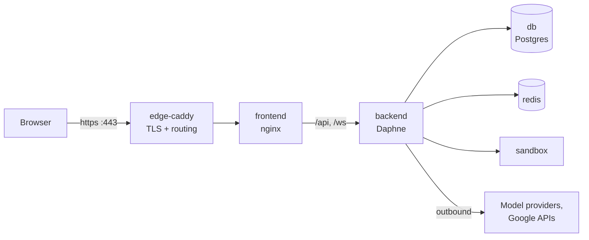

# How AIAAS Is Hosted: Simple Guide

> Containers, proxies, databases and networking, in plain words. For commands and numbers, see [DEPLOYMENT.md](./DEPLOYMENT.md). For live connections (streams, WebSockets, webhooks, schedules), see [REALTIME_AND_PROTOCOLS_SIMPLE_GUIDE.md](./REALTIME_AND_PROTOCOLS_SIMPLE_GUIDE.md).

---

## 1. The Big Picture

Your code does the thinking. The tools around it carry requests, keep state, and keep things apart.

---

## 2. Docker: One Box per Job

- An **image** is a sealed package: code, Python or Node, and settings. A **container** is an image that is running.
- A **compose file** lists the containers that make up the app and how they connect.
- Images are built on a dev machine and pushed to Docker Hub. The server only pulls and runs them.

| File | Builds | Used for |
|---|---|---|
| `Backend/Dockerfile` | backend | Runs `manage.py boot`, then Daphne |
| `better-n8n-frontend/Dockerfile` | frontend | Builds React, serves it with nginx |
| `Backend/sandbox_service/Dockerfile` | sandbox | Runs model-written Python |
| `docker-compose.yml` | none | Local: redis, backend, frontend, sandbox (plus optional worker and beat) |
| `docker-compose.prod.yml` | none | Production: redis, db, sandbox, backend, frontend (and caddy, which the shared VM leaves out, see §5) |

**Volumes** are the parts that survive a restart: `pgdata` (database), `backend_data` (agent checkpoints), `backend_media` (uploads) and `redis_data`. A redeploy replaces containers, not volumes.

Every production container has a memory limit. Sizes are in [DEPLOYMENT.md §5](./DEPLOYMENT.md).

---

## 3. The Server

- Production is one **Google Cloud Compute Engine VM** (`e2-medium`: 2 vCPU, 4 GB RAM). It is a rented computer that stays on.
- It is **shared with another project** (NGU). Memory limits matter here. One unlimited container could starve both apps.
- Only the proxy is reachable from the internet. Everything else is on private Docker networks.

---

## 4. Networking Basics

- **IP address.** A public IP is the VM's street address. A private IP is a container's room number inside Docker. Containers find each other by name (`backend:8000`). The internet cannot reach private IPs.
- **Static IP.** The VM's external IP must be *reserved*. An ephemeral one changes when the VM stops, and then DNS breaks for every app on the box.
- **DNS.** A name-to-number lookup. The `A` record for `aiaas.kaushaljain.com` points at the VM. Check it with `nslookup aiaas.kaushaljain.com`. Do not trust an IP written in a document until you check it.
- **Ports.** Ports are doors. 80 (HTTP) and 443 (HTTPS) are open to the world. The backend (8000), Postgres (5432), Redis (6379) and the sandbox (8100) are internal only. The firewall decides what the internet can reach. Compose decides what the host publishes. Production publishes only the proxy.
- **Firewall.** The GCP firewall allows 80, 443 and SSH. Nothing else.
- **Docker networks.** `aiaas-network` lets the app's containers talk to each other. `sandbox-net` is `internal: true`: it has no route out, so the sandbox cannot reach the internet.
- **Inbound and outbound.** Inbound is traffic from the world to us. Only 80 and 443 accept it. Outbound is our traffic to the world. The backend calls model providers and Google. The sandbox calls nothing.
- **TLS (HTTPS).** Encrypts traffic and proves the server's name with a certificate. `edge-caddy` gets and renews Let's Encrypt certificates by itself, and stores them in a volume. Traffic inside the box is plain HTTP. It never leaves the machine.

---

## 5. The Proxy Chain

A request passes three hops. Each hop must pass streams straight through, or chat tokens arrive in one lump at the end.

1. **edge-caddy** (one per VM, shared with NGU). Terminates HTTPS for `aiaas.kaushaljain.com` and forwards to the frontend. Other hosts, including the bare IP, go to NGU.
2. **nginx** inside the frontend container. Serves the React files. It sends `/api/` to the backend with buffering off. It sends `/ws/` with the WebSocket upgrade. It caches `/assets/` for a year, because file names change with their content. It sends `index.html` with no caching, so a deploy shows at once.
3. **Daphne** inside the backend container. An ASGI server: one process that handles normal HTTP and WebSockets. Django's `runserver` is for development only.

The repo's `Caddyfile` is the config for a dedicated box. On the GCP VM, `edge-caddy` does that job, and the server's compose file has no `caddy` service.

---

## 6. Each Box, and What Breaks if It Stops

| Box | Job | If it stops |
|---|---|---|
| edge-caddy | HTTPS and routing | Nothing on the VM answers, NGU included |
| frontend (nginx) | Files and routing | Blank page. The API still answers. |
| backend (Daphne) | Application logic and streams | Pages load. Chat and runs fail. |
| db (Postgres) | Users, chats, runs, checkpoints | Sign-in and history fail |
| redis | Live channel messages and cache | Live updates freeze. The cache refills. |
| sandbox | Runs `execute_python` | The code tool reports busy. Chat still works. |

---

## 7. Helpers

- **Postgres** (`db`, version 16) is the permanent store. The app and the agent checkpointer each keep a connection pool. Pool sizes and the connection budget are in DEPLOYMENT §5.
- **Redis** does three jobs. It carries live messages between processes (the channel layer, `USE_REDIS_CHANNEL_LAYER`). It is the cache. It is also the Celery broker, but production runs no Celery. Production evicts old cache keys when it reaches its memory cap.
- **Sandbox** is a separate container for code the model wrote. Its root filesystem is read-only. It has no Linux capabilities, a memory cap, a process cap and no network, and it holds no secrets. A runaway program is killed with its whole process group. If the sandbox is busy, the backend gets a retryable "busy" error.
- **Scheduler loop.** Not a container. A loop inside the backend process fires schedules and runs periodic jobs. Only one process holds its lease at a time. See REALTIME §7.

---

## 8. Local and Production

| | Local (`docker-compose.yml`) | Production (the VM) |
|---|---|---|
| Images | Built from your folders | Pulled from Docker Hub |
| Database | SQLite file in a volume | Postgres |
| Entry point | `localhost:3000`, no proxy | `https://aiaas.kaushaljain.com` via edge-caddy |
| Sandbox | Yes | Yes |
| Celery | Optional (`--profile async`) | None |
| `DEBUG` | `True` | `False` |
| CORS | Allow all | Allow-list of the one domain |

---

## 9. Scaling: One Box, on Purpose

- Scale **up** first: a bigger VM, or higher limits in the compose file. Scale **out** only when the bigger box is not enough.
- Adding a second backend breaks four things today:
  - WebSocket connections stick to one process, so the balancer needs sticky sessions.
  - Chat-run subscriptions live in one process's memory. They must move to Redis pub/sub first.
  - The scheduler lease lets one process sweep. It is already safe, because only the lease holder sweeps.
  - The connection budget doubles, so Postgres's `max_connections` must grow.
  - Uploads and checkpoints must move to shared storage. `USE_S3` is off today, so files sit on a volume.
- Serverless (Lambda-style) does not fit. Streams and agent runs last minutes to hours, and checkpoints need a process that stays warm.
- There is no CDN. Static files come from nginx with long cache headers.

---

## 10. Operating It

- **Logs:** `docker compose logs` for each container, and `docker logs edge-caddy` for the proxy. Logs are capped and rotated.
- **Errors:** Sentry, if `SENTRY_DSN` is set. It is off by default.
- **Secrets:** live in `.env` on the VM, never in git. `CREDENTIAL_ENCRYPTION_KEY` is the one to back up. Lose it and stored credentials cannot be decrypted.
- **Backups:** see DEPLOYMENT §7. A dump on the same disk is not a backup.
- **Deploys:** see DEPLOYMENT §3. Nothing is built on the VM.

---

## 11. Remember in 30 Seconds

- **Docker:** a sealed package per job. The server only runs them.
- **Public IP:** the street address. **Private IP:** the room number. **Static:** an address you keep.
- **DNS:** a phone book from name to number.
- **Firewall:** only 80 and 443 are open. Inside Docker, the sandbox has no road out.
- **Proxy chain:** edge-caddy (HTTPS), then nginx (files and routing), then Daphne (the app). Every hop must not buffer streams.
- **One box on purpose.** Scale up before you scale out.
