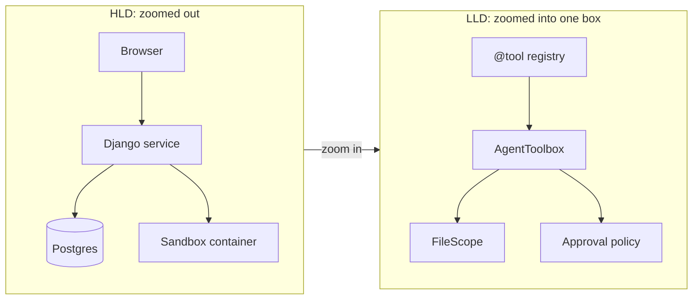
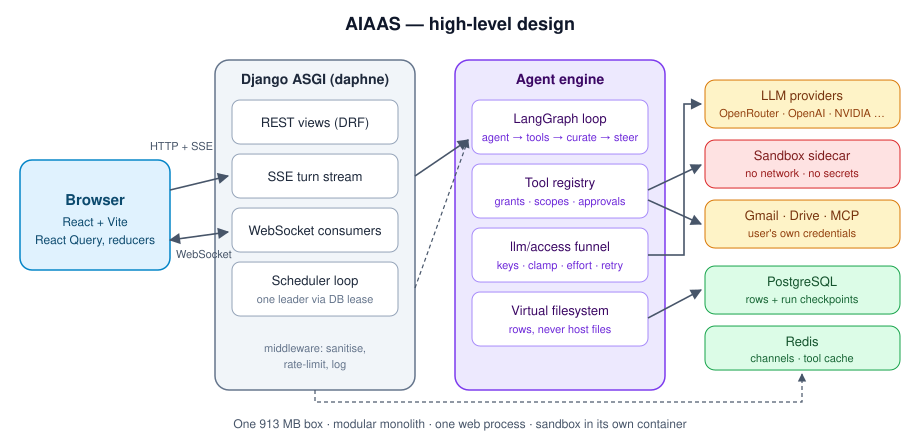
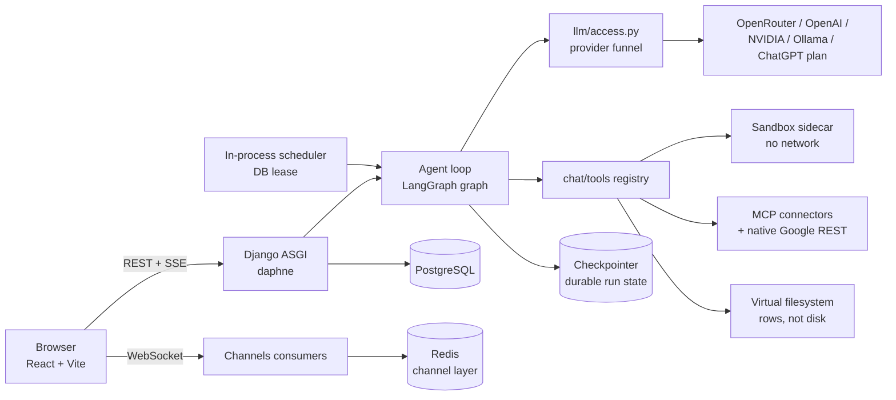
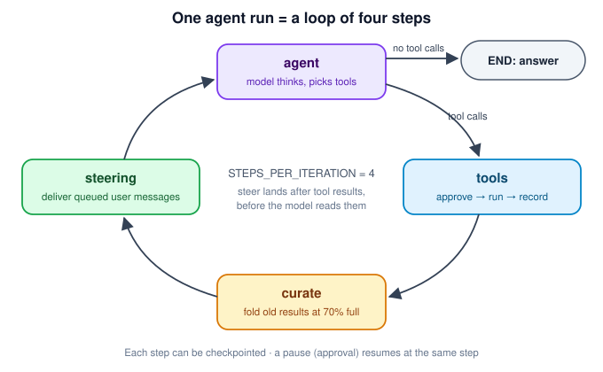
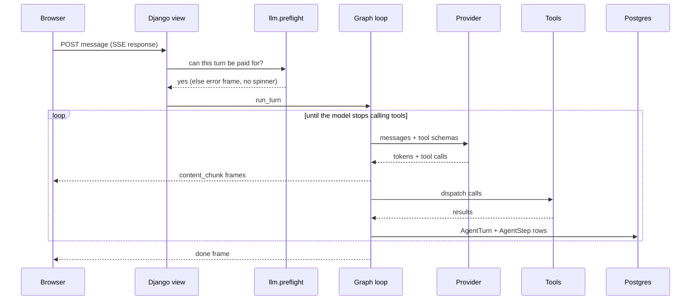
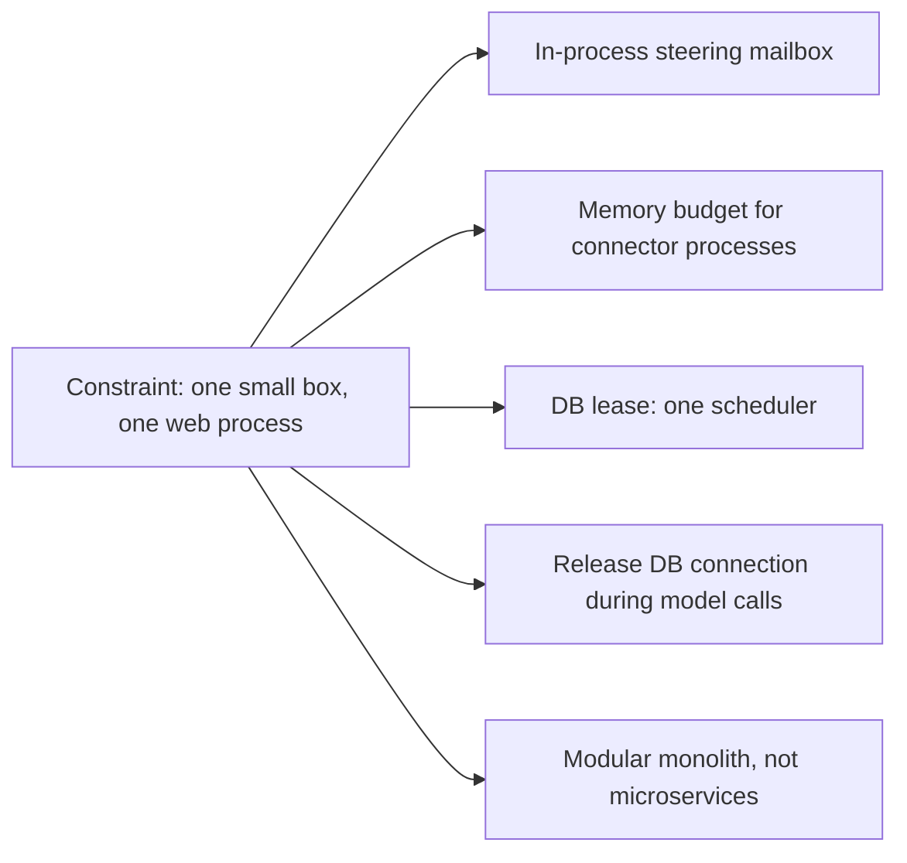
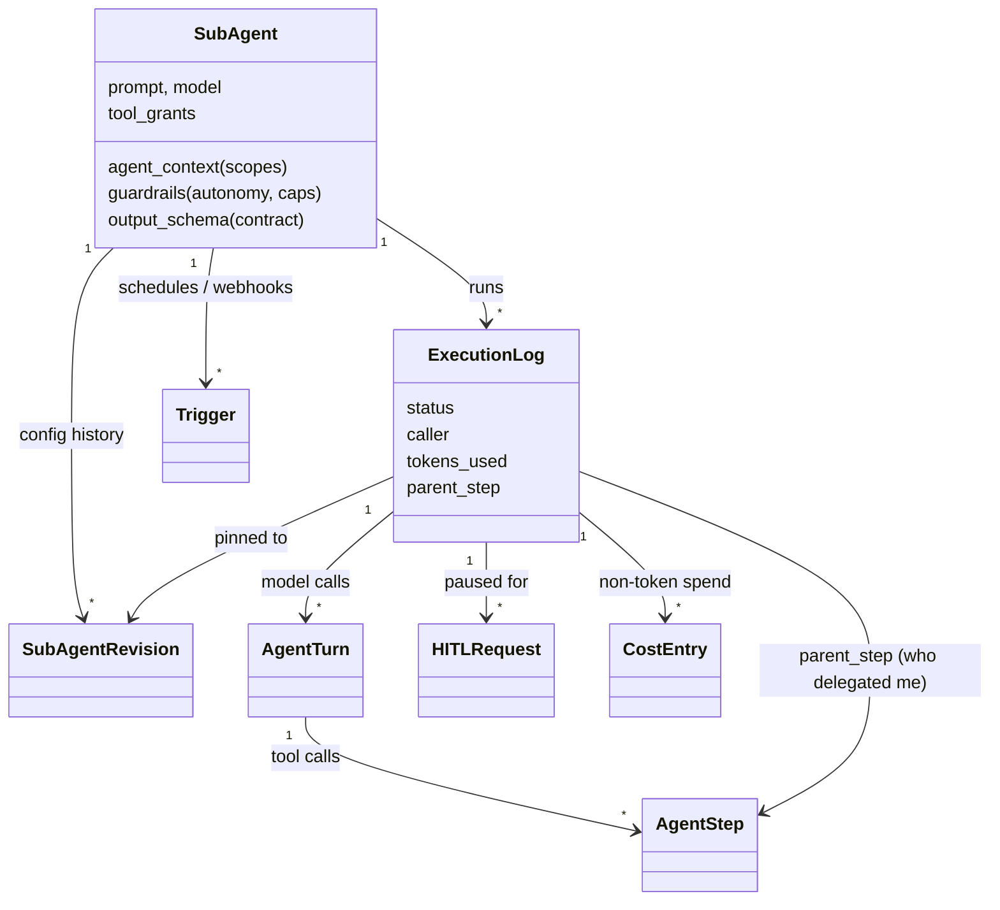
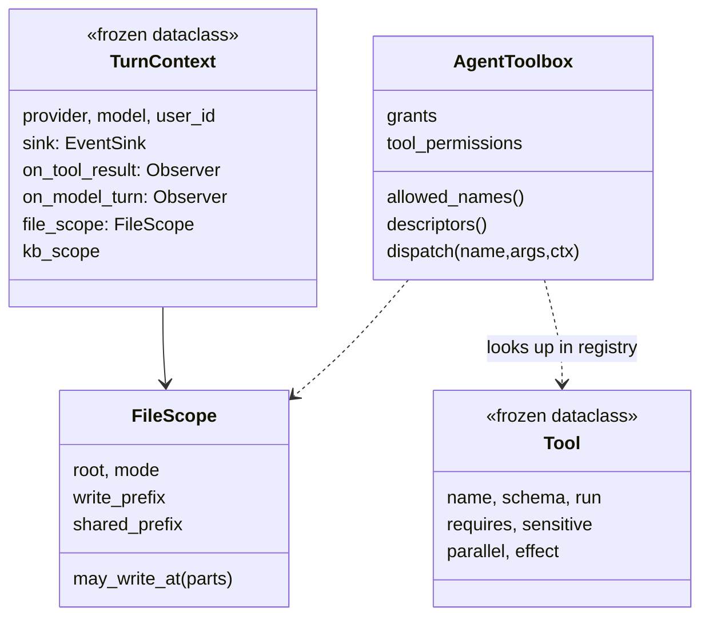
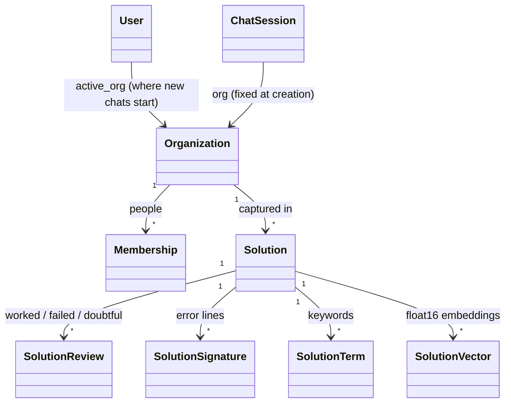

# Part 1 — HLD and the Object Model

> The big boxes, how a request travels, and the classes that carry the design.
> Back to the [index](README.md).

---

## 0. How to use this part

- Read one pattern at a time, with the linked file open beside it. The excerpts
  here are trimmed; the files hold the full reasoning in their comments.
- For each pattern learn three things: the problem it solves, where it lives,
  and what it costs. The cost is what separates someone who memorised patterns
  from someone who used them.
- Each section ends with an **interview line**, written to be said in about 20 seconds.

> **A pattern is an answer to a force.** Name the force first ("tools are added
> often and must never drift from their schema"), then the pattern ("so the
> decorator *is* the registration").

---

## 1. HLD vs LLD

| | High-level design (HLD) | Low-level design (LLD) |
|---|---|---|
| **Question** | What are the big boxes, and how do they talk? | What is inside one box, and how is it shaped? |
| **Units** | Services, databases, queues, caches, networks | Classes, interfaces, functions, data structures, state machines |
| **Decisions** | Sync vs async, where state lives, how it scales, what fails | Which pattern, which class owns what, which invariants hold, how errors travel |
| **Interview** | "Design WhatsApp" | "Design a parking lot / rate limiter / LRU cache" |
| **In AIAAS** | Django ASGI, LangGraph loop, providers; Postgres, Redis, sandbox sidecar | `@tool` registry, `AgentToolbox.dispatch`, `FileScope`, steering mailbox |

HLD decides the constraints; LLD honours them. The HLD fact "one small box,
one web process" drives most LLD choices: in-process mailboxes instead of Redis
queues, a memory budget on connector subprocesses, a database lease so one
scheduler runs, and connections released before long model calls. The reasons
are in [learning/13](../learning/13_async_django_concurrency_bottlenecks.md) and
[learning/16](../learning/16_deploy_downtime_and_background_work.md).

---

## 2. The high-level design

### 2.1 What the product is

A person chats with an **orchestrator** (the chat agent). It reads, plans and
delegates. The work is done by **subagents**: saved configurations of a prompt,
a model, the tools it may use and its limits. Subagents run on demand, on a
schedule or from a webhook. Every run is recorded, can pause for a human's
approval, and can be evaluated.

### 2.2 The boxes

Deployment (the VM, the proxy chain, containers and their limits) is in
[INFRASTRUCTURE_SIMPLE_GUIDE.md](../INFRASTRUCTURE_SIMPLE_GUIDE.md). Which
transport carries what is in
[REALTIME_AND_PROTOCOLS_SIMPLE_GUIDE.md](../REALTIME_AND_PROTOCOLS_SIMPLE_GUIDE.md).

### 2.3 The one data flow to know by heart

1. The browser POSTs a message. The response is a **Server-Sent Events** stream
   (`api/sse.ts` reads it, because `EventSource` cannot POST).
2. `chat/turn/pipeline.py` runs **preflight** first: can this turn be paid for?
   If not, it fails before any "thinking" is shown (see [02 §10.1](02_Backend_LLD_Patterns.md)).
3. The graph runs `agent → tools → curate → steering → agent` until the model
   answers without a tool call.
4. Each node emits events into a sink. The sink writes SSE frames, and the
   frontend reducer folds them into the screen.
5. Each model call becomes an `AgentTurn` row, each tool call an `AgentStep`
   row, all under one `ExecutionLog`.

**Where a chat's earlier turns come from.** From one place only: the database
(`ChatMessage`, windowed and summarised). The checkpointer holds only the
current turn and is cleared at the start of each new chat turn
(`run_turn(fresh_transcript=True)`). An approval resume never clears it, so a
paused run still resumes from its checkpoint. Sending history twice (once from
the database, once from the checkpoint) was a real bug; see
[02 §12](02_Backend_LLD_Patterns.md).

### 2.4 HLD decisions worth defending

| Decision | Why | What it costs |
|---|---|---|
| **Modular monolith** (Django apps as modules) | One box, one deploy; one DB transaction can span modules | Needs import contracts to stop modules tangling ([02 §4.5](02_Backend_LLD_Patterns.md)) |
| **SSE for chat, WebSocket for run events** | SSE is one-way over plain HTTP and easy to resume; WebSocket only where the server pushes unasked | Two transports to maintain |
| **One door for runs** (`start_agent_run`) | Guardrails can only be forgotten in a second door | Every caller fits one signature |
| **Sandbox as a separate container** | A Python breakout lands somewhere with no secrets and no network | An extra hop per `execute_python` |
| **Durable checkpointer as a setting** | Long runs must survive deploys in production; tests want isolation | Three backends to keep compatible |
| **Postgres pool, not PgBouncer** | Django 5.1 pools natively; one less process on a small box | Pool size must stay under `max_connections` |

**Interview line:** "It's a modular monolith on one small box, so most of my
scaling work happened inside the process: bounded pools, admission control on
subprocesses, releasing database connections across slow model calls, and runs
that are durable across a deploy."

---

## 3. The object model

### 3.1 The run record

Why it is shaped like this:

- **A run is a loop of turns, so `AgentTurn` is a row**, not a JSON blob. A
  grouping you must rebuild at read time cannot be queried.
- **`AgentStep` is written before the tool runs.** A tool can start a child run
  (delegation), and the child needs a step id to point at.
- **Delegation points at a step, not a run.** `parent_step.execution` answers
  "which run asked?"; `parent_step.turn.reasoning` answers "what was it thinking?"
- **A run is pinned to a config revision** when it opens, so editing an agent
  mid-run cannot rewrite history.

### 3.2 The agent at runtime

- `TurnContext` is **frozen**. Settings for a turn never change mid-turn.
  Anything that must change mid-run (a steer, an autonomy switch) goes through
  a mailbox ([02 §7.6](02_Backend_LLD_Patterns.md)). Immutability removed a
  whole class of "who changed this?" bugs.
- `AgentToolbox` is the **policy object**: it answers two questions, what to
  *offer* and whether to *allow* a call.
- `Tool` is a **value object**: a frozen record, compared by content.

**Interview line:** "I model *records* as rows so they can be queried, *settings*
as frozen dataclasses so they can't drift mid-run, and *policy* as one object
that owns both the offer and the check."

### 3.3 Organisations and solution memory

Solved problems are saved by one person in an organisation and found again by
the next. The code is the `solutions/` app plus `core.Organization` and `Membership`.

- **A chat belongs to one org for its whole life.** `ChatSession.org` is set at
  creation and cannot be changed through the API, so a person in two
  organisations cannot carry one org's fixes into the other.
- **Sharing is a per-chat switch** (`share_solutions`), starting at the org's
  `share_by_default`.
- **Every read goes through one function**, `solutions/access.py::visible`. A
  test fails if other code filters `Solution.objects` ([02 §8.9](02_Backend_LLD_Patterns.md)).
- **Freshness is not stored.** Each claim has a kind, and whether it is still
  safe to state is computed when it is read ([02 §8.10](02_Backend_LLD_Patterns.md)).
- **Search indexes are small separate tables** (signatures, keyword terms,
  float16 vectors), loaded per scope. One in-memory index per organisation would
  not fit in the backend container.

**Interview line:** "Org isolation isn't a filter each query remembers to add.
There's one read function, the org comes from the chat rather than from a tool
argument, and a test fails if anyone queries the table another way."
