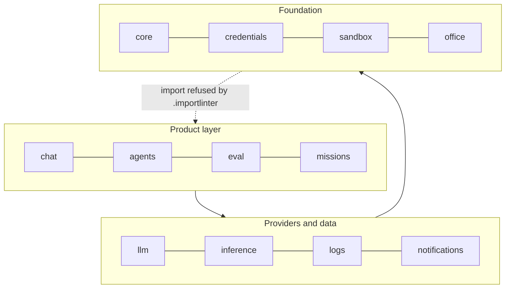
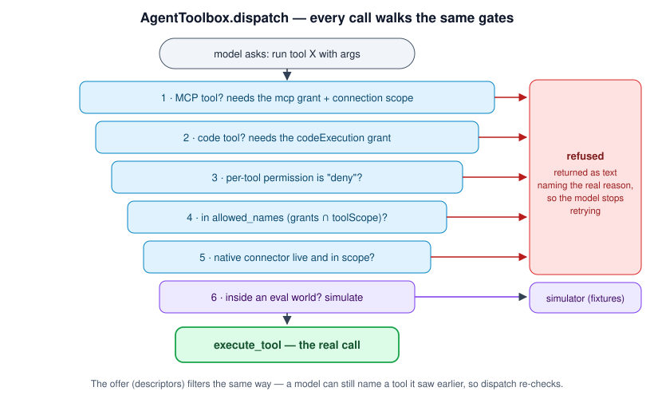
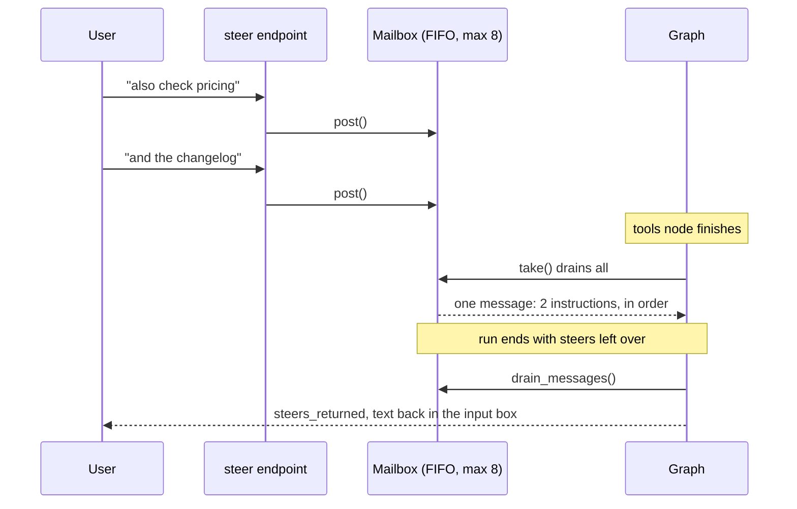
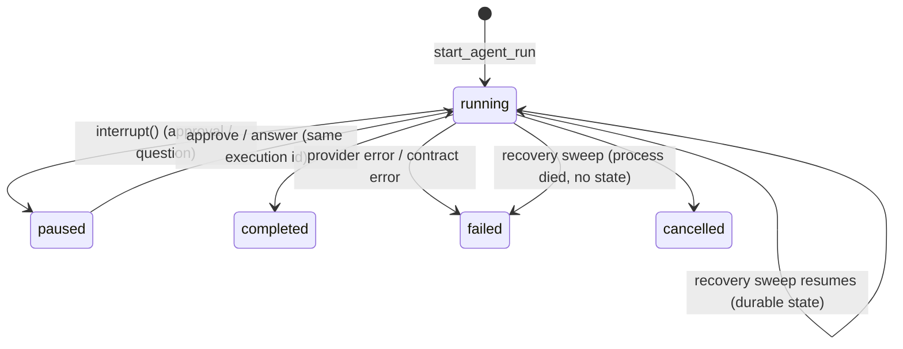
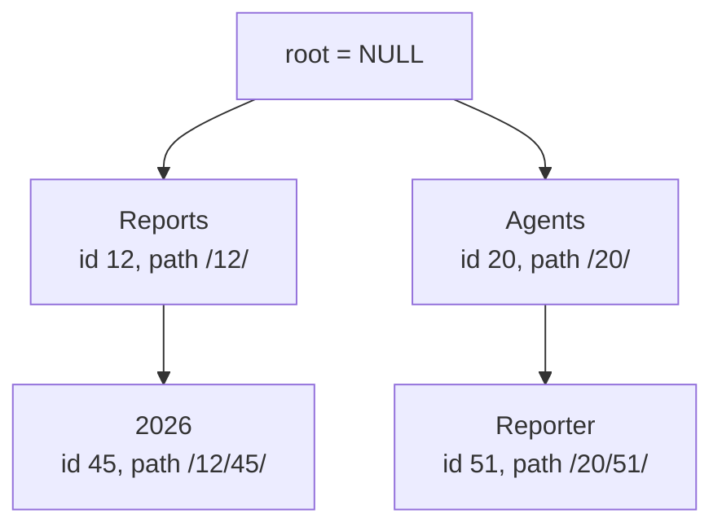
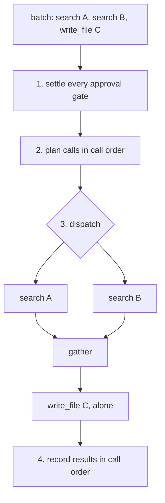
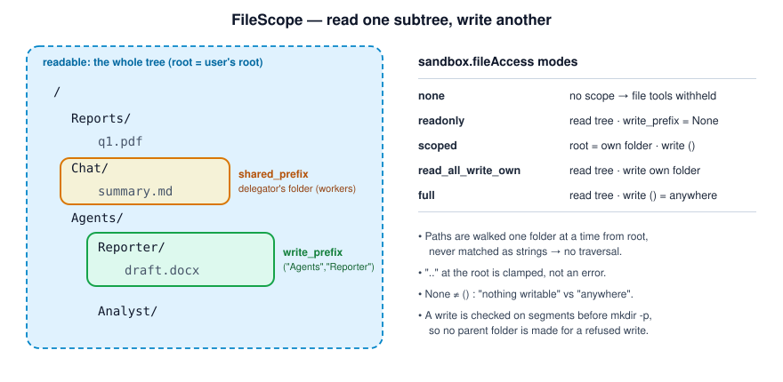
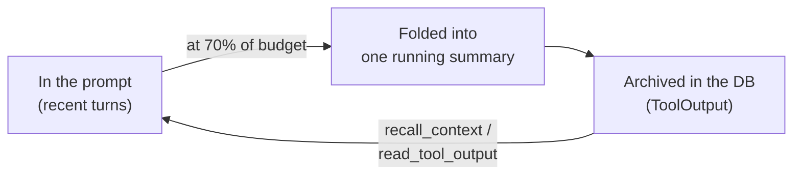
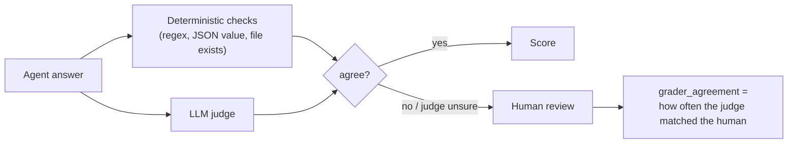
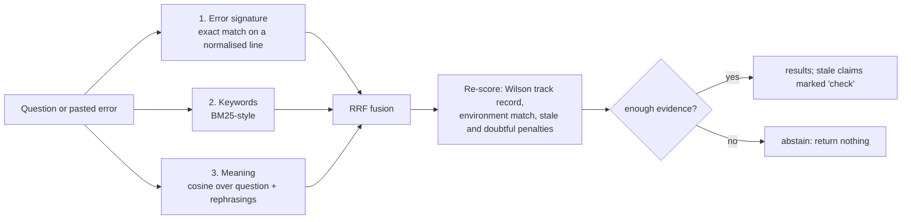

# Part 2 — Backend LLD Patterns (Django / Python)

> The single catalogue of backend patterns: SOLID, the GoF and system patterns,
> the safety rules, the AI-system patterns, and the mistakes this project fixed.
> Each has the force behind it, the real code and what it costs. Back to the
> [index](README.md). Frontend patterns are in [03](03_Frontend_LLD_Patterns.md).

---

## Pattern index

| Pattern | Where in AIAAS | § |
|---|---|---|
| Singleton | `ProviderRegistry`, `CredentialManager` | 5.1 |
| Factory | `checkpoints.build()`, `vfs.build_scope()` | 5.2 |
| Lazy initialisation | `get_graph()` | 5.3 |
| Builder | LangGraph `StateGraph` (`chat/turn/agent.py`) | 5.4 |
| Facade ("one door") | `arun_code`, `llm/access.py`, `eval/api.py`, `start_agent_run` | 6.1 |
| Adapter | provider `reasoning_payload`, eval simulators | 6.2 |
| Decorator / middleware | `@tool`, `HybridMiddleware` | 6.3 |
| Proxy | eval environment inside `AgentToolbox.dispatch` | 6.4 |
| Composite | delegation trees | 6.5 |
| Registry / plugin | tools, graders, contracts, providers, commands | 7.1 |
| Strategy | approval policies, sandbox engines, checkpointers | 7.2 |
| Template Method | `OpenAICompatibleLLMNode` | 7.3 |
| Chain of Responsibility | `AgentToolbox.dispatch` | 7.4 |
| Observer | `EventSink`, `on_tool_result`, `on_model_turn` | 7.5 |
| Command / producer–consumer | steering mailbox, slash commands | 7.6 |
| State machine | run, approval and trigger status | 7.7 |
| Null object, dispatch table, specification | `null_sink`, `_SIDE_EFFECTS`, output `Contract` | 7.8 |
| Soft delete | `LiveManager` | 8.1 |
| Optimistic concurrency (compare-and-swap) | trigger slot claim, `expected_version` | 8.2 |
| Lease | `SchedulerLease` | 8.3 |
| Snapshot / versioning | `SubAgentRevision`, `DocumentVersion` | 8.4 |
| Materialised path | `Folder.path` | 8.5 |
| Multi-tier cache with a floor | MCP tool catalogue | 8.6 |
| Idempotency | HITL open, pack install | 8.7 |
| Ledger | `CostEntry` | 8.8 |
| Choke point | `solutions/access.py::visible`, `filesystem.resolve_folder` | 8.9 |
| Derived state | solution freshness | 8.10 |
| Fair selection under a budget | memory categories | 8.11 |
| Detached task | `spawn()`, `run_in_thread()` | 9.1, 9.7 |
| Plan, gather, then act in order | `tools_node` | 9.2 |
| Admission control | `ConnectorSupervisor` | 9.3 |
| Bounded LRU pool | MCP session pool | 9.4 |
| Retry only what is safe | `stream_execute` | 9.5 |
| Safety principles, FileScope | `FileScope`, dispatch gates | 10.1–10.2 |
| Context tiers, LLM judge, guardrail layers, rank fusion, abstention | AI-system patterns | 10.3–10.9 |

---

## 4. SOLID

### 4.1 S — Single responsibility

"A module should have one reason to change."

- `agents/grants.py` holds only the permissions vocabulary (`GRANT_TOOLS`,
  `AUTONOMY_LADDER`, `CALLERS`). It used to sit inside the 2,700-line runtime,
  so reading a table meant importing the whole engine.
- `logs/costs.py::record` is the only writer of `CostEntry`. One writer means one
  place to get rounding and "unpriced is estimated, never free" right.
- The chat page's drawing is split into props-only pieces (`ChatHeader`,
  `ChatMessageItem`, `ToolApprovalCard`). State lives in one owner.

### 4.2 O — Open/closed

Adding a tool, grader, contract, provider or slash command means **adding** a
declaration. No central `if/elif` is edited. Test: *could two people add two
tools on the same day without a merge conflict?* Here, yes.

### 4.3 L — Liskov substitution

- Every provider handler is a `BaseNodeHandler`, and `llm/access.py` calls
  `execute()` / `stream_execute()` without knowing which one it got.
- `stream_execute` has a default that calls `execute()` and yields the result as
  one chunk, so a provider that cannot stream still satisfies the contract.
- Both sandbox engines return the same result envelope (`success`, `output`,
  `stderr`, `timed_out`), so the caller cannot tell them apart.

### 4.4 I — Interface segregation

- The event sink is a one-method `Protocol` (`chat/turn/events.py`). A node that
  emits events needs nothing else.
- `BaseNodeHandler` was trimmed of canvas fields (`icon`, `inputs`, `get_schema()`)
  once the canvas was removed. A fat base class forces every subclass to pretend.

### 4.5 D — Dependency inversion



- **The eval environment is duck-typed.** `agents/` must not import `eval/`, so
  the runtime accepts any object with `simulates(name)` and `run_simulated(...)`,
  and `eval` passes one in. The policy owns the interface; the detail plugs into it.
- **Import contracts enforce the direction.** `Backend/.importlinter` states the
  layers, and `workflow_backend/tests/test_import_contracts.py` fails CI on a
  wrong-way import. Only direct imports are checked, and tests are exempt.

**Interview line:** "The agent runtime can't import eval, so eval hands the
runtime an object that matches a small interface the runtime defines. A test
enforces the direction."

---

## 5. Creational patterns

### 5.1 Singleton — `ProviderRegistry`

```python
class ProviderRegistry:
    _instance: 'ProviderRegistry | None' = None
    _handlers: dict[str, Type[BaseNodeHandler]] = {}   # slug -> CLASS

    def __new__(cls):
        if cls._instance is None:
            cls._instance = super().__new__(cls)
        return cls._instance
```

[`llm/handlers/registry.py`](../Backend/llm/handlers/registry.py)

- **Force:** every model call needs "slug → handler class", and building that map
  twice is waste.
- **Subtlety:** it stores *classes*, and `get_handler()` returns a *new instance*
  per call. The registry is shared; the handlers are not, so no request state leaks.
- **Cost:** a singleton is global state. `CredentialManager`'s cache is keyed by
  `{user_id}:{credential_id}`, and test databases restart ids at 1, so entries
  leaked between tests until `setUp` cleared the cache. In Python a module-level
  object is usually simpler than `__new__` tricks.

### 5.2 Factory — `checkpoints.build()`

[`chat/turn/checkpoints.py`](../Backend/chat/turn/checkpoints.py) picks the run-state
saver from `AGENT_CHECKPOINTER` (`memory | sqlite | postgres`). The factory has
**different failure rules per environment**:

- SQLite (dev) degrades to memory and says so.
- Postgres (production) raises at startup. A durability that silently is not
  there is worse than never claiming it.

Other factories: `vfs.build_scope(user, file_access)` turns a mode string into a
`FileScope`; `get_registry()` registers providers lazily.

### 5.3 Lazy initialisation — `get_graph()`

```python
_graph = None

def get_graph():
    global _graph
    if _graph is None:
        _graph = _build_graph()        # needs a running event loop for the durable saver
    return _graph

def __getattr__(name):                 # PEP 562: old imports keep working
    if name == "chat_agent_graph":
        return get_graph()
    raise AttributeError(name)
```

- **Force:** the durable saver's constructor needs a running event loop, and
  there is none at import time. An eagerly built graph could only ever get the
  in-memory saver, silently.
- **Lesson:** *when* an object is built can be a correctness question, not only a
  speed one.

### 5.4 Builder — the agent graph

```python
graph = StateGraph(AgentState)
graph.add_node("agent", agent_node)
graph.add_node("tools", tools_node)
graph.add_node("steering", steering_node)
graph.add_node("curate", curate_node)
graph.set_entry_point("agent")
graph.add_conditional_edges("agent", _next_step, {"tools": "tools", END: END})
graph.add_edge("tools", "curate")
graph.add_edge("curate", "steering")
graph.add_edge("steering", "agent")
return graph.compile(checkpointer=checkpoints.build())
```

The **order of edges is a design decision**. The steer lands after tool results
and before the model reads them, the only point where a new user message cannot
split an assistant turn from its tool replies.

---

## 6. Structural patterns

### 6.1 Facade — "one door"

| Facade | Hides |
|---|---|
| [`sandbox/engine.py::arun_code`](../Backend/sandbox/engine.py) | Two engines, HTTP to the sidecar, threads, file transfer |
| `llm/access.py` | Credential lookup, platform-key fallback, context clamping, effort snapping, streaming |
| `eval/api.py` | Graders, sweeps, supervision. The only thing other apps may import from `eval` |
| `agents/agent/runtime.py::start_agent_run` | Every way a run can start |

```python
async def arun_code(code, *, files=None, collect=()):
    if _engine() == "service":
        return await run_via_service(code, files=files, collect=collect)
    outcome = await sync_to_async(get_sandbox().execute,
                                  thread_sensitive=False)(code, files=files, collect=collect)
    outcome.setdefault("timed_out", False)
    return outcome
```

**Why it matters:** every check behind the door applies to every caller. A second
door is a second place to forget a guardrail. The old DAG product ended up with
three ways to start work, each slightly different.

### 6.2 Adapter — five providers, one vocabulary

Every provider spells reasoning effort differently: OpenAI takes
`reasoning_effort: "high"`, OpenRouter takes `reasoning: {effort: "high"}`,
Ollama takes `think`. The adapters hide that.

```python
def reasoning_payload(self, effort) -> dict:
    level = effort_levels.normalize(effort)
    if level is None or not self.effort_field:
        return {}                          # no effort control: send nothing
    if level == "none":
        level = "minimal"                  # OpenAI has no "none"
    return {self.effort_field: level}
```

[`llm/handlers/openai_compatible.py`](../Backend/llm/handlers/openai_compatible.py)

- **The hook returns a fragment to merge, not a value to assign**, because the
  providers disagree about shape, not just the field name. `OpenRouterNode`
  overrides this one method.
- **Eval simulators** (`eval/sim/`) are adapters too: they return results in the
  real tools' shapes, field for field, and a test fails if a real tool gains no simulator.

### 6.3 Decorator — two meanings

- **Python decorator as registration.** `@tool(schema, ...)` returns the function
  *unchanged* and records it ([§7.1](#71-registry--plugin--the-declaration-is-the-schema)).
  Unchanged on purpose: the function stays callable and testable with no wrapper.
- **Middleware as a decorator chain.** Each middleware wraps `get_response`.
  `HybridMiddleware` ([`core/http/middleware.py`](../Backend/core/http/middleware.py))
  lets subclasses override only the `process_request` / `process_response` hooks
  (also a Template Method). It runs inline in sync and async modes, because the old
  sync middleware made Django hop threads on every request.

### 6.4 Proxy — the eval environment

`AgentToolbox.dispatch` checks every real rule **first**, then asks the
environment whether to simulate:

```python
if self.environment is not None and self.environment.simulates(name):
    return await self.environment.run_simulated(name, args, context)
return await execute_tool(name, args, context)
```

The order is the design. The first version simulated *before* the checks, so a
"read-only Gmail" agent could send mail in its own eval: the eval was testing a
stronger agent than the real one.

### 6.5 Composite — delegation trees

An orchestrator run delegates to worker runs, which are runs themselves, so runs
form a tree through `parent_step`. Limits compose down the tree: depth
(`MAX_DELEGATION_DEPTH` = 2), budget (split up front), write paths and command
scopes (intersected, most restrictive wins). The rule: **a child can never have
more than its parent.**

---

## 7. Behavioural patterns

### 7.1 Registry / plugin — "the declaration is the schema"

The most repeated pattern in the codebase, and the one to lead with in an interview.

```python
@dataclass(frozen=True, slots=True)
class Tool:
    name: str
    schema: dict
    run: ToolFunc
    requires: Requirement | None = None
    sensitive: bool = False
    parallel: bool = False                  # safe default
    effect: Effect = "irreversible"         # worst-case default
    connector: str | None = None

_REGISTRY: dict[str, Tool] = {}

def tool(schema, *, requires=None, sensitive=False, parallel=False,
         effect="irreversible", connector=None):
    name = schema["function"]["name"]
    def register(func):
        if name in _REGISTRY:
            raise RuntimeError(f"Tool {name!r} is registered twice")
        _REGISTRY[name] = Tool(name, schema, func, requires, sensitive,
                               parallel, effect, connector)
        return func
    return register

@tool(WEB_SEARCH_SCHEMA, parallel=True, effect="read")
async def web_search(args, context) -> str: ...
```

[`chat/tools/registry.py`](../Backend/chat/tools/registry.py)

**The problem it replaced:** a tool lived in three places (a schema list, the
implementation, a dispatch dict). A schema without a dispatch entry advertised a
tool that answered "not recognized". Now the advertised object *is* the dispatched
object.

| Registry | File | Key |
|---|---|---|
| Tools | `chat/tools/registry.py` | tool name |
| Graders | `eval/graders.py` | grader name |
| Output contracts | `agents/contracts.py` | contract name |
| LLM providers | `llm/handlers/registry.py` | provider slug |
| Slash commands | `chat/commands/registry.py` | command name |

Production details: duplicate names fail at import, not at run time; metadata
(`requires`, `effect`, `parallel`) lives on the declaration so filters read a
field instead of matching names in a distant list; derived views are functions
(`sensitive_names()`, `parallel_names()`), never second lists kept by hand.

**Interview line:** "Registration *is* the schema. Adding a tool is one decorator,
an advertised tool is dispatchable because it's the same object, and the defaults
are the safe ones, because MCP tools minted at runtime can never carry a declaration."

### 7.2 Strategy — choose the algorithm by configuration

```python
# Same signature for all three: (name, args, context) -> should_pause
async def default_policy(name, args, context) -> bool: ...     # chat: gate credentialed writes
async def unattended_policy(name, args, context) -> bool: ...  # no one watching: gate all credentialed calls
async def never(name, args, context) -> bool: return False     # plan / full

def approval_policy_for(autonomy: str):
    if autonomy in ('full', 'plan'):
        return permissions.never
    if autonomy == 'auto':
        return permissions.default_policy
    return permissions.unattended_policy        # review, ask
```

[`agents/agent/runtime.py`](../Backend/agents/agent/runtime.py) and
[`chat/tools/permissions.py`](../Backend/chat/tools/permissions.py)

In Python a strategy is often just a function. More strategies here: the sandbox
engine (`SANDBOX_ENGINE`), the checkpointer (`AGENT_CHECKPOINTER`), the browser
engine (`BROWSER_ENGINE`, where `none` means the tools are not offered at all),
and a trigger's overlap policy.

**A rule this code follows:** *no automatic fallback between strategies where
safety differs.* If the sidecar is down, the run fails rather than quietly running
on the weaker in-process engine.

### 7.3 Template Method — the provider base class

```python
class OpenAICompatibleLLMNode(BaseNodeHandler):
    # per-provider declaration
    provider_slug = ""
    base_url = ""
    default_model = ""
    effort_field: str | None = "reasoning_effort"

    # overridable hooks
    def auth_headers(self, api_key): ...
    def chat_payload(self, *, model, messages, config, stream): ...
    def reasoning_payload(self, effort): ...

    # the fixed algorithm
    async def execute(self, input_data, config, context): ...
    async def stream_execute(self, input_data, config, context): ...

class OpenAINode(OpenAICompatibleLLMNode):
    node_type = "openai"
    base_url = "https://api.openai.com/v1"
```

Four of the five providers share the HTTP, retry, streaming and parsing code, so
a provider that speaks the OpenAI protocol is about 15 lines. The Responses API
(the ChatGPT plan) subclasses the same base through `ResponsesAPINode`.

**Template Method vs Strategy:** Template Method varies *steps* through
inheritance; Strategy swaps the *whole algorithm* through composition. Providers
share 90% of the algorithm, so inheritance fits. Approval policies share nothing,
so plain functions fit.

### 7.4 Chain of Responsibility — the dispatch gauntlet



```python
async def dispatch(self, name, args, context) -> str:
    if is_mcp_tool(name):
        if not self.mcp_allowed:                 return _denied(name, 'MCP tools')
        allowed, refusal = self.mcp_call_allowed(name)
        if not allowed:                          return _denied(name, refusal)
        return await MCPToolProvider.execute(name, args, self.user_id)
    if name in CODE_TOOLS and not self.grants.get('codeExecution'):
        return _denied(name, 'code execution')
    if self.tool_permissions.get(name) == 'deny':
        return "Error: ... its per-tool permission is 'deny'. Do not try it again ..."
    if name not in self.allowed_names:           return _denied(name, name)
    permitted, refusal = await self.native_call_allowed(name)
    if not permitted:                            return _denied(name, refusal)
    if self.environment and self.environment.simulates(name):
        return await self.environment.run_simulated(name, args, context)
    return await execute_tool(name, args, context)
```

[`agents/agent/runtime.py`](../Backend/agents/agent/runtime.py)

- **Refusals are returned as text, not raised.** The caller is a model. A model
  told *why* stops; a model told only "denied" retries until the iteration cap.
- **Each refusal names the real reason.** If the grant is held but the tool is
  denied per-tool, "not granted" would send the owner to flip a switch that does nothing.

The middleware stack is the other chain in the project ([§6.3](#63-decorator--two-meanings)).

### 7.5 Observer — hooks and event sinks

- **`TurnContext.on_tool_result` / `on_model_turn`**: agent runs pass observers
  that write `AgentStep` and `AgentTurn` rows. Chat passes `None`. The loop never
  imports the logging code.
- **`EventSink`**: every node emits `(event, payload)`. Chat's sink writes SSE
  frames, a test's sink appends to a list, and the default is `null_sink`.
- **Django signals** (`post_delete` recounts a knowledge base) and the **channel
  layer** (run events published to a group) are the same pattern at framework level.

The rule the code states twice: **an observer must not raise.** A failure to
record must never fail the thing being recorded.

```python
try:
    await handler(parsed, args, meta, sink)
except Exception:
    # A UI side effect must never fail the turn: the model already has the result.
    logger.exception("[Tools] Side effect for %s failed", name)
```

### 7.6 Command + producer/consumer — the steering mailbox

A user can type while an agent works. That message is a **command object**
dropped in a **queue**, consumed at a safe point.



[`chat/turn/steering.py`](../Backend/chat/turn/steering.py)

```python
def post(key, message) -> bool:
    slot.messages.append(message)
    while len(slot.messages) > MAX_QUEUED_STEERS:
        slot.messages.popleft()          # drop OLDEST: the user waits on the newest
        slot.dropped += 1                # count it, so the UI can say so
    return True

def take(key) -> str:
    items = list(slot.messages); slot.messages.clear()
    if len(items) == 1:
        return items[0]
    return f'{len(items)} messages arrived while you were working. Take them together, in order:\n' + numbered(items)
```

- **It was a single slot (last write wins), then became a FIFO.** People steer
  additively ("also check pricing", then "and the changelog"). Last-write-wins
  silently turned three instructions into one while reporting success for all three.
- **Bounded, drop-oldest.** An unbounded queue is a memory leak with extra steps.
- **Drain all into one message.** The graph expects exactly one trailing human
  message; returning three would leave two unread but still billed.
- **Two kinds of data, two lifetimes.** A steer is consumed once. An autonomy mode
  is standing state and is not drained; mixing them would make "stop asking me"
  expire after one tool call.
- **Nothing is lost at the end.** Leftovers return to the client.

Slash commands (`chat/commands/`) are the other Command pattern: `{name, args,
text}` objects, validated by the backend and stored on the message so
"regenerate" can replay them.

### 7.7 State machine — runs, approvals, triggers

Anything with a `status` column is a state machine. Draw it before coding it.



Rules the code enforces:

- **Transitions are guarded by a conditional UPDATE.** A HITL row is answered only
  `WHERE status='pending'`. That one filter stops the Inbox and a WebSocket from
  both answering the same question.
- **Resume on the original id.** A trace split across two ids cannot be joined.
- **Paused keeps its checkpoint; terminal states drop it** (`forget_thread`).
- **A transient failure is `failed`, not `completed`.** A run whose "answer" was an
  upstream error message was once recorded as a success.
- **Recovery is its own sweep.** [learning/16](../learning/16_deploy_downtime_and_background_work.md)
  covers what a restart does to runs.

### 7.8 Small patterns

- **Dispatch table instead of `if/elif`.** `_SIDE_EFFECTS = {"web_search":
  _on_web_search, "write_file": _on_file, ...}` in `chat/turn/agent.py`. A dict of
  functions is the lightweight Strategy/Command when each branch is independent.
- **Null object.** `null_sink` does nothing. `TurnContext.sink` defaults to it, so
  node code never checks `if sink:`.
- **Specification / contract.** Agents can return a named output contract
  (`research`, `files`, `findings`) from `agents/contracts.py`:

  ```python
  def coerce(answer: str, contract: Contract) -> dict:
      payload = json.loads(_strip_fence(answer))     # prose -> ContractError
      if contract.repair: payload = contract.repair(payload)
      missing = [k for k in contract.required if k not in payload]
      if missing: raise ContractError(...)
  ```

  The registry is **closed on purpose**: the UI can only render shapes it has a
  panel for. And it **fails rather than wraps**: silently wrapping prose in
  `{"text": ...}` would make every agent "satisfy" every contract.

---

## 8. Data and persistence patterns

### 8.1 Soft delete through the default manager

```python
class LiveManager(models.Manager):
    def get_queryset(self):
        return super().get_queryset().filter(deleted_at__isnull=True)

class Document(models.Model):
    objects = LiveManager()          # declared first -> the default manager
```

[`inference/models.py`](../Backend/inference/models.py)

- **Force:** trash must disappear from *every* listing, including ones written
  next year by someone who never heard of trash.
- **Why not a "Trash" folder:** every query would have to remember to exclude one
  magic id, and forgetting would be silent. A default manager cannot be forgotten.
- **Costs:** `post_delete` does not fire on a soft delete, so the trash path calls
  `recount_kb` itself. `_base_manager` must stay unfiltered so restore and purge
  can still reach the rows.

### 8.2 Optimistic concurrency — claim with a conditional UPDATE

```python
claimed = Trigger.objects.filter(
    id=trigger.id,
    next_due_at=trigger.next_due_at,        # "...if it's still what I read"
).update(next_due_at=new_next)
if not claimed:
    return 'busy'                           # someone else took this slot
```

[`agents/sweep.py`](../Backend/agents/sweep.py) (`prepare`)

Two schedulers must never fire the same slot. No lock is held; the UPDATE succeeds
only if nobody changed the row since it was read. Rowcount zero means you lost the
race. The same idea appears in `expected_version` on file writes, the stale-write
guard on code edits (`ws_read` records a sha256; `ws_edit` refuses if it changed),
and claim-then-send for reminders.

**Interview line:** "It's a compare-and-swap in SQL: `UPDATE ... WHERE id=? AND
version=?`. A rowcount of zero means you lost. It holds no lock, so it can't deadlock."

### 8.3 Leases — leader election on a row

```python
def try_acquire(now=None) -> bool:
    SchedulerLease.objects.get_or_create(name=LEASE_NAME, defaults={...})
    return SchedulerLease.objects.filter(name=LEASE_NAME).filter(
        Q(holder=HOLDER) | Q(expires_at__lt=now)     # mine, or expired
    ).update(
        holder=HOLDER,
        expires_at=now + timedelta(seconds=LEASE_SECONDS),
        beat_at=now,
    ) == 1
```

[`agents/scheduler.py`](../Backend/agents/scheduler.py)

- One atomic UPDATE takes or renews the lease. If the holder dies, the lease
  expires and another process takes it. `HOLDER` is unique per process.
- **Why not Redis locks or ZooKeeper?** The database is already there and already
  consistent. Fewer moving parts on a small box.
- `CodeLease` applies the same idea to file paths: overlap is refused, naming the holder.

### 8.4 Snapshot and versioning

- `SubAgentRevision` snapshots the agent config when it changes. **An empty diff
  records nothing**, because the builder PATCHes constantly.
- A run is pinned to the revision it started with (`ExecutionLog.revision`).
- `DocumentVersion` keeps what each overwrite replaced (coalesced per 5 minutes, last 25).
- A published agent is a **snapshot, not a pointer**. A live pointer would let the
  author widen the permissions of something other people already installed.

### 8.5 Materialised path for trees



- `Folder.path` stores **ids**, not names. Rename is O(1).
- "Is B inside A?" is `b.path.startswith(a.path)`, with no query. That is the cycle check for moves.
- A subtree is one indexed prefix query.
- Root is `NULL`, not a row, so the most-used location cannot be forged and old
  documents were placed correctly the moment the column appeared.

### 8.6 Multi-tier cache with a floor

MCP tool lists: **Redis → database → live handshake.**

- The database row is always reported *stale*, so the caller refreshes behind it.
- Invalidation drops both tiers. The floor survives cache loss, never an edit.
- **Never cache an empty answer.** Every failure path returns `[]`, and caching it
  would record "timed out" as "has no tools".
- Negative caching where it is right: a failed connector start is remembered for
  60 s; an "over budget" refusal for 10 s, because "not right now" is a different
  claim from "broken".

### 8.7 Idempotency

- Opening a HITL request is idempotent on `(execution, call_id)`, because
  `interrupt()` re-runs the node. Two rows would mean two reminder ladders for one question.
- Installing a pack is idempotent via `SubAgent.template_slug`.
- The Auto judge caches its verdict per `(session, call_id)`, so a resumed node
  does not judge the same call twice and answer differently.

### 8.8 Ledger

`CostEntry` rows are append-only; spend is a **sum**, never a mutable counter. Easy
to audit and safe under concurrency. Watch for double counting: images are excluded
from the ledger total because they already ride in `ExecutionLog.cost_usd`.

### 8.9 Choke point: one read door, enforced by a test

```python
def visible(user_id, org_id, *, include_inactive=False) -> QuerySet:
    if not user_id:
        return Solution.objects.none()
    if org_id:
        rule = Q(author_id=user_id, shared=False, org_id=org_id)   # my private rows from this org
        if is_member(user_id, org_id):                             # checked live, every call
            rule |= Q(org_id=org_id, shared=True)                  # the org's shared rows
        else:
            return Solution.objects.none()                         # left the org: nothing
    else:
        rule = Q(author_id=user_id, shared=False, org__isnull=True) # personal chat
    return Solution.objects.filter(rule)
```

[`solutions/access.py`](../Backend/solutions/access.py)

- **Force:** org isolation is a security boundary, and "every query remembers to add
  the org filter" fails the first time someone forgets.
- **Pattern:** a *choke point*. Every reader (tools, API, search, the capture job)
  starts from `visible()`, and `test_isolation.py::ChokePointTests` fails if
  `Solution.objects` is filtered anywhere else. The folder tree uses the same idea
  (`filesystem.resolve_folder`, with its own test).
- **The org comes from the chat, never from a tool argument.** The tools read it
  from the turn's context. A model cannot ask for another org's data because there
  is no parameter to ask with.
- **Foreign and unknown ids look the same** (both 404). A 403 would be an ownership oracle.

### 8.10 Derived state: compute it when you read it

A saved fix has claims that go stale at different speeds. "Restart the worker after
changing the env file" stays true; "the VPN portal is at 10.2.0.4" might not. Each
claim has a kind, and each kind has a shelf life:

| Kind | Safe to state without re-checking for |
|---|---|
| `principle` | ever |
| `procedure` | 365 days |
| `versioned` | 180 days, or never if the environment differs from the one it was solved on |
| `config` | 90 days |
| `time_sensitive` | 30 days |
| `ephemeral` | never saved |

```python
def claim_state(kind, as_of, *, now=None, env_mismatch=False) -> str:
    now = now or timezone.now()
    days = KINDS.get(clean_kind(kind))
    if kind == 'versioned' and env_mismatch:
        return 'check'                      # the version is the thing that moved
    if days is None:
        return 'fresh'
    return 'fresh' if now - as_of <= timedelta(days=days) else 'check'
```

[`solutions/freshness.py`](../Backend/solutions/freshness.py)

- **Force:** "is this still true?" depends on today's date. A stored `is_stale`
  column would need a nightly job and would be wrong between runs.
- **Pattern:** *derived state*. Store the facts (`kind`, `valid_as_of`) and compute
  the label on every read. Confirming a fix just moves `valid_as_of`.
- **Label, don't hide.** A stale claim is shown as `check`, and the prompt obliges
  the model to re-verify it or say it may have changed.

### 8.11 Fair selection under a budget

[`core/memory.py::_select`](../Backend/core/memory.py)

User memory is short facts grouped by category, and only 2,000 characters fit in
the prompt. The old code sorted categories alphabetically and filled until full, so
"anything else" used the space before "who they are" was reached.

- **Round-robin** in priority order (`profile, preference, project, context`), one
  fact per category per round, newest first within a category. A busy category
  cannot crowd another out.
- **Skip, don't stop.** A fact that does not fit is skipped, because a shorter one
  behind it may still fit.
- **One selection, two readers.** The prompt and the Memory tab call the same
  function, so the tab can mark the facts the model is *not* shown (`in_prompt: false`).
- **Duplicates match after normalising** (case, spacing, end punctuation).
- **Eviction is by least recently saved**, not used. Tracking reads would cost a
  database write on every turn.

**Interview line:** "When several groups share a fixed budget, fill it round-robin
in priority order and skip what doesn't fit, rather than filling in sort order
until it runs out."

---

## 9. Concurrency patterns

The reasons behind these rules (the connection pool held across waits, thread
executors, the event loop) are in [learning/13](../learning/13_async_django_concurrency_bottlenecks.md).

### 9.1 Detached tasks with their own context

```python
def spawn(coro, *, name=None):
    loop = asyncio.get_running_loop()
    return loop.create_task(_detached(coro), name=name,
                            context=contextvars.Context())   # fresh context

async def _detached(coro):
    async with ThreadSensitiveContext():                     # own executor
        try:
            return await coro
        finally:
            await sync_to_async(close_old_connections)()     # give the DB back
```

[`workflow_backend/background.py`](../Backend/workflow_backend/background.py)

- **The bug it fixes:** `create_task` copies the request's context, including a
  thread executor that dies when the response is sent. The first ORM call afterwards
  raised `CurrentThreadExecutor already quit`.
- **Lesson:** a background task's lifetime must not borrow anything from a
  shorter-lived owner. Any work that outlives its response uses `spawn()`.

### 9.2 Plan, gather, then act in order



Tool calls in one model turn are independent: the model issued them all before
seeing any result. So `tools_node` runs in four passes (`_settle_gates`,
`_plan_calls`, `_dispatch_calls`, `_record_results`):

- **Approvals first.** `interrupt()` re-runs the node. Dispatching the safe half,
  pausing on the sensitive half and resuming would dispatch the safe half *again*.
  Graph state rolls back; the outside world does not.
- **Parallel is an allow-list.** `execute_python` swaps the process-global
  `sys.stdout`, so two at once would interleave output. No tool name reveals that,
  so parallelism is declared per tool, and unknown tools run serially.
- **Record in call order.** Completion order would reshuffle the transcript between
  runs of the same turn.
- **Each call gets its own context copy.** A shared dict's `call_id` would be
  overwritten by a sibling.

### 9.3 Admission control, not a counter

Starting a connector subprocess costs roughly 70–150 MB. The supervisor reserves an
estimate *before* spawning, evicts idle sessions (LRU) to make room, refuses after
a short wait when nothing can be freed, and then measures real memory so the next
estimate is better.

```python
def _has_room(self, cost: float) -> tuple[bool, str]:
    if MEMORY_BUDGET_MB > 0:
        if used + reserved + cost > MEMORY_BUDGET_MB:
            return False, "connector memory budget reached (...)"
    headroom = container_headroom_mb()
    if headroom is not None and cost > headroom:
        return False, "container has N MB before its ceiling"
    return True, ""
```

[`mcp_integration/supervisor.py`](../Backend/mcp_integration/supervisor.py)

- **A count is not a budget.** "Max 6 sessions" cannot stop an OOM when one session is 150 MB.
- **Check what is about to be spent,** not a usage fraction measured afterwards. A
  fraction answers one start too late.
- **Two independent ceilings.** Turning off one must not turn off the other.
- **Degrade to permissive** where memory cannot be measured (for example, no `/proc`
  on Windows), rather than refusing everything.

### 9.4 Bounded LRU pool

The MCP session pool is an `OrderedDict` with a maximum size. Recency is marked
when a session is *borrowed*, not created. The cap is soft: a session mid-call is
never evicted. This is the LRU cache from the interview classics ([04 §14](04_Interview_Kit.md))
running in production.

### 9.5 Retry only what is safe

`stream_execute` retries a failed connection twice (about 4 s) **only while nothing
has been emitted**. Once tokens reached the user, a retry would repeat them. An HTTP
status the provider actually returned (401, 402, 429) is never retried: 401 is not
transient, and retrying a 429 turns a rate limit into an outage.

### 9.6 Timeouts that actually stop work

`Thread.join(timeout=...)` stops waiting, not the thread. The in-process sandbox
raises `SystemExit` into the thread and reports honestly whether it died. The
production sidecar kills the whole process group. A timeout is real only if it
frees the resource.

### 9.7 Starting async work from sync code

```python
def run_in_thread(coro, *, name=None) -> None:
    threading.Thread(target=asyncio.run, args=(_detached(coro),),
                     daemon=True, name=name).start()
```

[`workflow_backend/background.py`](../Backend/workflow_backend/background.py)

`spawn()` needs a running loop, but some triggers arrive in sync code: a thumbs-up
saved by a DRF view that starts the async solution-capture job. `run_in_thread`
reuses `_detached`, so the job gets its own executor and closes its database
connection when it ends.

- *Cost:* a thread per job, with no queue. Fine for a rare event, wrong for anything frequent.
- *Contrast, document indexing:* uploads used to start a thread each, so 200 files
  meant 200 jobs at once. They now go through a queue drained by a fixed number of
  workers (`inference/indexing.py`). The rule: when one user action can fan out into
  many jobs, bound the concurrency, not the arrivals.

---

## 10. Safety and AI-system patterns

### 10.1 Safety as a design property

These are LLD choices, not policies bolted on later.

| Principle | Where | Why |
|---|---|---|
| **Fail closed by default** | `effect="irreversible"`, `parallel=False` on `Tool` | Unknown tools (MCP, minted at runtime) get the strictest treatment |
| **Enforce at both doors** | Offer (`descriptors`) and dispatch (`dispatch`) | A model can name a tool it saw earlier; "we didn't offer it" is not access control |
| **Allow-list, not deny-list** | Env vars for subprocesses; `SHAREABLE_KEYS` when publishing | A deny-list leaks every field added later ([learning/15](../learning/15_whole_project_security_review.md)) |
| **Refuse, don't truncate** | Delegation payload caps, chart series caps | A trimmed instruction makes a worker confidently do the wrong job |
| **Truncation is visible** | `truncated` flags; spilled tool output with an id | A cut list and a complete one must not look alike |
| **Same 404 for every refusal** | Webhooks, public pages, folder ids | A 403 for "exists, not yours" is an ownership oracle |
| **Fail before looking busy** | `llm.preflight()` before the first status event | No spinner followed by an apology for a missing key |
| **Scopes only narrow** | Worker scope = parent ∩ own | Delegation must not become a way around your own rules |
| **`None` and empty differ** | `write_prefix`: `None` = nothing writable, `()` = anywhere | Conflating them would turn "no restriction" into "write anywhere" |
| **Paths are walked, never matched** | `vfs` resolves one folder hop at a time | Traversal cannot reach outside the tree |

Security reviews and agent hardening in depth: [learning/08](../learning/08_agentic_security_hardening.md),
[learning/15](../learning/15_whole_project_security_review.md). Every guardrail in
one list: `Backend/docs/SAFETY_AND_GUARDRAILS.md`.

### 10.2 FileScope



```python
@dataclass(frozen=True, slots=True)
class FileScope:
    user: Any
    root: Folder | None
    mode: str
    write_prefix: tuple[str, ...] | None = None    # None: read-only. (): anywhere.
    shared_prefix: tuple[str, ...] | None = None   # the delegator's folder

    def may_write_at(self, parts) -> bool:
        for prefix in (self.write_prefix, self.shared_prefix):
            if prefix is not None and tuple(parts[:len(prefix)]) == prefix:
                return True
        return False
```

[`inference/vfs.py`](../Backend/inference/vfs.py)

An agent's filesystem is artificial: POSIX-shaped paths over the user's own rows.
`os` is never imported and no handle is opened, so the worst a traversal bug reaches
is another row. It checks segments, not resolved rows, so a write can be refused
before `mkdir -p` creates parents for a write that will not happen.

### 10.3 Context-window management: a memory hierarchy



- **Watermark, not trickle.** It triggers at 70% and cuts to 45%. Constantly
  changing the prompt's beginning would defeat provider prompt caching.
- **An assistant message and its tool results are one unit.** Drop one without the
  other and the provider rejects the request.
- **Anything removed stays retrievable by id**, and the model is told how.
- **Chat compacts and archives but does not pay for a summary call**, because one
  chat turn can run many tool iterations. Agent runs also fold old steps into one summary.
- **Stable things go in the system prompt; changing things go in a per-turn note.**
  The system prompt is the cached prefix, so it holds only what does not change in a
  session. The per-turn note (a trailing system message) carries the clock, the
  chat's mode and how many old messages were left out. Before the mode note, the
  model planned to delegate in `plan` mode, where delegation is off.
- **Earlier chat turns come from one source** (the database). See [§12](#12-anti-patterns-this-project-fixed).

### 10.4 LLM-as-judge, with the judge measured



- The judge is a **different model** from the one under test, so it does not grade its own mistakes.
- Humans review only the **disagreements**, so review cost does not grow with the suite.
- The automatic verdict is **kept** when a human overrides it. Otherwise agreement cannot be computed.
- "Work" cases run three times and report pass@1 and pass^k. A case that passes
  twice in three runs is not a reliable feature.

Details: [`Backend/docs/EVALUATION.md`](../Backend/docs/EVALUATION.md).

### 10.5 Offline evaluation with simulated environments

An agent that sends email cannot be tested against a real inbox. Each eval suite
gets a generated fake world (mailbox, calendar, drive, a frozen web). Simulators
return results in the real tools' shapes, and the simulation runs **after** the
real permission checks ([§6.4](#64-proxy--the-eval-environment)). This is the agent
version of a held-out test set.

### 10.6 Guardrails in layers

| Layer | Stops | Analogy |
|---|---|---|
| Input sanitiser | Direct prompt injection in the user's message | input validation |
| Content policy | A small set of illegal content categories | a hard filter |
| **Taint tracking** | *Indirect* injection: instructions hidden in a page or email the agent read | data provenance |
| Tool grants and scopes | Reaching tools, files or connections not given | least privilege |
| Approval gates | Irreversible actions without a human's OK | human in the loop |
| Egress checks | Leaking data by composing URLs that carry secrets | data-loss prevention |

The "lethal trifecta" (private data, untrusted content, and a way to send data out)
is the combination these layers are arranged to break.

### 10.7 Hybrid retrieval with rank fusion

Vector search is good for meaning; keyword search is good for exact IDs and names.
The hybrid backend runs both and merges them with **reciprocal-rank fusion**: each
document scores `Σ 1 / (k + rank)` across the lists. RRF uses ranks, not raw
scores, so cosine similarities and BM25 scores need no calibration against each other.

### 10.8 Cost and blast-radius control

Tokens become money at one blended rate (`RUPEES_PER_MILLION_TOKENS`), rounded up so
no run is free, and a per-agent spend cap is checked before each run. The cap is a
safety limit, not billing, so an approximate rate is acceptable. What matters is
that the number the UI shows and the number the cap enforces are the same number.

### 10.9 Retrieval that can say "I don't know"

The solution memory in §8.9–8.10 is also a small retrieval system with a reject option.



- **Three retrievers, fused by rank.** A pasted traceback usually hits an exact
  signature, and then the embedding call is skipped entirely.
- **Track record scored with a lower bound.** Ranking by the raw success ratio would
  put a fix that worked once (1/1) above one that worked nine times in ten. So it
  uses the Wilson score lower bound:

  ```python
  def wilson(positive, total, z=1.96):
      phat = positive / total
      return (phat + z*z/(2*total) - z*sqrt((phat*(1-phat) + z*z/(4*total))/total)) / (1 + z*z/total)
  ```

  A single success scores about 0.21; nine of ten scores about 0.60.
- **It abstains.** A result is returned only with real evidence. A wrong fix shown
  with a colleague's name on it is worse than no fix. The thresholds are first
  guesses, to be tuned on an offline set.
- **Capture is triggered by a human** (a thumbs-up, or "that worked"), never by the
  model grading itself. An exchange that read instruction-shaped text is never
  captured, and saving is refused in a tainted turn, so one poisoned page cannot
  become an organisation-wide fact. Any doubt is recorded with the model that raised it.

**Interview line:** "A hybrid retriever with a reject option: signature, keyword and
vector results fused by rank, re-scored by a Wilson lower bound on track record, and
nothing returned when the evidence is thin."

### 10.10 Talking about it as an AI engineer

Do not list pattern names. Tie each to an AI problem.

> "Tool calling is name plus JSON, so every tool registers itself with its schema.
> The schema the model sees and the function that runs are the same object, so
> they cannot drift. That's a registry."

> "Providers disagree on how to spell 'reasoning effort'. I kept one vocabulary and
> put the spelling in an adapter per provider. A model with no effort control gets
> nothing, because OpenAI rejects unknown fields."

> "The judge in my evals is itself evaluated. I keep its original verdict when a
> human overrides it, so I can report judge–human agreement."

> "A tool refusal is returned as text with the real reason, because the caller is
> an LLM. If it only hears 'denied', it retries until the iteration cap."

### 10.11 Self-check exercises

1. You add a sixth provider that speaks the OpenAI protocol. Which pattern keeps it
   small, and which class do you subclass? *(Template Method: subclass
   `OpenAICompatibleLLMNode`, set `node_type` and `base_url`.)*
2. Your team wants every tool call sent to a tracing service. Where do you plug in
   without editing the loop? *(An observer: `on_tool_result` or an `EventSink`.)*
3. Why might keyword search find "INV-2291" when vector search misses it? What does
   the hybrid backend do? *(Embeddings smear exact tokens; hybrid runs both and fuses by rank.)*
4. The embedding model changes to a different dimension. What must happen to
   existing indexes, and how does the code notice? *(Rebuild them; `EMBEDDER_VERSION`
   no longer matches the stored version.)*
5. Two browser tabs approve the same call at the same moment. What stops it running
   twice? *(A conditional update `WHERE status='pending'`: only one gets a row.)*
6. Why cut context at a 70% watermark instead of a little every turn? *(A stable
   prompt prefix keeps provider prompt caching working.)*

---

## 11. The bridge: AI-engineering terms to patterns

A **design pattern** is a named, reusable answer to a problem that keeps
coming up when you organise code. It isn't a library — it's a *shape*. You
have already used most of them: PyTorch, scikit-learn, Hugging Face and pandas
are built out of them. This section is the translation table.

### 11.1 AIAAS in AI-engineering terms

| AI concept you know | What it is in AIAAS | Where |
|---|---|---|
| **ReAct loop** (reason → act → observe) | The agent graph: `agent → tools → curate → steering → agent` | `chat/turn/agent.py` |
| **Function / tool calling** | Built-in tools, each declared once with a JSON schema | `chat/tools/` |
| **Context window** | A budget; old tool results are summarised or archived at 70% full | `chat/turn/curation.py`, `llm/budget.py` |
| **RAG** | Knowledge bases with vector (FAISS HNSW), keyword, raw and hybrid backends | `inference/` |
| **Embeddings** | NVIDIA `nemotron-3-embed-1b` via API, 2048-dim, L2-normalised | `inference/engine.py` |
| **Hybrid search** | Vector + keyword results merged with reciprocal-rank fusion | `inference/backends/` |
| **Structured output** | Named output "contracts" validated and repaired after generation | `agents/contracts.py` |
| **Multi-agent systems** | An orchestrator delegates to worker agents under depth and parallelism bounds | `agents/agent/orchestrator.py` |
| **Human-in-the-loop** | Risky tool calls pause for approval; the run resumes from a checkpoint | `agents/agent/hitl.py` |
| **Evaluation** | Graders + LLM-as-judge + human review; judge–human agreement is measured | `eval/` |
| **Guardrails** | Sanitizer, content policy, taint tracking, approval gates | `core/safety/`, `chat/tools/permissions.py` |
| **Model serving / routing** | Five providers behind one interface (openrouter, nvidia, openai, ollama, chatgpt) | `llm/` |
| **Checkpointing** | Agent state saved per step, so runs survive restarts | `chat/turn/checkpoints.py` |
| **Cost tracking** | Tokens → rupees, per run; a spend cap stops runaway agents | `agents/spend.py` |

### 11.2 The bridge table: patterns you've already used

| Pattern | You've seen it in… | In AIAAS |
|---|---|---|
| **Strategy** | `sklearn` estimators; `Adam` vs `SGD` | Approval policies; sandbox engines; checkpoint backends |
| **Template Method** | `nn.Module.forward`; Keras `train_step`; `BaseEstimator` | `OpenAICompatibleLLMNode` (providers override small hooks) |
| **Registry** | HF `AutoModel.from_pretrained("bert-base")` | `@tool`, `@grader`, output contracts, providers |
| **Factory** | Hydra `instantiate(cfg)`; `get_optimizer("adam")` | `checkpoints.build()` |
| **Observer / callbacks** | Keras callbacks; Lightning hooks | `EventSink`, `on_tool_result`, `on_model_turn` |
| **Pipeline / chain** | `sklearn.Pipeline`; `torchvision.transforms.Compose` | Middleware; the dispatch checks |
| **Adapter** | HF tokenizers; LiteLLM; LangChain chat wrappers | Provider payload hooks (effort spelled 3 ways) |
| **Facade** | `trainer.fit()`; `pd.read_csv()` | `arun_code()`, `llm/access.py`, `eval/api.py` |
| **Decorator** | `@torch.no_grad()`, `@functools.lru_cache` | `@tool(...)`, `@api_view`, `@transaction.atomic` |
| **Singleton** | `logging.getLogger("x")`; one loaded model per process | `ProviderRegistry`, `CredentialManager` |
| **Producer–consumer** | `DataLoader` workers feeding a queue | Steering mailbox (bounded deque) |
| **State machine** | A training job: queued → running → finished/failed | Agent run / approval / schedule status |
| **Snapshot / versioning** | Model checkpoints; MLflow registry; DVC | `SubAgentRevision`, `DocumentVersion` |
| **Ledger** | Experiment tracking: metrics appended, never edited | `CostEntry`, `AgentTurn`, `AgentStep` |
| **Cache** | `joblib.Memory`; HF model cache | Redis → DB → live tool catalogue; LRU session pool |
| **Specification / schema** | Pydantic models; JSON Schema for LLM output | `Contract` + `coerce()` |
| **Null object** | `wandb` disabled mode; a no-op logger | `null_sink` |

### 11.3 The computer science underneath

| CS idea | Where it shows up | Why this one |
|---|---|---|
| **Hash map** | Tool / grader / provider registries | O(1) lookup by name |
| **Deque (double-ended queue)** | Steering mailbox | O(1) add at one end, drop at the other |
| **Ordered dict / LRU** | Connector session pool | Evict the least recently used when full |
| **Materialised path** | Folders (`/12/45/`) | Subtree = one prefix query |
| **Inverted index** | Keyword knowledge-base backend | Term → documents, like a book's index |
| **HNSW graph** | FAISS vector index | Approximate nearest neighbours in ~log time |
| **Exponential backoff** | WebSocket reconnects, retries | `min(base × 2^attempt, cap)` spreads load |
| **Compare-and-swap** | `UPDATE ... WHERE value = what_I_read` | Lock-free race handling |
| **Leases** | One scheduler among many processes | Leader election with automatic expiry |
| **Finite state machine** | Run, approval, schedule status | Only legal transitions |
| **Reducer / fold** | Frontend chat stream | Screen state = fold over events |
| **Bounded buffers** | Queues, caches, output caps | Memory can't grow without limit |
| **Wilson score interval** | Ranking solutions by track record | A lower confidence bound — 1 of 1 doesn't beat 9 of 10 |
| **Round-robin under a budget** | Picking memory facts for the prompt | Every category gets a turn |

---

## 12. Anti-patterns this project fixed

Each is a real fix with a general lesson. Interviewers remember these.

| Anti-pattern | What happened here | General lesson |
|---|---|---|
| **Shotgun definition** | A tool lived in 3 places; schemas drifted from dispatch | One declaration; derive the rest |
| **Dead switch** | `notifyOnHitl`, `allowUnattended`, `connectors` were stored and read by nothing | A setting nobody reads is a lie; test that each knob moves something |
| **Guardrail on an unwritten column** | Spend cap compared against `credits_used`, which nothing wrote | Enforce against the number you actually record |
| **Broad `except` hiding a bug** | The Auto judge called `llm.complete` on an empty package; every call "failed safely" into "ask" | Fail-safe paths need a test that the happy path runs ([learning/14](../learning/14_auto_mode_judge_that_never_ran.md)) |
| **Tests that each cover one hop** | The todo list passed six suites and no component rendered it | One end-to-end test on what the client actually receives |
| **Silent truncation** | Tool output middle-trimmed with no marker | Say what was cut and where to fetch it |
| **Rename left strings behind** | `select_related('execution__workflow')` after `Workflow` became `SubAgent` | Strings are not type-checked; grep and test the paths |
| **Wrong join in an aggregate** | `Count('id')` across a LEFT JOIN tripled run counts and spend | Read the SQL your ORM writes for aggregates |
| **Order-dependent simulation** | Eval simulated tools before checking scopes | In a proxy chain, the real checks go first |
| **Budget sized for the old shape** | Recursion limit assumed two nodes per iteration; the loop had four, so runs died at half their limit | Derive limits from the structure and pin them with a test |
| **Two sources of truth** | Chat's earlier turns reached the model twice (from the database and from the checkpoint). The per-turn tool limit also counted the whole session's calls | One owner per piece of data; test what reaches the provider on turn 3 |
| **Sort order as a priority** | Memory categories cut alphabetically; "anything else" beat "who they are" | State the priority; share a budget round-robin (§8.11) |
| **Docs describing the design, not the code** | A note said eviction was by least recently *used*; the code evicts by least recently *saved* | When you touch the code, re-read its description |
| **Sandbox fallback** | A sidecar outage silently ran code on the weaker in-process engine | No automatic fallback where safety differs (§7.2) |
