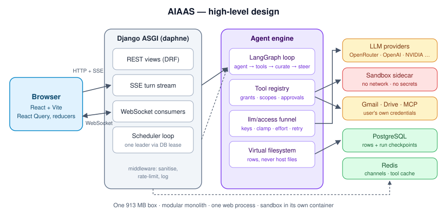
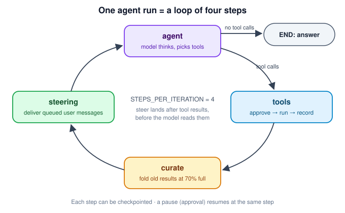
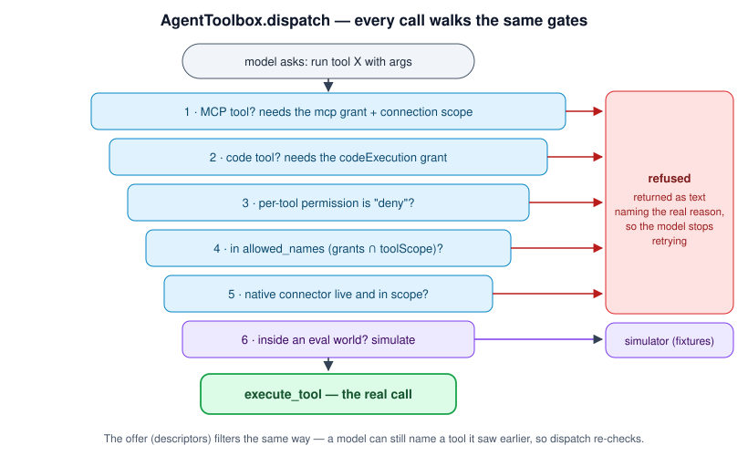
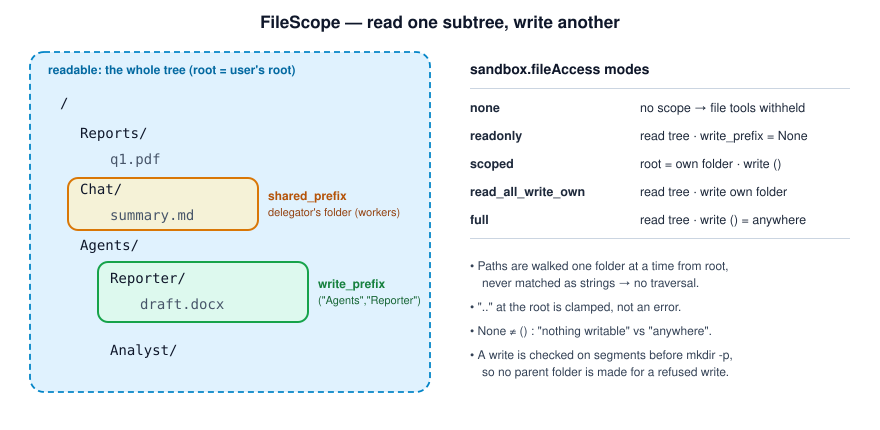
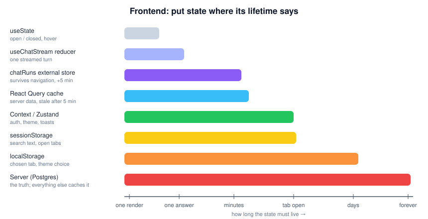

# AIAAS Low-Level Design Guide

The single index for this guide and for the deep dives in `../learning/`.

The guide teaches the design of AIAAS from its own code: the high-level design
(the big boxes) and the low-level design (the classes, patterns and invariants
inside each box), for the backend (Django / Python) and the frontend (React /
TypeScript). Every pattern links to a real file. Most sections open with a
picture. **Look at the picture first, then read.** Mermaid renders on GitHub and
in VS Code's preview (install "Markdown Preview Mermaid Support" if a block shows
as code).

## Design reading order

| # | File | What it covers | Time |
|---|---|---|---|
| 1 | [01_HLD_and_Object_Model.md](01_HLD_and_Object_Model.md) | The big boxes, one request's path, the core classes and why they are shaped that way | 25 min |
| 2 | [02_Backend_LLD_Patterns.md](02_Backend_LLD_Patterns.md) | The backend pattern catalogue: SOLID, GoF and system patterns, safety, AI-system patterns, anti-patterns this project fixed | 90 min |
| 3 | [03_Frontend_LLD_Patterns.md](03_Frontend_LLD_Patterns.md) | Frontend layers, state by lifetime, API and real-time, components, performance, client security, testing | 60 min |
| 4 | [04_Interview_Kit.md](04_Interview_Kit.md) | A feature designed end to end, classic problems mapped to this code, STAR stories | 40 min |

Section numbers run across the four files: §0–3 in 01, §4–12 in 02, §11 in 03,
§13–16 in 04. A reference like "§8.9" means section 8.9 wherever it is.

## Primers (for reading the code when a language is new)

| # | File | Read it if… | Time |
|---|---|---|---|
| 5 | [05_Python_Syntax.md](05_Python_Syntax.md) | `@decorator`, `async`, bare `*`, dataclasses or `is None` look strange | 45 min |
| 6 | [06_Django_Primer.md](06_Django_Primer.md) | You don't know models, the ORM, URLs, views, serializers or migrations | 60 min |
| 7 | [07_TypeScript_Syntax.md](07_TypeScript_Syntax.md) | `?.`, `??`, `<T>` or unions look strange | 45 min |
| 8 | [08_React_Primer.md](08_React_Primer.md) | You don't know components, state, effects, hooks or React Query | 60 min |

**Beginner path:** 5 → 6 → 1 → 2, then 7 → 8 → 3, then 4.
**Know AI but not software design:** read [02 §10](02_Backend_LLD_Patterns.md) (the AI-system patterns) first.

## Interviews and testing

| # | File | What it gives you |
|---|---|---|
| 10 | [10_Probable_Interview_Questions.md](10_Probable_Interview_Questions.md) | The only interview bank: questions by topic, model answers, numbers to know, questions to ask |
| 11 | [11_How_We_Test.md](11_How_We_Test.md) | Every kind of test, what each guards against, and how to run them |

## Deep dives (`../learning/`)

One topic each, written from the real code and incidents.

| File | Topic |
|---|---|
| [01 Google OAuth and JWT](../learning/01_google_oauth_jwt.md) | Social login, token verification, cookie security |
| [05 MCP](../learning/05_mcp_model_context_protocol.md) | The tool protocol, stdio vs remote, credential injection, tool caching |
| [06 React hooks and WebSockets](../learning/06_react_hooks_websocket_patterns.md) | `useRef` vs `useState`, cleanup, backoff, the StrictMode race |
| [07 WebSocket overuse and polling](../learning/07_websocket_overuse_and_polling_fixes.md) | Choosing SSE, WebSocket or polling; the hardcoded-URL pitfall |
| [08 Agentic security hardening](../learning/08_agentic_security_hardening.md) | Approval bypass, environment leaks, shell timeouts, path validation |
| [10 Performance, caching, queries](../learning/10_performance_caching_and_query_optimization.md) | Keyset pagination, React Query, payload trimming |
| [12 Docker build time and disk](../learning/12_docker_build_speed_and_deploy.md) | BuildKit cache mounts, image transfer, patch-layer hotfix, the Docker disk on Windows |
| [13 Async Django concurrency](../learning/13_async_django_concurrency_bottlenecks.md) | Why one user made the server lag: pool held across waits, thread executors, event-loop blocking |
| [14 The auto-mode judge that never ran](../learning/14_auto_mode_judge_that_never_ran.md) | A fail-safe that hid a broken import; mocks that skip the broken seam |
| [15 Whole-project security review](../learning/15_whole_project_security_review.md) | Pre-account takeover, JWT revocation, hashed keys, SSRF through redirects |
| [16 Deploy downtime and background work](../learning/16_deploy_downtime_and_background_work.md) | What a restart does to streams, runs and the scheduler; at-least-once vs at-most-once |

**Find by topic**

| Topic | Read |
|---|---|
| Security | 01, 08, 15 |
| Agents and MCP | 05, 08, 14 |
| Frontend | 06, 07 |
| Concurrency and deploys | 13, 16, 12 |
| Data and performance | 10 |

## Pictures

| Picture | Shows | Used in |
|---|---|---|
|  | The whole system on one page | 01 §2.2 |
|  | The four-step agent loop | 01 §2.3 |
|  | Every gate a tool call passes | 02 §7.4 |
|  | What an agent may read and write | 02 §10.2 |
|  | Where frontend state lives | 03 §11.2 |

## How to study it

1. Read a section, then open the linked file and find the excerpt.
2. Write the pattern from memory in a scratch file, without the project.
3. Say the section's "interview line" out loud.
4. For every pattern, be ready for: what problem, why here, what it costs, and
   what changes at 10× scale.

## Related

- [../START_HERE.md](../START_HERE.md): plain-language tour of the product
- [../INFRASTRUCTURE_SIMPLE_GUIDE.md](../INFRASTRUCTURE_SIMPLE_GUIDE.md): containers, proxies and the server
- [../REALTIME_AND_PROTOCOLS_SIMPLE_GUIDE.md](../REALTIME_AND_PROTOCOLS_SIMPLE_GUIDE.md): SSE, WebSockets and polling in plain words
- [../CLAUDE.md](../CLAUDE.md): the full design history, one decision at a time
- [../Backend/docs/README.md](../Backend/docs/README.md): the index of backend docs
